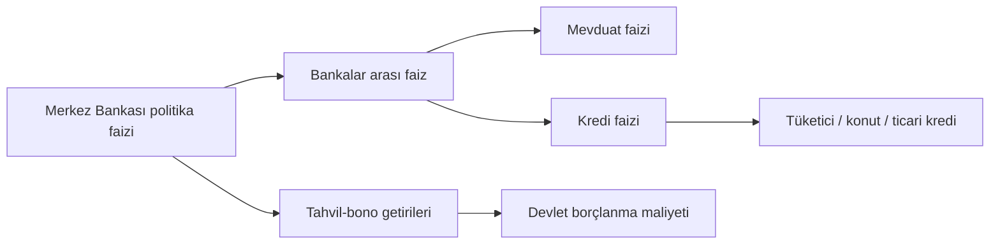

# 6. Faiz ve Tefecilik / Interest and Usury

> Faiz sınırları ve oranlar sık değişir; güncel oranları Merkez Bankası ve mevzuattan doğrulayın. / Rates and limits change often; verify current figures.

## 🇹🇷 Türkçe

### 6.1 Faiz nedir?
Paranın zaman bedelidir. Borç verenin riski, enflasyonu ve fırsat maliyetini karşılar.

**Temel kavramlar**
- **Nominal faiz vs reel faiz:** Reel faiz ≈ nominal faiz − enflasyon. Enflasyon faizden yüksekse paranız değer kaybeder.
- **Basit faiz / bileşik faiz:** Bileşik faizde faiz de faiz kazanır; zaman uzadıkça fark büyür.
- **Yıllık maliyet oranı:** Krediyi karşılaştırırken yalnızca aylık faize değil, masraf ve sigortalar dahil toplam maliyete bakın.
- **Kanuni faiz ve temerrüt faizi:** 3095 sayılı Kanun çerçevesinde; borç gecikince işleyen faiz.
- **Politika faizi:** Merkez Bankası faizi artırınca borçlanma pahalanır, enflasyon baskısı azalır; indirince tersi olur.

### 6.2 Yasal faiz uygulamaları
Banka mevduatı ve kredisi, tahvil-bono, repo, yasal sözleşme faizi (azami sınırlar içinde), ticari alacaklarda temerrüt faizi.

### 6.3 Yasa dışı: tefecilik ve haksız faiz
- **Tefecilik (TCK md. 241):** Yetkisiz kişilerin, yasal sınırı aşan faizle ya da hileyle borç para vermesi.
- **Gizli faiz:** Faizi "komisyon", "masraf", "hediye" ya da senet bedeline gizleme.
- **Senet/çek rehinli borç:** Teminat olarak boş senet, boş çek, araç tapusu, kimlik alma.
- **Şiddet, tehdit, taciz:** Tahsilat için bunlar ayrıca suçtur (tehdit, şantaj, özel hayatın gizliliği).
- **Organize tefeci ağları:** Borcu sürekli büyütüp kişiyi bağımlı hale getirir; aile ve iş hayatını da etkiler.

**Tefeci tuzağının işaretleri:** Bankanın vermediği krediyi "hemen" verme, yazılı sözleşme yok, aşırı yüksek geri ödeme, boş belge imzalatma.

**Mağdurysanız:** Ödeme kayıtlarını saklayın, tehdit mesajlarını kaydedin, savcılığa/polise ve (finansal ürünlerde) BDDK/banka kanalına başvurun, avukat desteği alın.

## 🇬🇧 English

### 6.1 What is interest?
The price of money over time, compensating the lender for risk, inflation and opportunity cost.

- **Real vs nominal rate:** real ≈ nominal − inflation.
- **Compound interest:** interest earns interest; small rate differences compound into large gaps over decades.
- **APR / effective cost:** compare loans by total cost including fees.
- **Policy rate:** central banks raise rates to cool inflation (borrowing gets costlier, assets often reprice lower) and cut them to stimulate.

### 6.2 Legal lending
Bank deposits and loans, bonds, repo, regulated consumer credit, contractual interest within statutory caps, default interest on commercial debts.

### 6.3 Illegal: loan sharking and usury
Lending above legal caps, hiding interest as "fees", demanding blank signed cheques/notes or ID as collateral, and collecting by threats or violence. Usury caps differ by jurisdiction (many US states have caps; EU countries apply consumer-credit directives). Unlicensed lenders are often tied to wider criminal networks.

**If targeted:** keep records, report threats to police, contact a consumer-protection or financial regulator, and seek legal aid. Many jurisdictions void usurious contracts.
