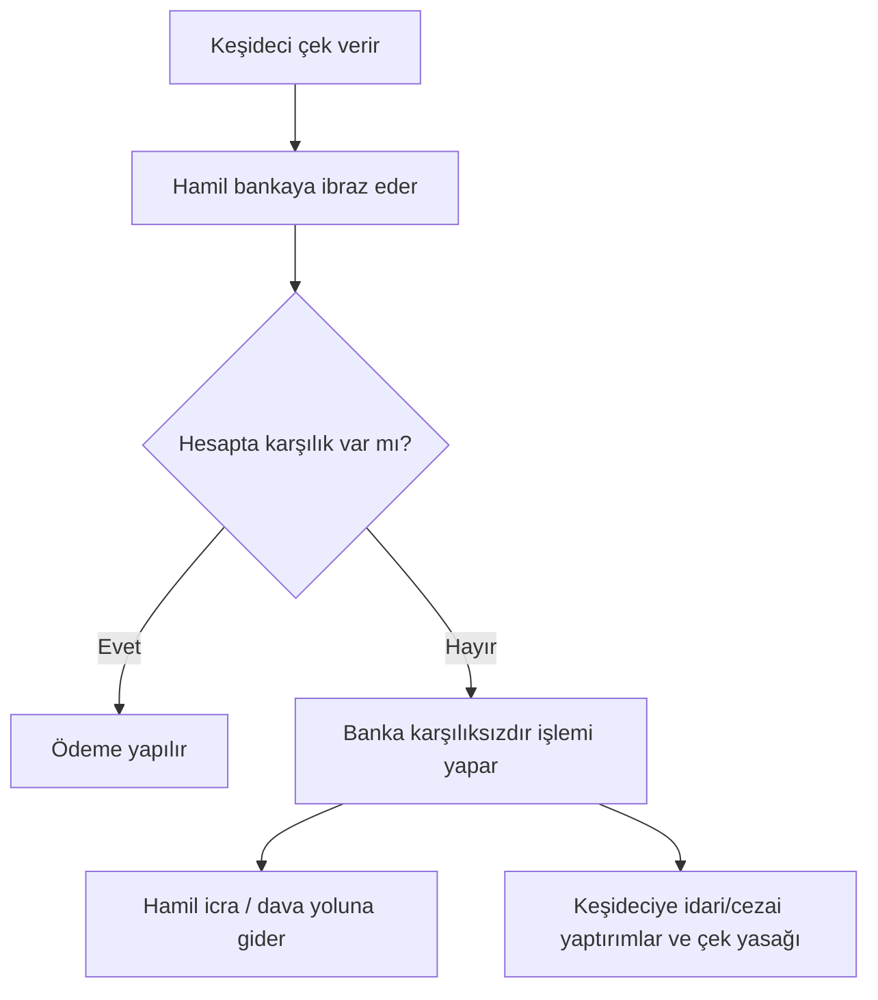

# 7. Çek ve Senet / Cheques and Promissory Notes

> Süreler, tutarlar ve yaptırımlar mevzuatla değişebilir; güncel Çek Kanunu ve TTK'yı kontrol edin. / Deadlines, amounts and penalties change; check current law.

## 🇹🇷 Türkçe

### 7.1 Çek
- **Dayanak:** 5941 sayılı Çek Kanunu ve Türk Ticaret Kanunu.
- **Ne işe yarar:** Keşidecinin bankadaki hesabından, hamile ya da lehtara ödeme yapılmasını emreden kıymetli evrak. Vadesiz bir ödeme aracıdır: ibraz edildiğinde ödenir.
- **Vadeli çek:** Çek üzerinde ileri tarih yazılsa bile çek "görüldüğünde ödenir"dir. Pratikte vade gibi kullanılsa da hukuken ibraz günü önemlidir.
- **İbraz süreleri (TTK m. 796):** Düzenleme yeri ve ödeme yeri aynıysa 10 gün, farklı bir yerde ödenecekse 1 ay. Yurt dışında düzenlenen çeklerde aynı kıtada 1 ay, farklı kıtada 3 ay. Süreler hak düşürücüdür, düzenleme günü sayılmaz; süre tatile denk gelirse ilk iş gününe uzar.
- **Zamanaşımı (TTK m. 814, resmî metin):** Hamilin çirantalara, düzenleyene ve diğer çek borçlularına karşı başvuru hakları ibraz süresinin bitiminden itibaren 3 yılda zamanaşımına uğrar (metin 2012'de 6273 sayılı Kanunla "altı ay"dan "üç yıl"a çıkarılmıştır). Bir çek borçlusunun diğerine karşı hakkı da çeki ödediği veya aleyhine dava açıldığı tarihten itibaren 3 yıldır.
- **Bankanın karşılık sorumluluğu:** Banka, hesapta yeterli karşılık olmasa bile kanunda belirlenen tutara kadar ödeme yapmakla yükümlü olabilir; tutarlar güncellenir.

**Karşılıksız çek (5941 sayılı Çek Kanunu md. 3, 5, 6; resmî metinden):**
- **Ceza (md. 5/1):** Süresinde ibrazda "karşılıksızdır" işlemine sebep olan kişiye, hamilin şikâyeti üzerine her çek için **1.500 güne kadar adli para cezası**; ceza çekin karşılıksız kalan miktarından az olamaz. Mahkeme ayrıca **çek düzenleme ve çek hesabı açma yasağı** koyar; yargılama sırasında koruma tedbiri olarak da resen karar verilebilir. Davalar icra mahkemesinde görülür. Önödeme, uzlaşma ve hükmün açıklanmasının geri bırakılması uygulanmaz (md. 5/10). Adli para cezası ödenmezse doğrudan hapse çevrilir (md. 5/11).
- **Sorumlu kişi:** Çek hesabı sahibi; tüzel kişide mali işleri yürütmekle görevli yönetim organı üyesi, belirlenmemişse yönetim organını oluşturan kişiler (md. 5/2). Yasaklılar yasak süresince sermaye şirketlerinin yönetim organlarında görev alamaz; elindeki tüm çek yapraklarını bankalara iade eder ve 10 gün içinde düzenlediği, karşılığı tahsil edilmemiş çeklerin listesini muhatap bankaya verir (md. 5/6–7).
- **Etkin pişmanlık (md. 6):** Karşılıksız kalan bedeli, ibraz tarihinden itibaren ticari işlerde temerrüt faiziyle birlikte tamamen ödeyen hakkında yargılama aşamasında dava düşer, mahkûmiyet kesinleşmişse hüküm bütün sonuçlarıyla ortadan kalkar; şikâyetten vazgeçmede de aynı. Yasağın kaldırılması, cezanın infazından 3 yıl ve her hâlde yasak tarihinden 10 yıl geçtikten sonra istenebilir.
- **Banka sorumluluğu (md. 3):** Banka, süresinde ibraz edilen her çek yaprağı için kanundaki tutara kadar ödeme yapmakla yükümlüdür (baz tutar 1.000 TL; her yıl Ocak ayında TÜİK fiyat endekslerine göre TCMB belirler ve Resmî Gazete'de yayımlar). Ödemeyi geciktirirse hamile günlük binde üç gecikme cezası öder. Bankanın bu sorumluluğu, çek yaprağının basım tarihinden itibaren 5 yıl içinde ibraz edilmezse sona erer.
- **İleri tarihli çek (md. 3/8):** Çekin düzenleme tarihinden önce ibrazında karşılık ödenmemişse hukuki takip yapılamaz. İleri tarihli çekle takip için çekin, üzerindeki düzenleme tarihine göre kanuni ibraz süresi içinde bankaya ibraz edilip "karşılıksızdır" işlemi yapılması gerekir.
- **Diğer suçlar (md. 7):** Tacir olmayan kişinin ticari amaçla çek defteri kullanarak çek düzenlemesi 6 ay–2 yıl hapis; yasaklıyken çek düzenleme 1–3 yıl hapis; yetkisiz çek defteri basma 2–5 yıl hapis ve 1.500 güne kadar adli para cezası; bankaya gerçeğe aykırı beyan 3 ay–2 yıl hapis.
- Bazı mahkûmiyetlerin infazı geçici maddelerle durdurulmuş ve taksitle ödeme imkânı tanınmıştır; tarihler birkaç kez uzatıldı (son değişiklik 7566 sayılı Kanunla, 2025). Güncel durum için Çek Kanunu'nun geçici maddelerine bakın.

### 7.2 Senet (bono)
- **Ne işe yarar:** Borçlunun belirli vadede belirli tutarı ödemeyi yazılı taahhüt ettiği kıymetli evrak.
- **Unsurlar (TTK m. 776, resmî metin):** (a) "Bono" veya "emre yazılı senet" kelimesi, (b) kayıtsız şartsız belirli bir bedeli ödeme vaadi, (c) vade, (d) ödeme yeri, (e) kime veya kimin emrine ödeneceği, (f) düzenlenme tarihi ve yeri, (g) düzenleyenin imzası.
- **Eksik unsur (TTK m. 777):** Bu unsurlardan birini içermeyen senet bono sayılmaz; ancak üç istisna vardır: vade yazılmamışsa **görüldüğünde ödenir** sayılır; ödeme yeri belli değilse düzenleme yeri ödeme yeri ve düzenleyenin yerleşim yeri sayılır; düzenleme yeri yoksa düzenleyenin adının yanındaki yerde düzenlenmiş sayılır. Dolayısıyla bono ibaresi, ödeme vaadi, lehtar, tarih ve imza eksik olamaz.
- Bonoya poliçe hükümlerinin önemli bölümü (ciro, vade, rücu, zamanaşımı, avale) TTK m. 778–779 ile uygulanır.
- **Tahsil:** Süresinde ödenmezse kambiyo senetlerine özgü icra takibi mümkündür; hızlı yoldur.
- **Senet türleri (özet):** Bono (düzenleyen borçlu), poliçe (üçüncü kişiye ödeme emri).

### 7.3 Yasa dışı ve riskli uygulamalar
| Uygulama | Sorun |
|---|---|
| **Sahte çek / sahte senet / sahte imza** | Resmi belgede sahtecilik, dolandırıcılık |
| **Karşılıksız çıkacağını bile bile çek verme** | Dolandırıcılık ve Çek Kanunu yaptırımları |
| **Boş çek/senet imzalatma ("güvence")** | Hak ihlali; sonradan doldurma sahteciliğe yol açar |
| **Çek-senet tefeciliği** | Düşük karşılıkla çek/senet alıp yüksek faizli tahsilat |
| **Çek ticareti ile kara para aklama** | Gerçek mal/hizmet olmadan dolaşan çekler |
| **Çalıntı/kayıp çekin kullanımı** | Hırsızlık, dolandırıcılık |
| **Hayali ticaret (kıymetli evrak üzerinden)** | Muvazaalı işlemler ve vergi suçları |

**Güvenli kullanım:**
1. Karşı tarafın çek hesabı ve çek yasağı durumunu bankadan/ilgili sistemden sorun.
2. Ciro silsilesini ve imzaları kontrol edin.
3. İbraz süresini kaçırmayın.
4. Çek/senedi eksiksiz doldurun; boş imza atmayın.
5. Çeki kaybederseniz bankaya ve mahkemeye hemen bildirin.

## 🇬🇧 English

### 7.1 Cheques
A written order to a bank to pay money from the drawer's account. In most systems a cheque is payable on presentation; a post-dated cheque is still legally payable on demand in some jurisdictions (including Türkiye). Banks check funds on presentation; a bounced cheque triggers bank records, fees, possible bans on writing cheques, civil collection and in some places criminal penalties.

### 7.2 Promissory notes
An unconditional written promise to pay a fixed sum at a set date. Often enforceable through fast summary procedures. Essential elements must be present; missing items can void it.

### 7.3 Illegal and risky uses
Forgery · knowingly issuing bad cheques · signing blank cheques/notes as "security" · using cheques as collateral for usurious loans · cheque kiting (floating funds between accounts) · laundering via fake invoices and cheques · use of stolen or lost instruments.

**Protect yourself:** verify the drawer, check the endorsement chain, present on time, never sign blank instruments, and report loss immediately.
