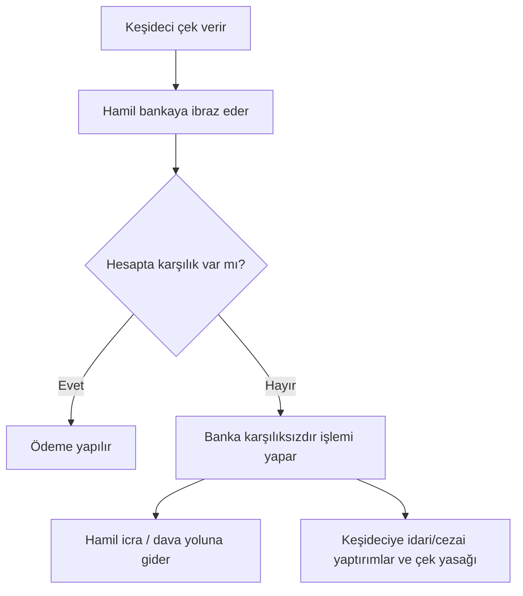

# 7. Çek ve Senet / Cheques and Promissory Notes

> Süreler, tutarlar ve yaptırımlar mevzuatla değişebilir; güncel Çek Kanunu ve TTK'yı kontrol edin. / Deadlines, amounts and penalties change; check current law.

## 🇹🇷 Türkçe

### 7.1 Çek
- **Dayanak:** 5941 sayılı Çek Kanunu ve Türk Ticaret Kanunu.
- **Ne işe yarar:** Keşidecinin bankadaki hesabından, hamile ya da lehtara ödeme yapılmasını emreden kıymetli evrak. Vadesiz bir ödeme aracıdır: ibraz edildiğinde ödenir.
- **Vadeli çek:** Çek üzerinde ileri tarih yazılsa bile çek "görüldüğünde ödenir"dir. Pratikte vade gibi kullanılsa da hukuken ibraz günü önemlidir.
- **İbraz süreleri (TTK m. 796):** Düzenleme yeri ve ödeme yeri aynıysa 10 gün, farklı bir yerde ödenecekse 1 ay. Yurt dışında düzenlenen çeklerde aynı kıtada 1 ay, farklı kıtada 3 ay. Süreler hak düşürücüdür, düzenleme günü sayılmaz; süre tatile denk gelirse ilk iş gününe uzar.
- **Zamanaşımı (TTK m. 814):** Hamilin çirantalara ve düzenleyene karşı başvuru hakları ibraz süresinin bitiminden itibaren 3 yılda zamanaşımına uğrar (ikincil kaynaklara göre; güncel metni doğrulayın).
- **Bankanın karşılık sorumluluğu:** Banka, hesapta yeterli karşılık olmasa bile kanunda belirlenen tutara kadar ödeme yapmakla yükümlü olabilir; tutarlar güncellenir.

**Karşılıksız çek (Çek Kanunu md. 5–6):** 2012 değişikliğinden sonra hapis cezası kaldırıldı; hamilin şikâyeti üzerine adli para cezası verilir (her çek için en çok 1.500 güne kadar). Şikâyet süresi öğrenmeden itibaren 3 ay, her hâlde 1 yıldır. Mahkeme çek düzenleme ve çek hesabı açma yasağı koyabilir; karşılıksız kalan bedel temerrüt faiziyle ödenirse yasak kaldırılabilir. Yasak kaydı 10 yıl sonra silinir. Ayrıca icra takibi ve bankada kayıt sonuçları doğar. (Ayrıntılar ve tutarlar değişir; güncel Çek Kanunu'nu kontrol edin.)

### 7.2 Senet (bono)
- **Ne işe yarar:** Borçlunun belirli vadede belirli tutarı ödemeyi yazılı taahhüt ettiği kıymetli evrak.
- **Zorunlu unsurlar (TTK m. 776):** "Bono" veya "emre yazılı senet" ibaresi, kayıtsız şartsız belirli bir bedeli ödeme vaadi, lehtarın adı, düzenleme tarihi ve düzenleyenin imzası. Vade, ödeme yeri ve düzenleme yeri yazılmamışsa kanunda karineler vardır (ör. vade yoksa görüldüğünde ödenir sayılır); zorunlu unsurlardan biri eksikse belge bono sayılmaz, adi borç senedi olabilir.
- **Tahsil:** Süresinde ödenmezse kambiyo senetlerine özgü icra takibi mümkündür; hızlı yoldur.
- **Senet türleri (özet):** Bono (düzenleyen borçlu), poliçe (üçüncü kişiye ödeme emri).

### 7.3 Yasa dışı ve riskli uygulamalar
| Uygulama | Sorun |
|---|---|
| **Sahte çek / sahte senet / sahte imza** | Resmi belgede sahtecilik, dolandırıcılık |
| **Karşılıksız çıkacağını bile bile çek verme** | Dolandırıcılık ve Çek Kanunu yaptırımları |
| **Boş çek/senet imzalatma ("güvence")** | Hak ihlali; sonradan doldurma sahteciliğe yol açar |
| **Çek-senet tefeciliği** | Düşük karşılıkla çek/senet alıp yüksek faizli tahsilat |
| **Çek ticareti ile kara para aklama** | Gerçek mal/hizmet olmadan dolaşan çekler |
| **Çalıntı/kayıp çekin kullanımı** | Hırsızlık, dolandırıcılık |
| **Hayali ticaret (kıymetli evrak üzerinden)** | Muvazaalı işlemler ve vergi suçları |

**Güvenli kullanım:**
1. Karşı tarafın çek hesabı ve çek yasağı durumunu bankadan/ilgili sistemden sorun.
2. Ciro silsilesini ve imzaları kontrol edin.
3. İbraz süresini kaçırmayın.
4. Çek/senedi eksiksiz doldurun; boş imza atmayın.
5. Çeki kaybederseniz bankaya ve mahkemeye hemen bildirin.

## 🇬🇧 English

### 7.1 Cheques
A written order to a bank to pay money from the drawer's account. In most systems a cheque is payable on presentation; a post-dated cheque is still legally payable on demand in some jurisdictions (including Türkiye). Banks check funds on presentation; a bounced cheque triggers bank records, fees, possible bans on writing cheques, civil collection and in some places criminal penalties.

### 7.2 Promissory notes
An unconditional written promise to pay a fixed sum at a set date. Often enforceable through fast summary procedures. Essential elements must be present; missing items can void it.

### 7.3 Illegal and risky uses
Forgery · knowingly issuing bad cheques · signing blank cheques/notes as "security" · using cheques as collateral for usurious loans · cheque kiting (floating funds between accounts) · laundering via fake invoices and cheques · use of stolen or lost instruments.

**Protect yourself:** verify the drawer, check the endorsement chain, present on time, never sign blank instruments, and report loss immediately.
