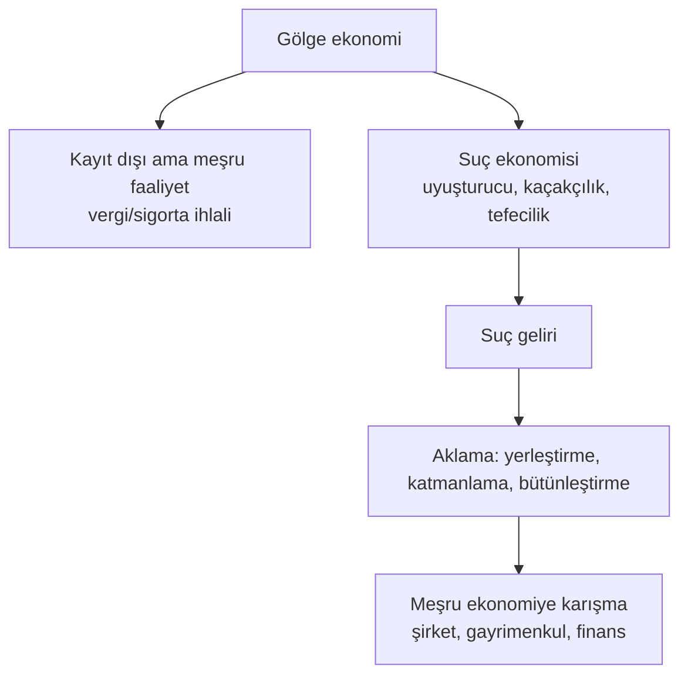

# 8. Gölge Ekonomi, Yolsuzluk ve Karanlık İlişkiler / Shadow Economy, Corruption and Dark Networks

> Bu bölüm **kamuya açık, mahkemeye yansımış veya araştırmacı gazetecilik/uluslararası kuruluş raporlarına dayanan** konuları genel olarak anlatır. Kimseyi suçlamaz, suç işleme yöntemi öğretmez. / This section describes publicly documented topics in general terms. It accuses no one and teaches no crime.

## 🇹🇷 Türkçe

### 8.1 Gölge ekonomi nedir?
Resmi kayıtlara girmeyen ekonomik faaliyetlerdir. Hepsi suç değildir: kayıt dışı istihdam, kayıt dışı satış veya nakit işler vergi/sigorta kaçırıyorsa yasa dışıdır; uyuşturucu, silah, insan ticareti gibi **kara piyasa** ise doğrudan suçtur.

### 8.2 Kara para aklamanın üç aşaması (kavramsal)
1. **Yerleştirme:** Nakdin finans sistemine girmesi.
2. **Katmanlama:** Kaynağı gizlemek için çok sayıda hesap/işlem.
3. **Bütünleştirme:** Paranın meşru gelir gibi ekonomiye dönmesi.

Bu çerçeve, bankaların ve MASAK'ın neye baktığını anlamak içindir. Ülkelerin savunma mekanizması: müşteri tanıma (KYC), şüpheli işlem bildirimi, gerçek faydalanıcı kaydı, nakit sınırları.

### 8.3 Yolsuzluk türleri
Rüşvet · irtikap/zimmet · ihaleye fesat karıştırma · kayırmacılık (nepotizm) · siyasi bağış üzerinden çıkar sağlama · **devlet yakalama (state capture)**: Özel çıkar gruplarının yasa ve düzenlemeleri kendi lehine şekillendirmesi · **düzenleyici ele geçirme (regulatory capture)**: Denetlenen sektörün denetçisini etkilemesi.

### 8.4 Offshore ve vergi cennetleri
- Bir şirketi yurt dışında kurmak **tek başına suç değildir**; meşru nedenleri olabilir (yatırım, vergi planlaması, uluslararası iş).
- Suç; gelirin gizlenmesi, vergi bildirmeme, kaynak aklama ve yaptırımdan kaçmaktır.
- **Panama Papers (2016), Paradise Papers (2017), Pandora Papers (2021)** gibi sızıntılar offshore yapıların nasıl kullanıldığını ve yasal/etik gri alanları gösterdi.
- Karşı önlemler: OECD ortak raporlama standardı (CRS) ve bilgi değişimi, gerçek faydalanıcı kayıtları, FATF "gri liste / kara liste".

### 8.5 Organize suç ve ekonomi
Organize suç örgütleri **kâr** peşindedir ve çoğu zaman kendini ekonomiye şu yollarla bağlar: tefecilik, kaçakçılık, kasalı işletmeler (restoran, inşaat, nakliye), kamu ihalesi, gayrimenkul. Yerel yönetim ve siyasetle ilişkiler yolsuzluğu besler. Etkileri: haksız rekabet, yükselen fiyatlar, hukuk güvensizliği, yatırım kaçışı.

### 8.6 Belgelenmiş vaka örnekleri (ders çıkarmak için)
| Vaka | Ne öğretir |
|---|---|
| **Madoff (ABD)** | Ponzi düzeni yıllarca saygın görünümle sürebilir; denetim ve due diligence şart |
| **Enron (ABD, 2001)** | Muhasebe hilesi ve denetçi çıkar çatışması; Sarbanes-Oxley Yasası'nı doğurdu |
| **Wirecard (Almanya, 2020)** | Sahte bakiye iddiaları ve denetim başarısızlığı |
| **FTX (2022)** | Müşteri varlıklarının karıştırılması; kripto platformlarında saklama/denetim riski |
| **1MDB (Malezya)** | Kamu fonlarının yolsuzlukla uluslararası finans sisteminden aktarılması davaları |
| **Odebrecht / Lava Jato (Brezilya)** | İhale rüşvetinin birçok ülkeye yayılması |

*(Vakaların ayrıntıları için mahkeme kararlarına, SEC/DOJ açıklamalarına ve güvenilir basın arşivlerine bakın.)*

### 8.7 Nasıl korunulur?
- Aşırı iyi gelirleri ve bilinmeyen kaynaklı fonları sorgulayın.
- Karşı taraf şirketin gerçek faydalanıcısını ve lisanslarını doğrulayın.
- Nakit ağırlıklı, belge vermeyen işlemlerden kaçının.
- Sizden "para geçirmenizi", hesabınızı kullandırmanızı isteyen teklifleri reddedin (para katırı / money mule suçu sayılabilir).
- Şüphe varsa MASAK, polis veya şirket uyum birimine bildirin.

## 🇬🇧 English

### 8.1 Shadow economy
Informal activity outside official records. Some is legal-but-unregistered (e.g., unreported cash work evading tax is illegal); **black-market** trade in narcotics, arms or trafficking is criminal.

### 8.2 Money laundering (conceptual)
Placement → layering → integration. Defenders use KYC, suspicious activity reports, beneficial-ownership registers, cash limits and FATF standards. Countries with weak controls land on the FATF grey or black list, which raises their cost of finance.

### 8.3 Corruption
Bribery · embezzlement · bid-rigging · nepotism · political-donation capture · **state capture** · **regulatory capture**. Anti-corruption law: FCPA (US), UK Bribery Act, OECD Anti-Bribery Convention, UNCAC. Transparency International's Corruption Perceptions Index ranks perceived public-sector corruption.

### 8.4 Offshore finance
Offshore structures are **not automatically illegal**. Illegality arises from hiding income, evading tax, laundering proceeds or evading sanctions. The Panama, Paradise and Pandora Papers leaks exposed abuse and legal grey areas. Transparency tools: OECD CRS, FATCA, beneficial-ownership registries.

### 8.5 Organized crime and the economy
Criminal groups seek profit and often blend into legitimate sectors: cash-intensive businesses, construction, logistics, real estate, public contracts. Links to officials fuel corruption; effects include unfair competition, higher prices, weaker rule of law and capital flight.

### 8.6 Documented case studies
Madoff (Ponzi) · Enron (accounting fraud → Sarbanes-Oxley) · Wirecard (missing funds, audit failure) · FTX (commingled customer assets) · 1MDB (sovereign fund looting cases) · Odebrecht/Car Wash (bribery network). Check court records and regulator releases for specifics.

### 8.7 Protect yourself
Question unexplained windfalls; verify beneficial owners and licenses; avoid cash-only, paperless deals; never lend your bank account to strangers (money-mule offences); report suspicions to your compliance team, police or the national FIU.
