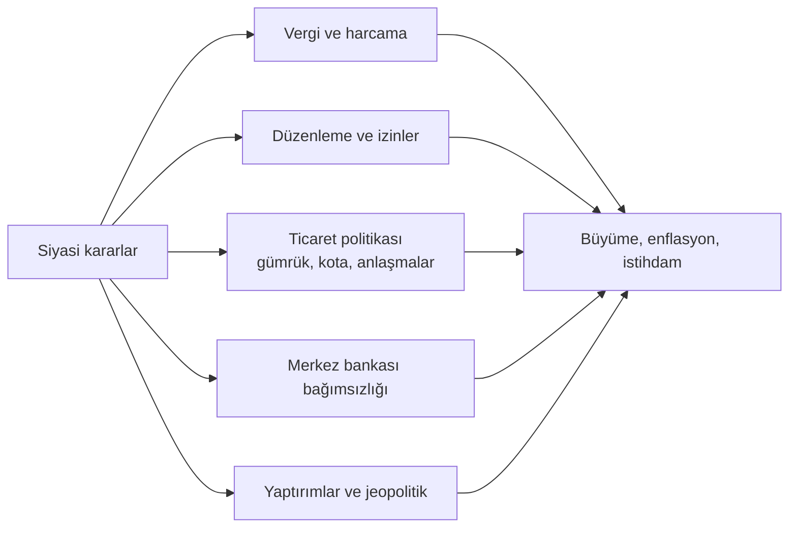

# 9. Siyaset ve Ekonomi / Politics and the Economy

## 🇹🇷 Türkçe

### 9.1 Siyaset ekonomiyi nasıl şekillendirir?

**Temel mekanizmalar**
- **Maliye politikası:** Vergi, harcama, bütçe açığı, kamu borcu.
- **Para politikası:** Faiz, para arzı, kur rejimi. Bağımsız merkez bankası enflasyonla mücadelede güveni artırır; siyasi baskı beklentileri bozabilir.
- **Ticaret politikası:** Gümrük vergisi, kota, serbest ticaret anlaşmaları, korumacılık. Örnek: 2018 sonrası ABD–Çin tarife savaşı tedarik zincirlerini değiştirdi.
- **Yaptırımlar:** Finansal erişimi ve ticareti kısıtlar. 2022'de Rusya'ya uygulanan geniş yaptırımlar ve enerji dönüşümü bunun güncel örneğidir.
- **Seçim ekonomisi (siyasi iş çevrimi):** Seçim öncesi harcama artışı/vergi indirimi eğilimi.
- **Popülizm ve makro risk:** Uzun vadeli maliyeti ertelenen kısa vadeli cazip politikalar.

### 9.2 Lobicilik, kayırmacılık ve sınır
- **Yasal lobicilik:** Şeffaf kayıtlarla çıkar grubu görüşlerini iletmek (ABD'de kayıt zorunluluğu vardır).
- **Gri alan:** Kamu-özel kapıdan geçişi (revolving door), siyasi bağış–ihale ilişkisi.
- **Yasa dışı:** Rüşvet, ihaleye fesat, bağışı karşılık vaadiyle satın alma.
- **Kayırmacı kapitalizm (crony capitalism):** Başarı piyasa rekabetinden çok siyasi bağlantıdan gelir; uzun vadede verimliliği düşürür.

### 9.3 Küresel güç dengeleri
- **Bretton Woods (1944)**: IMF, Dünya Bankası, dolar merkezli düzen. **1971 Nixon şoku**: Doların altına dönüşünün sona ermesi.
- **Rezerv para:** Dolar, euro, yen, sterlin, yuan. Rezerv para ihraç etmek ucuz borçlanma sağlar; aynı zamanda finansal yaptırım gücü verir.
- **SWIFT ve ödeme sistemleri:** Erişimin kesilmesi güçlü bir yaptırım aracıdır; bu nedenle ülkeler alternatif ödeme kanalları arar.
- **Enerji ve kritik hammaddeler:** Petrol, doğalgaz, nadir toprak elementleri, yarı iletkenler jeopolitik koz haline gelir.
- **Bloklaşma:** G7, G20, BRICS, AB, WTO, OPEC+ gibi yapılar ekonomik çıkarları siyasi güçle bağlar.
- **Borç diplomasisi:** Büyük altyapı kredileri ülkeler arası bağımlılık yaratabilir; kredi koşullarının şeffaflığı tartışmalıdır.

### 9.4 Türkiye için kısa notlar
Dış ticarette AB Gümrük Birliği, enerji ithalatı bağımlılığı, döviz borcu, enflasyon ve kur dalgalanmaları temel izleme alanlarıdır. Resmi veriler: TCMB, TÜİK, Hazine ve Maliye Bakanlığı, Ticaret Bakanlığı.

## 🇬🇧 English

### 9.1 How politics shapes economies
Fiscal policy (tax, spending, debt) · monetary policy (rates, central-bank independence) · trade policy (tariffs, quotas, FTAs) · regulation and licensing · sanctions · political business cycles · populist policies with deferred costs.

### 9.2 Lobbying, influence and crime
Legal: registered lobbying, transparent donations. Grey: revolving door, donation-for-contract perception. Illegal: bribery, bid-rigging, buying influence with explicit quid pro quo. **Crony capitalism** rewards connections over competitiveness and slows long-run growth.

### 9.3 Global power and money
Bretton Woods (1944) → IMF/World Bank → 1971 Nixon shock ends dollar–gold convertibility. Reserve currencies (USD, EUR, JPY, GBP, CNY) give borrowing advantages and financial leverage. Control over payment systems (SWIFT), energy, chips and critical minerals is geopolitical power. Blocs: G7, G20, BRICS, EU, WTO, OPEC+. Large infrastructure lending can create dependence.

### 9.4 Why investors and traders should care
Political events move currencies, rates and commodity prices. Elections, sanctions, wars, central-bank independence and trade deals are leading risk factors.
