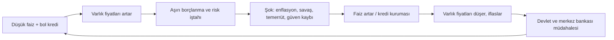
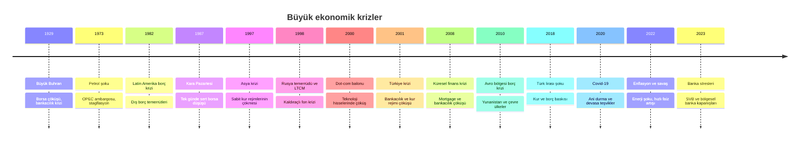

# 10. Dünya Ekonomisi ve Krizler / World Economy and Crises

## 🇹🇷 Türkçe

### 10.1 Dünya ekonomisi nasıl işler?
- **Büyük ekonomiler:** ABD, Çin, AB (Almanya), Japonya, Hindistan, Birleşik Krallık ilk sıralarda yer alır. Güncel sıralama için IMF/Dünya Bankası verilerine bakın.
- **Kurumlar:** IMF (dış denge ve kriz borcu), Dünya Bankası (kalkınma), WTO (ticaret kuralları), BIS (merkez bankalarının bankası), OECD (politika koordinasyonu).
- **Ana göstergeler:** GSYH büyümesi, enflasyon, işsizlik, cari denge, bütçe dengesi, kamu borcu/GSYH, rezervler, kur.

### 10.2 Kriz zaman çizelgesi

### 10.3 Krizlerin ortak nedenleri
1. **Aşırı borç/kaldıraç** ve kısa vadeli finansmanla uzun vadeli yatırım (vade uyumsuzluğu).
2. **Varlık balonları** (konut, hisse, kripto, kanallı kâr).
3. **Zayıf düzenleme ve denetim**, çıkar çatışmaları (derecelendirme kuruluşları, denetçiler).
4. **Kur/dış finansman kırılganlıkları** (cari açık + döviz borcu).
5. **Jeopolitik ve emtia şokları** (savaş, ambargo, pandemi).
6. **Güven kaybı ve panik** (bank run, satış paniği).

### 10.4 Vaka özetleri
- **2008 Küresel Kriz:** ABD'de riskli konut kredileri → menkul kıymetleştirme (MBS/CDO) → bankalar zarar → Lehman iflası → kredi kuruması → dünya durgunluğu. Dersler: sermaye yeterliliği (Basel III), stres testleri.
- **2001 Türkiye:** Sabit kur çapası, bankacılık zayıflığı, siyasi kriz → kurun serbest bırakılması, bankacılık reformu, IMF programı.
- **2018 Türk lirası:** Dış borç ve kur oynaklığı, enflasyon baskısı, faiz ve politika tartışmaları.
- **2022 Enflasyon:** Arz şokları + enerji + teşvikler → merkez bankalarının agresif faiz artırımı → tahvil ve teknoloji hisselerinde sert düzeltme.

### 10.5 Krizi önceden görmek mümkün mü?
Kesin tahmin yoktur. Ancak uyarı işaretleri izlenebilir: hızlı kredi büyümesi, ters verim eğrisi, aşırı değerlemeler, cari açık/döviz borcu, düşen rezervler, yüksek enflasyon beklentisi, bankalarda likidite stresi.

## 🇬🇧 English

### 10.1 How the world economy works
Major economies: US, China, EU, Japan, India, UK (verify current rankings with IMF/World Bank). Institutions: IMF, World Bank, WTO, BIS, OECD. Key indicators: GDP growth, inflation, unemployment, current account, budget balance, debt/GDP, reserves, exchange rate.

### 10.2 Crisis timeline
1929 Great Depression · 1973 oil shock · 1980s Latin American debt crisis · 1987 Black Monday · 1992 ERM/sterling crisis · 1997 Asian crisis · 1998 Russia/LTCM · 2000 dot-com · 2001 Türkiye · 2008 Global Financial Crisis · 2010–12 euro debt crisis · 2018 Turkish lira shock · 2020 Covid-19 · 2022 inflation and energy shock · 2023 regional bank failures (SVB).

### 10.3 Common causes
Excess leverage and maturity mismatch · asset bubbles · weak regulation and conflicts of interest · external vulnerabilities (current-account deficits + foreign-currency debt) · geopolitical or commodity shocks · panic and loss of confidence.

### 10.4 Case notes
**2008:** subprime loans → securitization (MBS/CDO) → bank losses → Lehman collapse → credit freeze → global recession; reforms: Basel III, stress tests. **2022:** supply shocks plus stimulus → inflation → fast rate hikes → bond and growth-stock repricing.

### 10.5 Warning signs
Rapid credit growth, inverted yield curve, stretched valuations, widening external deficits, falling reserves, rising inflation expectations, funding stress in banks. There is no reliable crisis calendar: risk management beats prediction.
