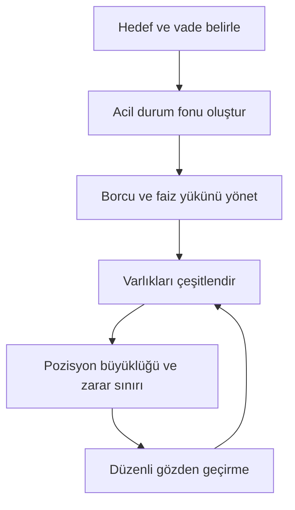

# 11. Fırsatlar ve Risk Yönetimi / Opportunities and Risk Management

> Bu bölüm **genel eğitim içeriğidir**, kişisel yatırım tavsiyesi değildir. Fırsat, kazanç garantisi demek değildir. / General education, not personal investment advice. An "opportunity" is never a guaranteed gain.

## 🇹🇷 Türkçe

### 11.1 Krizler fırsat yaratır mı?
Evet, ama risk de büyür. Kriz dönemlerinde fiyatlar düşer, rekabet azalır, yeni sektörler doğar; ancak likidite kuruması, iflas ve yanlış zamanlama riski yükselir. Başarılı olanlar genellikle **tahmin** yerine **hazırlık** yapar: nakit tamponu, düşük borç, çeşitlendirme, bilgi ve sabır.

### 11.2 Yasal fırsat alanları (kavramsal)
| Alan | Fırsat mantığı | Ana risk |
|---|---|---|
| **İhracat / yeni pazarlar** | Kur avantajı, talep çeşitlendirme, devlet destekleri | Alacak tahsili, kur, regülasyon |
| **E-ticaret ve dijital hizmetler** | Düşük sermaye ile ölçek | Rekabet, platform bağımlılığı |
| **Enerji dönüşümü / yenilenebilir** | Uzun vadeli teşvik ve talep | Politika değişimi, finansman maliyeti |
| **Teknoloji ve yapay zekâ** | Verimlilik artışı | Aşırı değerleme, hızlı eskime |
| **Tarım-gıda ve lojistik** | Temel ihtiyaç, tedarik zinciri açıkları | Maliyet oynaklığı, hava/iklim |
| **Beceri ve eğitim** | Gelir artışı, krizde dayanıklılık | Zaman ve emek yatırımı |
| **Finansal varlıklar** | Mevduat, tahvil, fon, hisse, altın, döviz çeşitlendirmesi | Piyasa riski, enflasyon, kur |

### 11.3 Risk yönetimi çerçevesi

1. **Önce koruma:** Acil durum fonu (birkaç aylık gider), sigorta, düşük borç.
2. **Çeşitlendirme:** Tek varlığa, tek ülkeye, tek para birimine bağlı kalmayın.
3. **Maliyeti ölçün:** Komisyon, vergi, kur farkı, enflasyon.
4. **Kaldıraçtan kaçının veya sıkı sınırlayın:** Kayıpları büyütür.
5. **Düzenli birikim:** Zamanlamaya çalışmak yerine periyodik alım (maliyet ortalama) disiplini.
6. **Duygusal kararlar:** Panik satışı ve "kaçırma korkusu" (FOMO) en yaygın hatalardır.
7. **Kaynak doğrulama:** Sosyal medya tavsiyelerine değil, resmi verilere ve lisanslı uzmanlara dayanın.

### 11.4 Fırsat gibi görünen tuzaklar
"Kesin kazanç" sinyalleri, yüksek kaldıraçlı forex/kripto vaatleri, yeni çıkan coin'ler, piramit "iş fırsatları", kriz döneminde ucuza mal toplatma vaat eden dolandırıcılar, "kara para" ya da kaçakçılık bağlantılı kolay kazançlar. Kolay görünen yüksek getiri çoğu zaman yüksek risk veya suçtur.

### 11.5 İleride bakılacak veri kaynakları
TCMB, TÜİK, Hazine ve Maliye Bakanlığı, Ticaret Bakanlığı, Borsa İstanbul, SPK, IMF World Economic Outlook, Dünya Bankası, OECD, BIS, FRED (ABD Merkez Bankası St. Louis verileri).

## 🇬🇧 English

### 11.1 Do crises create opportunity?
They can: prices fall, competitors fail, new sectors appear. But liquidity risk, bankruptcy and bad timing also rise. Winners usually **prepare** (cash buffer, low debt, diversification, skills) rather than **predict**.

### 11.2 Legal opportunity areas
Exports and new markets · e-commerce/digital services · energy transition · technology and AI · agriculture, food and logistics · skills and education · diversified financial assets (cash, bonds, funds, equities, gold, FX). Each has specific risks: currency, collections, regulation, valuation, competition.

### 11.3 Risk framework
Define goals and horizon → build an emergency fund → manage debt → diversify across assets, countries and currencies → size positions and set loss limits → avoid or tightly cap leverage → review regularly → watch costs, taxes and inflation → beware panic and FOMO.

### 11.4 Traps that look like opportunities
Guaranteed signals · high-leverage forex/crypto promises · pyramid "business opportunities" · crisis-themed scams · easy profits tied to smuggling or laundering.

### 11.5 Data sources
Central banks, national statistics offices, treasuries, regulators, IMF WEO, World Bank, OECD, BIS, FRED.
