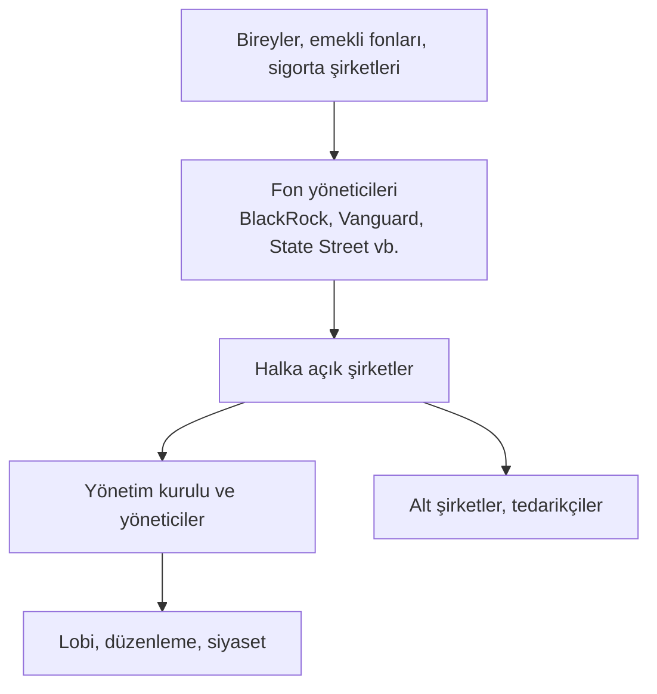

# 14. Global Şirketler, Fonlar ve Güç / Global Corporations, Funds and Power

## 🇹🇷 Türkçe

### 14.1 Kim kimin sahibi? Halka açık şirketlerin yapısı

- **Pasif endeks fonları** sayesinde birkaç büyük yönetici birçok şirkette önemli oy gücüne sahiptir. Bu, fon sahiplerinin değil **yöneticilerin** oy kullanma yetkisiyle ilgilidir. "Ortak mülkiyet" (common ownership) tartışması, aynı yatırımcının rakip firmalarda pay sahibi olmasının rekabeti zayıflatıp zayıflatmadığını sorar; kanıtlar tartışmalıdır.
- **Aile holdingleri, devlet şirketleri, kurucu pay sahipleri:** Türkiye'de ve Asya'da hâlâ güçlüdür.
- **Kontrol yolları:** Oy hakkı farklılığı (imtiyazlı paylar), piramit yapılar, çapraz sahiplik.

### 14.2 Büyük oyuncu türleri
| Tür | Rol | Risk/tartışma |
|---|---|---|
| Çok uluslu şirket | Küresel üretim ve satış | Vergi planlaması, tedarik zinciri istismarı |
| Varlık yöneticisi | Emekli ve bireysel parayı yönetir | Oy gücü yoğunluğu, çıkar çatışması |
| Özel sermaye / hedge fon | Satın alma, kaldıraçlı strateji | Borçla satın alma, kısa vadecilik |
| Bağımsız denetim ("Dört Büyükler": Deloitte, PwC, EY, KPMG) | Mali tablo denetimi | Denetim-danışmanlık çıkar çatışması |
| Derecelendirme kuruluşları | Borç risk notu | 2008'de hatalı notlar |
| Teknoloji platformları | Pazar, veri, reklam | Tekelleşme, veri gizliliği |
| Savunma ve enerji devleri | Devlet sözleşmeleri | Siyasetle iç içe geçme |

### 14.3 Güç nasıl kullanılır (yasal ve yasa dışı)
- **Yasal:** Lobicilik, kamuoyu kampanyaları, düzenleme önerileri, sendikalarla pazarlık, vergi avantajı arayışı (kanun içinde).
- **Gri:** Kamu–özel kapı değişimi (revolving door), vergi cennetleri, "agresif vergi planlaması", ağır etkili bağışlar.
- **Yasa dışı:** Rüşvet, fiyat anlaşması (kartel), ihaleye fesat, sahte muhasebe, işçi/çevre ihlalleri, yaptırım delme.

### 14.4 Belgelenmiş örnekler
| Örnek | Ders |
|---|---|
| **Standard Oil (ABD, 1911 bölünme)** | Tekel karşıtı hukukun doğuşu |
| **Enron (2001)** | Muhasebe hilesi, denetçi bağımsızlığı |
| **Volkswagen "Dieselgate" (2015)** | Emisyon testlerini aldatan yazılım; büyük cezalar |
| **Boeing 737 MAX (2018–2019)** | Güvenlik kültürü ve düzenleyiciyle ilişki |
| **Apple–İrlanda vergi davası** | AB Komisyonu 2016'da İrlanda'nın Apple'a verdiği vergi kararlarını yasa dışı devlet yardımı saydı; Genel Mahkeme 2020'de bu kararı iptal etti, AB Adalet Divanı 10 Eylül 2024'te iptali bozup Komisyon kararını geri getirdi. İrlanda'nın yaklaşık 13,1 milyar avro (artı faiz) tahsil etmesi gerekti |
| **AB/ABD tekel soruşturmaları (Microsoft, Google vb.)** | Dijital pazarların düzenlenmesi |

*(Ayrıntılar için mahkeme ve regülatör açıklamalarına bakın.)*

### 14.5 Kendi araştırmanızı nasıl yaparsınız?
- **Türkiye:** KAP (Kamuyu Aydınlatma Platformu), MKK, Ticaret Sicili Gazetesi, SPK bültenleri, faaliyet raporları.
- **ABD:** SEC EDGAR (10-K, 13F, 13D/G), OpenSecrets (lobicilik ve bağış).
- **Küresel:** OECD, EU Transparency Register, ICIJ Offshore Leaks Database, Transparency International.
- **Yöntem:** Sahiplik yapısı, yönetim kurulu, ilişkili taraf işlemleri, denetçi görüşü, dava ve ceza geçmişi.

## 🇬🇧 English

### 14.1 Who owns what
Retail and pension money flows into funds; large index managers (BlackRock, Vanguard, State Street) hold sizeable voting blocs in public companies. The "common ownership" debate asks whether overlapping stakes in rivals dull competition; evidence is contested. Family holdings, state firms and dual-class shares remain powerful in many countries.

### 14.2 Actors
Multinationals · asset managers · private equity and hedge funds · the Big Four auditors · credit-rating agencies · tech platforms · defense and energy majors. Typical issues: tax planning, conflicts of interest, concentration, regulatory capture.

### 14.3 Using power
Legal: lobbying, campaigns, regulatory submissions. Grey: revolving door, aggressive tax planning. Illegal: bribery, cartels, bid-rigging, accounting fraud, sanctions evasion.

### 14.4 Documented examples
Standard Oil breakup (1911) · Enron · Volkswagen Dieselgate · Boeing 737 MAX · Apple–Ireland state-aid litigation · EU/US antitrust cases against Big Tech.

### 14.5 Research tools
SEC EDGAR, OpenSecrets, EU Transparency Register, ICIJ Offshore Leaks, national company registries, annual reports. Look at ownership, board, related-party transactions, auditor opinions and litigation history.
