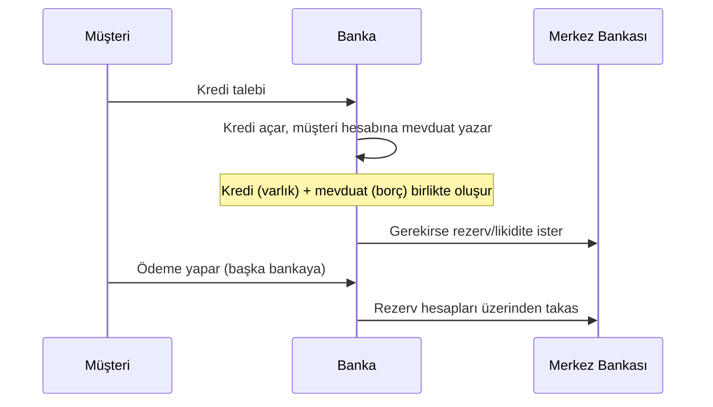
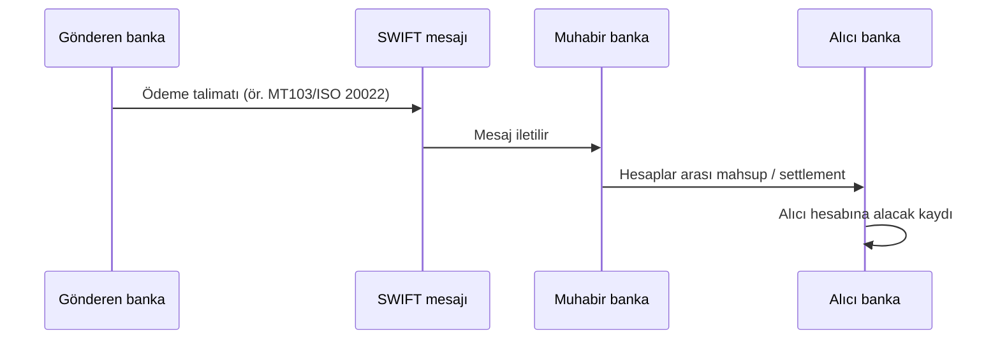

# 15. Banka Sistemleri ve Ödeme/İşlem Sistemleri / Banking and Payment Systems

## 🇹🇷 Türkçe

### 15.1 Para nasıl yaratılır?
Modern ekonomide parayı çoğunlukla **ticari bankalar kredi vererek** yaratır; merkez bankası ise bankaların rezerv ve faiz koşullarını belirler. Bank of England'ın "Money creation in the modern economy" makalesi bunu resmi olarak açıklar.

- **Rezerv, sermaye, likidite:** Bankalar rezerv tutar, sermaye yeterlilik oranını (Basel III) sağlar, likidite oranlarına uyar.
- **Mevduat sigortası:** Mevduat Sigorta Fonu (TMSF) belirli tutara kadar mevduatı güvenceye alır; limit değişir.
- **Banka hücumu (bank run):** Güven kaybıyla toplu para çekme. Merkez bankası "son kredi mercii"dir.
- **Kurtarma (bail-out) vs içeriden kurtarma (bail-in):** Devletin mi, yoksa hissedar/alacaklıların mı zarar yüklendiği.

### 15.2 Merkez bankası ne yapar?
Faiz belirler, fiyat istikrarını gözetir, para basar, rezerv yönetir, ödeme sistemlerini işletir, bankaları denetler (ülkeye göre). Bağımsızlık güveni artırır.

**Mit: "Fed özel şirketlerin mülküdür."** Gerçek: Federal Reserve karma bir yapıdır. Üye bankalar bölgesel Fed bankalarında devredilemez, sabit temettülü pay tutar ancak kontrol hakkı vermez. Guvernörler Başkan tarafından atanıp Senato'ca onaylanır. Faaliyet fazlası Hazine'ye aktarılır. Ayrıntı: federalreserve.gov.
**Mit: "Rothschild ailesi bankaları yönetir."** Gerçek: Tarihsel bankacılık hanesi olarak önemliydi; bugün dünya bankacılığını tek aile yönetmez. Bu söylem antisemitik komplo kaynaklıdır.

### 15.3 Ödeme ve takas sistemleri (işleyiş)
| Katman | Türkiye | Dünya |
|---|---|---|
| Merkez bankası brüt ödeme | TCMB **EFT** | Fedwire (ABD), T2 (Avro bölgesi), CHAPS (İngiltere) |
| 7/24 anlık ödeme | **FAST** (2021) | FedNow, SEPA Instant, UPI (Hindistan), Pix (Brezilya) |
| Mesajlaşma | Bankalar arası ağlar | **SWIFT** (para taşımaz, mesaj taşır) |
| Kart | BKM, Troy, Visa/Mastercard | Visa, Mastercard, UnionPay |
| Menkul kıymet saklama/takas | **MKK, Takasbank** | DTCC (ABD), Euroclear, Clearstream |
| Büyük ticaret finansmanı | Akreditif, garantiler | Korespondan bankacılık |
| Alternatif | Kripto, stablecoin | CBDC (dijital merkez bankası parası) çalışmaları |

- **Mesaj ≠ para:** SWIFT mesajı iletir; asıl para hareketi banka hesaplarında gerçekleşir.
- **Kart ödemesi:** Yetkilendirme → takas → mutabakat; üye işyeri komisyonu ve banka/ağ ücretleri.
- **Menkul kıymet işlemi:** Alım-satım → merkezi karşı taraf (CCP) → takas (T+1/T+2) → saklama.

### 15.4 Yaptırım, kontrol ve suistimal
- **Kontrol:** SWIFT'ten bazı bankaları çıkarmak, korespondan hesapları kapatmak, dövizli işlemi engellemek.
- **Suistimal türleri (tanımak için):** Kimlik hırsızlığı, hesap devralma, sahte fatura/BEC dolandırıcılığı, para katırlığı, kart dolandırıcılığı, kara para aklama.
- **Savunma:** KYC, işlem izleme, çok faktörlü doğrulama, limit ve uyarı sistemleri, MASAK bildirimleri.

### 15.5 Bireysel güvenlik
- Bankanız asla şifre/OTP istemez; linkten giriş yapmayın.
- Tanımadığınız kişiye hesabınızı kullandırmayın.
- IBAN/alıcı adını kontrol edin; "yanlışlıkla gönderdim" talepleri dahil şüpheli.
- Mevduat dağılımı ve sigorta limitini bilin.

## 🇬🇧 English

### 15.1 Money creation
Most money is created when commercial banks lend (creating loan and deposit simultaneously); central banks set policy rates, supply reserves and act as lender of last resort. The Bank of England's *Money creation in the modern economy* explains this. Banks follow capital (Basel III) and liquidity rules; deposit insurance protects small depositors; bank runs are mitigated by central-bank liquidity; bail-in shifts losses to shareholders and creditors.

### 15.2 Myths vs facts
- **"The Fed is privately owned":** it is a hybrid. Member banks hold non-transferable, fixed-dividend stock without control; governors are presidentially appointed and Senate-confirmed; surplus earnings go to the Treasury. See federalreserve.gov.
- **"The Rothschilds run the banks":** a historic banking family, not a present-day global controller; the claim stems from antisemitic conspiracy narratives.

### 15.3 Payment and settlement systems
Central-bank RTGS (Fedwire, T2, CHAPS, Türkiye EFT) · instant payments (FedNow, SEPA Instant, FAST, UPI, Pix) · SWIFT messaging (messages, not money) · correspondent banking · card networks (Visa, Mastercard, UnionPay) · securities clearing and depositories (DTCC, Euroclear, Clearstream, MKK/Takasbank) · emerging CBDCs and stablecoins.

### 15.4 Control and abuse
Controls: sanctions, SWIFT disconnection, correspondent-account closure. Abuse patterns: identity theft, account takeover, business email compromise, money mules, card fraud, laundering. Defenses: KYC, monitoring, multi-factor authentication, suspicious activity reporting.

### 15.5 Personal safety
Never share passwords or OTPs · don't lend your account · verify beneficiaries · know deposit insurance limits.
