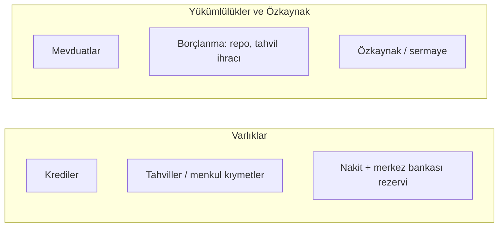
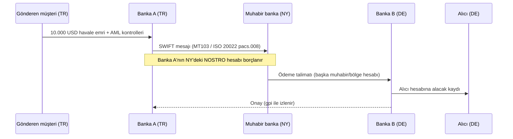
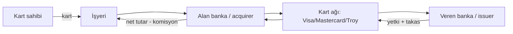
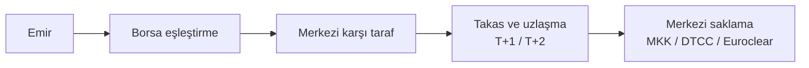

# D1. Derin İnceleme: Para, Banka, Ödeme Sistemleri / Deep Dive: Money, Banks, Payments

> Sayısal örnekler eğitim amaçlıdır; oranlar, limitler ve tarihler zamanla değişir. Kesin değer için resmi kaynağa bakın. / Numbers are illustrative; verify current figures at official sources.

## 1. Paranın katmanları

| Katman | İçerik | Kim yaratır |
|---|---|---|
| **Merkez bankası parası (rezerv / "yüksek güçlü para")** | Banknot-bozuk para + bankaların merkez bankasındaki hesapları | Merkez bankası |
| **Ticari banka parası** | Mevduatlar (vadesiz hesapta gördüğünüz bakiye) | Ticari bankalar, kredi vererek |
| **Dar para (M1)** | Dolaşımdaki nakit + vadesiz mevduat | - |
| **Geniş para (M2, M3)** | M1 + vadeli mevduat + bazı kısa vadeli araçlar | - |
| **Yakın para ikameleri** | Para piyasası fonları, repo, kısa vadeli bono | Piyasa |

Günlük hayatta kullandığımız paranın büyük çoğunluğu **banka mevduatıdır**, banknot değildir. Banknot, toplam paranın küçük bir kısmıdır.

## 2. Banka kredi verince para nasıl doğar? (muhasebe düzeyinde)

Ayşe bankadan **100.000 birim** kredi çekiyor.

| Adım | Bankanın bilançosu |
|---|---|
| 1. Kredi sözleşmesi imzalanır | **Varlık:** Ayşe'ye kredi alacağı +100.000 |
| 2. Aynı anda hesabına yazılır | **Yükümlülük:** Ayşe'nin mevduatı +100.000 |
| 3. Ayşe bu parayı Mehmet'e öder (başka banka) | Banka, merkez bankasındaki **rezerv hesabından** 100.000 gönderir; rezervi 100.000 azalır, Mehmet'in bankasında artar |
| 4. Kredi geri ödendikçe | Alacak azalır, mevduat yok edilir (para **silinir**) |

Sonuç: Banka kredi verirken "başkasının mevduatını ödünç vermez"; yeni mevduat yaratır. Sınırlayıcı faktörler: **sermaye yeterliliği, likidite, kredibilitesi iyi borçlu bulma, merkez bankası faizi ve düzenleme.** (Bank of England 2014 "Money creation in the modern economy".)

### "Para çarpanı" mitine dikkat
Ders kitabı modeli: Rezerv oranı %10 ise 1.000'lik mevduat zincirinde toplam ≈ 1.000 / 0,10 = **10.000** mevduat oluşur.

Zincir: 1.000 → 900 → 810 → 729 → 656,1 → 590,5 → 531,4 … (ilk 7 halka toplamı ≈ 5.217).
Modern uygulamada çoğu merkez bankası **rezerv oranına değil faize** göre yönetir; kredi, rezervden önce gelir. Çarpan modeli sadece sezgi verir.

## 3. Bankanın bilançosu ve riskler

- **Kredi riski:** Borçlu ödeyemez. Karşılık: provizyon.
- **Piyasa riski:** Faiz/kur/fiyat değişimi tahvil değerini düşürür.
- **Likidite riski:** Mevduat çekilir, varlıklar hemen satılamaz (**vade uyumsuzluğu**).
- **Operasyonel risk:** Sistem hatası, dolandırıcılık.
- **Faiz oranı riski:** Uzun vadeli sabit faizli varlıklar, kısa vadeli mevduatlar.

### Basel III temel eşikleri (genel çerçeve)
| Gösterge | Asgari |
|---|---|
| Çekirdek sermaye (CET1) / risk ağırlıklı varlık | %4,5 (+%2,5 koruma tamponu) |
| Tier 1 sermaye | %6 |
| Toplam sermaye | %8 |
| Kaldıraç oranı | %3 |
| Likidite karşılama oranı (LCR) | %100 |
| Net istikrarlı fonlama oranı (NSFR) | %100 |
Ülkeler daha sıkı uygulayabilir; sistemik önemli bankalara ek tampon gelir.

## 4. Banka kriz anatomisi: SVB örneği (Mart 2023)
1. 2020–21'de mevduat hızla büyüdü; banka uzun vadeli tahvil aldı.
2. 2022'de faizler hızla yükseldi → tahvil değerleri düştü (kayıp "vadeye kadar tutulan" olarak gizliydi).
3. Mevduat çoğunlukla **sigortasız** ve sınırlı sayıda müşteri/teknoloji sektörü yoğunluğundaydı; sosyal medya ve mesajlaşma paniği hızlandırdı.
4. Birkaç saatte on milyarlarca dolar çekildi; banka kapatıldı ve ABD mevduat sigorta kurumu (FDIC) el koydu.
5. Düzenleyiciler sistemik risk istisnası ile tüm mevduatı güvence altına aldı.
**Ders:** Vade uyumsuzluğu + mevduat yoğunluğu + sigortasız para + hız (dijital bankacılık).

## 5. Merkez bankası araç kutusu
- **Politika faizi** (Türkiye'de 1 hafta vadeli repo ihale faizi): borçlanma maliyetinin çapası.
- **Açık piyasa işlemleri, repo/ters repo:** Likiditeyi ayarlar.
- **Zorunlu karşılıklar:** Bankaların tutmak zorunda olduğu oran.
- **Nicel gevşeme (QE) / sıkılaştırma (QT):** Tahvil alıp bilançoyu büyütme / küçültme.
- **Son kredi mercii:** Güvenli ama geçici likidite sıkıntısındaki bankalara kredi.
- **Makroihtiyati araçlar:** Kredi büyüme sınırı, kredi/değer (LTV) oranı.

## 6. Ödeme sistemleri: mesaj, takas, mahsup, uzlaşma

### Dört kavram
| Kavram | Anlamı |
|---|---|
| **Mesajlaşma** | "X, Y'ye şu kadar ödeyecek" bilgisi (SWIFT) |
| **Takas (clearing)** | İşlemlerin eşleşmesi ve net yükümlülüklerin hesaplanması |
| **Uzlaşma (settlement)** | Paranın hesaplar arasında gerçekten el değiştirmesi (merkez bankası hesapları üzerinde) |
| **Nihai kesinlik** | Geri alınamaz hale gelme anı |

### Sistemler
| Sistem | Tür | Not |
|---|---|---|
| **TCMB EFT** | Brüt tahsilat (RTGS) | Bankalar arası yüksek tutar, anlık brüt uzlaşma |
| **FAST** | Anlık ödeme | 7/24, saniyeler içinde; 2021'de açıldı |
| **Takasbank / MKK** | Menkul kıymet takas-saklama | Borsa İstanbul işlemlerinin arka ofisi |
| **Fedwire** | ABD RTGS | Yüksek tutar |
| **CHIPS** | ABD özel sektör netleştirme | Dolar uluslararası ödemelerinin büyük kısmı |
| **T2 (eski TARGET2)** | Avro RTGS | Avro bölgesi |
| **CHAPS** | İngiltere RTGS | Sterlin |
| **CIPS** | Çin yuan ödeme sistemi | SWIFT'e alternatif/tamamlayıcı |
| **SEPA** | Avro bölgesi bireysel ödemeler | Havale/otomatik ödeme standardı |
| **UPI / Pix** | Hindistan / Brezilya anlık ödeme | Hızlı benimsenen kamu altyapıları |

### Uluslararası havale örneği (korespondan bankacılık)

- **Nostro/Vostro:** "Bizim sizdeki hesabımız" / "Sizin bizdeki hesabınız."
- **Ücretler:** Gönderen, aracı bankalar ve alıcı banka kesinti yapabilir (OUR/SHA/BEN ücret talimatları).
- **Süre:** Aynı gün ile birkaç iş günü; zaman dilimi, kara liste taraması ve yetersiz bilgi gecikme nedenidir.
- **Uyum:** KYC, yaptırım listeleri (OFAC, AB, BM), amaç beyanı; eksik alanlar mesajı durdurur.

### Kart ödemesi: dört taraflı model

- **Interchange:** Alan bankanın veren bankaya ödediği ücret; kart ağı ve yönetmeliklere göre sınırlanır (AB'de bireysel kartlarda %0,2 banka kartı, %0,3 kredi kartı tavanı).
- **Chargeback (itiraz):** Dolandırıcılık/teslim edilmeyen mal durumunda tutar işyerinden geri alınabilir.
- **3-D Secure:** Çevrimiçi ödemede ek kimlik doğrulama.

### Menkul kıymet işlemi: emirden uzlaşmaya

ABD hisse senetlerinde standart uzlaşma Mayıs 2024'ten beri T+1; Türkiye'de pay piyasasında T+2 uygulanır (güncel için Takasbank).

## 7. Ödeme sistemlerini "silah" olarak kullanma
- SWIFT'ten çıkarma, korespondan hesap kapatma, dolar takasını engelleme, merkez bankası rezervlerini dondurma.
- Karşı hamleler: CIPS, ikili yerel para anlaşmaları, kripto/stablecoin, merkez bankası dijital paraları (CBDC), altın rezervi.

## 8. Fed sahipliği mitine detay
- 12 bölgesel Fed bankası; üye bankalar sermaye payı tutar (devredilemez, hisse kontrol vermez, sabit %6 temettü ile sınırlı; yüksek varlıklı bankalar için farklı oran).
- Yönetim: Board of Governors (7 üye; Başkan tarafından atanıp Senato onayı, 14 yıllık dönem). FOMC faiz kararını verir.
- Net gelirin giderler ve temettüler sonrası kalanı Hazine'ye aktarılır. Karma kamu-özel yapıdır; "bir avuç özel sahip kâr ediyor" iddiası yapıya uymaz.

## 9. Bireysel koruma listesi (detay)
1. Bankaya gelen "OTP/şifre" taleplerini hiçbir kurum istemez.
2. Linkten giriş yapmayın, resmi uygulamayı kullanın.
3. IBAN kontrolünde alıcı adı doğrulama (varsa) kullanın.
4. Yüksek bakiyeleri sigorta limitine göre dağıtın (limit güncelini TMSF'den kontrol edin).
5. "Yanlış gönderim, iade et" mesajına dikkat: sahte ödeme + iade tuzağı.
6. Kendi hesabınızı başkasına "para geçirmek" için kullandırmayın (para katırlığı).
7. Şüpheli işlemde banka çağrı merkezini kartın arkasındaki numaradan arayın.

## English summary
Most money is bank deposits created by lending (loan asset + deposit liability); reserves settle between banks, and the money-multiplier model is only an intuition. Basel III sets minimum capital (CET1 4.5% + 2.5% buffer, Tier 1 6%, total 8%), leverage (3%) and liquidity ratios (LCR/NSFR 100%). SVB (March 2023) shows maturity mismatch + uninsured, concentrated, fast-moving deposits. Payment systems separate messaging (SWIFT), clearing and settlement (RTGS on central-bank accounts). International transfers run through correspondent banks (nostro/vostro) with compliance checks; cards use a four-party model with interchange. The Fed is a hybrid public-private body; member-bank stock confers no control and surplus goes to the Treasury.
