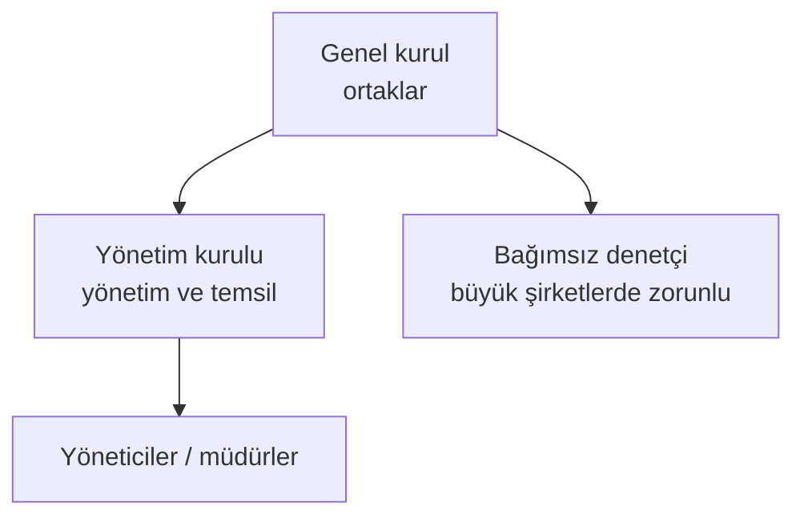
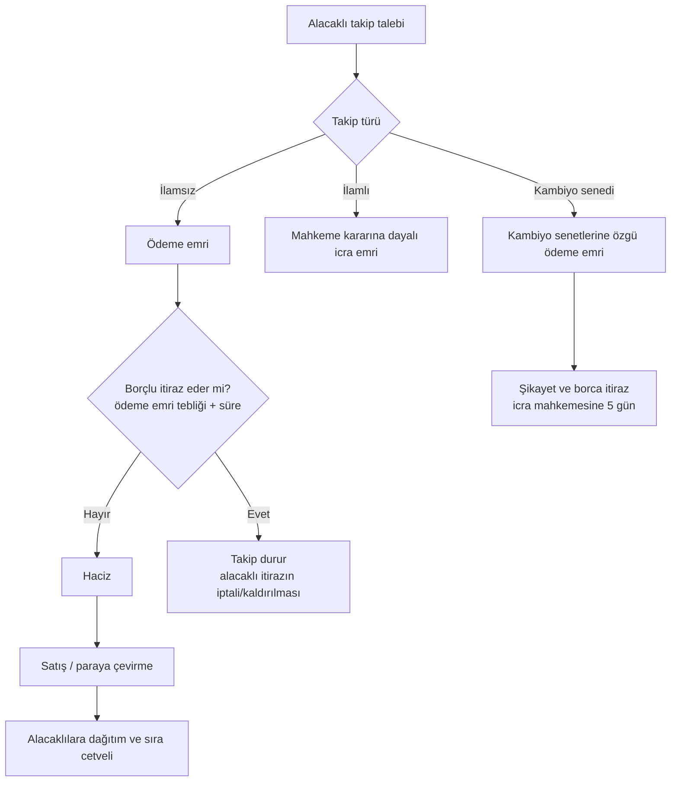

# D10. Derin İnceleme: Şirketler, İcra, İflas ve Konkordato / Companies, Enforcement, Bankruptcy

> Şirket maddeleri 6102 sayılı TTK resmî metninden okundu (✅). İcra İflas Kanunu (İİK) ve konkordato süreleri ikincil kaynaklara dayanır (⚠️). Hukuki karar için avukata danışın. / TTK read from the official text; İİK parts from secondary sources.

## 1. Ticari işletme ve tacir
- **Tacir** (TTK md. 18 ✅): Her türlü borcu için **iflasa tabidir**; ticaret unvanı seçmek, ticaret siciline tescil ve ticari defter tutmakla yükümlüdür; ticaretine ait faaliyetlerinde **basiretli bir iş adamı gibi** hareket etmelidir.
- **Ticari iş karinesi** (md. 19 ✅): Tacirin borçlarının ticari olması asıldır.
- Tacirler arasında temerrüt, fesih ve dönme ihbarları **noter, taahhütlü mektup, telgraf veya güvenli e-imzalı KEP** ile yapılır (md. 18/3 ✅). Sıradan e-posta yeterli olmayabilir.

## 2. Şirket türleri (md. 124 ✅)
Ticaret şirketleri: **kollektif, komandit, anonim, limited, kooperatif**. Kollektif ve komandit **şahıs şirketi**; anonim, limited ve sermayesi paylara bölünmüş komandit **sermaye şirketi** sayılır. Hepsi tüzel kişiliğe sahiptir (md. 125).

| Özellik | Anonim şirket | Limited şirket |
|---|---|---|
| Sorumluluk | Ortak, taahhüt ettiği sermaye ile sınırlı | Ortak, sermaye payı ile sınırlı (ek ödeme/ yan edim yükümlülükleri olabilir) |
| Payın devri | Serbest (esas sözleşme sınırlayabilir) | Genel kurul onayı ve noter şekli gerekir |
| Yönetim | Yönetim kurulu | Müdür(ler) |
| Halka arz | Mümkün | Mümkün değil |
| Asgari sermaye (kanun metni) | 50.000 TL; kayıtlı sermayeli halka açık olmayan: 100.000 TL (md. 332 ✅) | 10.000 TL (md. 580 ✅) |
| **Güncel asgari tutar** | Cumhurbaşkanı kararıyla **250.000 TL**; kayıtlı sermayeli halka açık olmayan **500.000 TL** ⚠️ | Cumhurbaşkanı kararıyla **50.000 TL** ✅ (md. 580 dipnotu, 7887 sayılı karar, 24/11/2023) |

**Uyum süresi:** Asgari sermayenin altında kalan şirketlerin sermayeyi artırması için verilen süre 31 Aralık 2026 idi; kaynaklara göre Ticaret Bakanlığı tebliği ile **31 Aralık 2027'ye uzatıldı** (⚠️ Resmî Gazete'den doğrulayın). Süre dolarsa ve sermaye tamamlanmazsa şirket, kanundaki sonuçlar uyarınca infisah etmiş sayılabilir.

## 3. Anonim şirketin organları ve temel kurallar

- **Genel kurul:** Esas sözleşme değişikliği, bilanço, kâr dağıtımı, yönetim kurulu seçimi.
- **Yönetim kurulu:** Şirketi yönetir ve temsil eder; kararlar toplantı yeter sayısıyla alınır.
- **Kâr dağıtımı:** Önce yasal yedek akçe ve ödenmiş sermayeye ilişkin kurallar; zarar varken kâr dağıtılamaz.
- **Kayıtlı sermaye sistemi:** Yönetim kurulu belirli tavana kadar sermaye artırabilir.

## 4. Sermaye kaybı, borca batıklık ve "teknik iflas" (md. 376 ✅)
1. **Sermaye ve yasal yedek akçelerin yarısı** zararla karşılıksız kalırsa: yönetim kurulu genel kurulu **hemen** toplantıya çağırır ve iyileştirici önlemler sunar.
2. **Üçte ikisi** karşılıksız kalırsa: genel kurul sermayenin üçte biri ile yetinme veya sermayenin tamamlanmasına karar vermezse **şirket kendiliğinden sona erer**.
3. **Borca batıklık şüphesi** varsa yönetim kurulu hem **devamlılık esasına göre** hem **muhtemel satış değerleri üzerinden** ara bilanço çıkarır. Aktifler alacaklıları karşılamıyorsa **asliye ticaret mahkemesine bildirir ve iflası ister**. Yazılı rütbe geriletme (alacağın en sona bırakılması) sözleşmesi, bilirkişi doğrulamasıyla iflası engelleyebilir.
**Yönetim kurulu için kritik risk:** Borca batık olduğunu bildiği/bilmesi gerektiği hâlde mahkemeye bildirmeyen yöneticiler zarardan sorumlu tutulabilir (md. 553 ✅: kusurla yükümlülüğü ihlal eden kurucular, yönetim kurulu üyeleri ve yöneticiler **şirkete, pay sahiplerine ve alacaklılara** karşı sorumludur).

## 5. İcra takibinin genel akışı (⚠️)

- **İlamsız takipte** ödeme emrine itiraz süresi yedi gündür (⚠️ İİK genel kural). İtiraz takibi durdurur; alacaklı **itirazın iptali davası** veya itirazın kaldırılması yoluna gider.
- **Kambiyo senedi takibinde** (çek, bono, poliçe): ödeme emrine 5 gün içinde icra mahkemesine **şikâyet ve borca itiraz**; başvuru kendiliğinden takibi durdurmaz (⚠️, bkz. [07](../07-cheques-and-promissory-notes.md)).
- **Haciz:** Mal varlığı tespit, bankalar ve tapu kaydı sorgusu, araç ve maaş haczi; **haczedilemeyen** mallar (zorunlu ihtiyaç eşyası, kısmen maaş vb.) vardır.
- **İhale ve satış:** Haczedilen mal satılır; alacaklılar sıra cetveline göre paylaşır (rehinli alacaklılar öncelikli).
- **Kamu alacakları** (vergi, SGK) için ayrı tahsil usulü vardır (6183 sayılı Kanun); ortak/yönetici sorumluluğu gündeme gelebilir ⚠️.

## 6. İflas
- **İflasa tabi kişiler:** Tacirler (md. 18 ✅).
- **Takip yoluyla iflas** (borçlu iflasa tabi ise) veya **doğrudan iflas** (borca batıklık bildirimi, aciz hâli).
- İflas kararıyla borçlunun mal varlığı **iflas masası** olur; kayyum/tasfiye memuru atanır, alacaklılar masaya kayıt yaptırır, mal paraya çevrilir ve **sıra cetveline** göre dağıtılır (rehinli alacaklar, işçi alacakları, kamu alacakları vb. öncelik sıraları).
- **İflas erteleme kurumu** 2018'de 7101 sayılı Kanunla kaldırıldı ✅; yerine konkordato kapsamı genişletildi.

## 7. Konkordato (⚠️)
- **Amaç:** Borçlunun alacaklılarla anlaşarak borçlarını yeniden yapılandırması; iflasın önlenmesi.
- **Aşamalar:** Başvuru → **geçici mühlet** (genellikle 3 ay, belirli şartlarla uzatma) → **kesin mühlet** (genellikle 1 yıl, belirli şartlarla uzatma) → alacaklılar kurulu oylaması ve mahkeme tasdiki.
- **Etkiler:** Mühlet boyunca takipler durur, tasarruf yetkisi sınırlanır, komiser atanır.
- **Kötüye kullanım riski:** Gerçek bir kurtarma amacı olmadan **zaman kazanmak** için başvuru; mahkemeler iyi niyet ve projeyi inceler. Süre uzatma sınırları kaynaklarda farklı anlatılıyor, İİK'nın güncel metnine bakın.

## 8. Yasa dışı yönler: iflasla ilgili suçlar (anatomi)

### 8.1 Hileli iflas (TCK md. 161 ✅)
**Üç yıldan sekiz yıla kadar hapis.** Malvarlığını eksiltmeye yönelik hileli tasarruflarda bulunan kişi, bu tasarruflardan önce veya sonra iflasa karar verilmesi hâlinde cezalandırılır. Hileli iflas için **şunlardan biri** aranır:
- a) Alacaklıların alacağına teminat olan malların **kaçırılması, gizlenmesi veya değerinin azalmasına** neden olunması,
- b) Mal kaçırmaya yönelik tasarrufların ortaya çıkmasını önlemek için **ticari defter, kayıt veya belgelerin gizlenmesi veya yok edilmesi**,
- c) Gerçekte alacak-borç ilişkisi yokken **sanki varmış gibi belge düzenlenmesi** (borçların yapay artırılması),
- d) **Gerçeğe aykırı muhasebe kayıtları veya sahte bilançoyla** aktifin olduğundan az gösterilmesi.

### 8.2 Taksirli iflas (TCK md. 162 ✅)
Tacir olmanın gerektirdiği dikkat ve özeni göstermemek yüzünden iflasa sebebiyet verme: **iki aydan bir yıla kadar hapis**.

### 8.3 Tasarrufun iptali ve muvazaa
Borçlunun, alacaklılara zarar vermek için borç ödeme güçlüğü sırasında mal kaçırması (üçüncü kişiye bedelsiz veya muvazaalı devir) **tasarrufun iptali davası** ile geri alınabilir (İİK ilgili hükümleri ⚠️). Şüpheli dönem (iflastan önceki belirli süre) içindeki devirler özellikle incelenir.

### 8.4 Tanıma göstergeleri (alacaklı/ denetçi)
- Borç çok artarken malvarlığının akrabalara, yeni şirketlere devri
- İflastan önce defter ve kayıtların kaybolması, bilanço tutarsızlıkları
- Yeni kurulan "kardeş şirkete" faaliyet ve çalışan aktarımı (phoenix şirket örüntüsü)
- Tedarikçilere gerçek dışı borç senetleri, çek-senet düzenlemeleri
- Son anda yüksek ödemeler ve imtiyazlı alacaklıların ödenmesi
**Alacaklı için:** Hızlı haciz, ihtiyati haciz, tasarrufun iptali, ticari defter incelemesi, yönetici sorumluluğu (md. 553), ceza şikâyeti.

## 9. Yönetici ve ortak koruma listesi
1. Aylık nakit akışı ve borç vade tablosu tutun.
2. Sermaye kaybı oranını (md. 376) bilanço dönemlerinde hesaplayın.
3. Borca batıklık şüphesinde **ara bilanço** hazırlayın ve hukuk görüşü alın.
4. Ortak ve yönetici cari hesaplarını belgelendirin.
5. Tek tek alacaklıları ayırarak kayırmayın (iflas eşitlik ilkesi); büyük ödemeleri kayıt altına alın.
6. Defter ve belgeleri kanuni süre boyunca saklayın.

## English summary
Merchants are subject to bankruptcy, must register and keep books and act prudently (TTK Art. 18). Commercial company types: general partnership, limited partnership, joint-stock, limited, cooperative (Art. 124). Statutory minimum capital is 50,000 TL (joint-stock; 100,000 TL for non-public registered-capital companies) and 10,000 TL (limited), raised by presidential decision to 250,000/500,000 TL and 50,000 TL; the compliance deadline has reportedly been extended to end-2027. Art. 376: half-capital loss → general meeting; two-thirds → continue only if capital is restored; insolvency suspicion → interim balance sheet and bankruptcy filing. Directors are liable to the company, shareholders and creditors for culpable breaches (Art. 553). Enforcement flow, bankruptcy and composition (konkordato; bankruptcy-postponement abolished by Law 7101 in 2018). Crimes: fraudulent bankruptcy (TCK 161, 3–8 years) and negligent bankruptcy (TCK 162, 2 months–1 year); asset-stripping can be reversed by avoidance suits.
