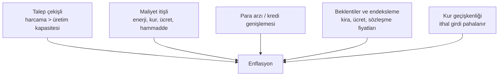

# D11. Derin İnceleme: Döviz, Altın, Enflasyon ve Faiz Mekaniği / FX, Gold, Inflation and Rates

> Eğitim amaçlıdır; yatırım tavsiyesi değildir. Örneklerdeki sayılar uydurma (illüstratif) örneklerdir. / Educational; illustrative numbers.

## 1. Enflasyon: ne, neden, nasıl ölçülür?

### 1.1 Ölçü
- **TÜFE (CPI):** Hane halkının satın aldığı mal ve hizmet sepetinin fiyat değişimi; TÜİK hesaplar. **Sepet ağırlıkları** (gıda, kira, ulaşım vb.) yıl yıl güncellenir.
- **Yİ-ÜFE (PPI):** Üretici fiyatları; maliyet baskısının öncü göstergesi.
- **Çekirdek enflasyon:** Enerji, gıda, alkol-tütün gibi oynak kalemler dışında kalan eğilim.
- **Yıllık değişim:** 12 aylık; **aylık** değişim yıllıklandırılırsa bileşik hesaplanır: aylık %3 → yıllık %42,6.
- Resmî ve bağımsız hesaplar (ör. ENAG) arasında fark olabilir; metodoloji farkı ve güvene ilişkin tartışmalar vardır.

### 1.2 Enflasyon nedenleri

- **Beklenti kanalı:** İnsanlar yüksek enflasyon bekliyorsa fiyat/ücret/kira buna göre belirlenir ve enflasyon kendini besler.
- **Kur geçişkenliği:** İthal girdisi yüksek ekonomilerde kur artışı fiyatlara hızla yansır.
- **Mali dominans:** Açıkların para basımıyla finansmanı, kronik enflasyon yaratır.

### 1.3 Enflasyon kimi, nasıl etkiler?
| Grup | Etki |
|---|---|
| **Sabit gelirliler** | Satın alma gücü erir |
| **Nakit tutanlar / mevduat sahipleri** | Reel faiz negatifse kaybederler |
| **Borçlular (sabit faizle)** | Borcun reel değeri erir (kazanç) |
| **Alacaklılar** | Reel değer kaybı |
| **Varlık sahipleri** (gayrimenkul, hisse, altın) | Genelde koruma, ama zamanlamaya bağlı |
| **Devlet** | "Enflasyon vergisi": nominal borcun reel yükü azalır |
**Reel faiz (Fisher):** (1 + nominal) / (1 + enflasyon) − 1. %40 mevduat faizi ve %50 enflasyonda reel getiri −%6,67; %10 ve %3'te +%6,8.

### 1.4 Hiperenflasyon ve dolarizasyon
Para değer kaybının hızlanması → insanlar parayı hemen harcar, yabancı paraya/altına kayar → dolaşım hızı artar. Yerel para hesap birimi ve değer saklama işlevini yitirir (dolarizasyon).

## 2. Kur rejimleri ve belirlenmesi
| Rejim | Nasıl çalışır | Avantaj | Risk |
|---|---|---|---|
| **Serbest dalgalanma** | Kuru piyasa belirler | Dış şoku sönümler, bağımsız para politikası | Oynaklık |
| **Yönetilen dalgalanma** | Merkez bankası ara sıra müdahale eder | Aşırı oynaklığı sınırlar | Rezerv tüketimi, güven |
| **Sabit/çapa (peg, currency board)** | Kur belirli değerde tutulur | Enflasyon çıpası | Savunulamazsa çöküş |
| **Dolarizasyon** | Yabancı para kullanımı | Fiyat istikrarı | Para politikasını kaybetmek |
**İmkânsız üçlü:** Sabit kur, serbest sermaye hareketi ve bağımsız para politikasından **yalnızca ikisi** aynı anda sürdürülebilir.

### 2.1 Kuru ne belirler? (uzun-kısa vade)
- **Uzun vade:** Göreli enflasyon ve verimlilik (satın alma gücü paritesi, PPP).
- **Orta vade:** Cari denge, dış borç, risk primi.
- **Kısa vade:** Faiz farkı, sermaye akımları, haber ve beklentiler, spekülasyon.
**PPP sezgisi:** Türkiye'de enflasyon yurt dışından hep yüksekse, uzun vadede TL nominal olarak değer kaybetmeye eğilimlidir; fakat kısa vadede kur ayrışabilir.

### 2.2 Risk primi ve CDS
Ülke borç göstergesi olarak **CDS primi** (kredi temerrüt takası fiyatı) izlenir; yükseldiyse yabancı yatırımcı daha yüksek getiri ister.

## 3. Faiz farkı işlemleri (carry trade): örnek
Yatırımcı düşük faizli para (ör. USD, %3) borçlanır, yüksek faizli para (TL, %45) cinsinden varlıkta tutar; kâr, kur değer kaybının faiz farkından küçük kalmasına bağlıdır.

Başlangıç: 1.000 USD borç, USD/TRY = 30 → 30.000 TL → yıl sonunda %45 getiri → 43.500 TL. Borç geri ödemesi: 1.030 USD.
| Yıl sonu USD/TRY | Geri ödeme (TL) | Net sonuç |
|---|---|---|
| 33 | 33.990 | **+9.510 TL (≈ +288 USD)** |
| 39 | 40.170 | **+3.330 TL (≈ +85 USD)** |
| 45 | 46.350 | **−2.850 TL (≈ −63 USD)** |
Kur çok hızlı kayarsa kazanç kayba döner; **kur şoku** (ani çıkış) bütün carry pozisyonlarının aynı anda kapanmasına yol açabilir ve krizi büyütür. 2018 gibi dönemlerde bu mekanizma önemlidir.

## 4. Altın: rolü ve fiyat belirleyicileri
- **Fiyat etkenleri:** Reel faizler (düşük reel faiz altını cazip kılar), dolar endeksi, merkez bankası alımları, jeopolitik risk, enflasyon beklentisi, takı ve sanayi talebi, yatırım talebi (ETF).
- **Merkez bankası rezervi:** Birçok ülke dolar dışı çeşitlendirme için altın alır.
- **Türkiye'de altın:** Hane halkının fiziki altın ve altın mevduatı yaygın; **gram altın fiyatı = ons fiyatı × USD/TRY / 31,1035** (1 troy ons ≈ 31,1035 gram).
- **Risk:** Altın faiz/temettü getirmez; fiyat uzun dönem düşebilir; saklama maliyeti vardır; **gram altın** yerel kurdan etkilenir (ons sabit kalsa bile TL cinsi hareket eder).
**Örnek:** Ons 2.000 USD, kur 30 TRY: gram altın ≈ 2.000 × 30 / 31,1035 ≈ 1.929 TL. Ons aynı kalıp kur 39 olursa gram ≈ 2.508 TL (+%30), ama dolar bazında değişmez.

## 5. Faizin transmisyonu: merkez bankası faizi ekonomiye nasıl yansır?
```mermaid
flowchart LR
    P[Politika faizi] --> K[Kredi ve mevduat faizleri]
    P --> T[Tahvil getirileri]
    P --> D[Kur (faiz farkı)]
    K --> HH[Hane halkı tüketim ve yatırım]
    K --> F[Firma yatırım kararı]
    D --> I[İthal fiyatlar]
    HH --> E[Talep ve enflasyon]
    F --> E
    I --> E
```
- Faiz artışı genelde talebi kısar ve kuru destekler; ama **reel faiz** ve **güvenilirlik** yoksa etki zayıf kalır.
- Gecikmeler uzundur (aylar-yıllar): bu yüzden merkez bankaları **ileriye dönük** (beklenti) çerçevesi kullanır.
- **Faiz ve kur** ilişkisi sabit değildir; panik dönemlerinde faiz artışı bile kuru savunamayabilir.

## 6. Kur Korumalı Mevduat (KKM) örneği (kısa)
2021 sonunda sert kur hareketinin ardından TL mevduat sahiplerini kur artışına karşı koruyan KKM uygulaması başlatıldı (❓ ayrıntı ve sonraki değişiklikler için TCMB/Hazine duyurularına bakın). Genel ders: Devletin kur farkını üstlenmesi **kamu bütçesi ve rezerv maliyeti** yaratır; çıkış yolu zordur.

## 7. Yasa dışı ve riskli yönler
- **Yetkisiz döviz alım-satımı ve kayıt dışı döviz büroları:** Yetkili döviz müessesesi ve banka dışı işlemler kanunlara aykırı olabilir (izin gerektirir); sahte döviz, kur manipülasyonu ve dolandırıcılık riski var.
- **Gayriresmî transfer (hawala vb.):** Kayıt dışı değer transferi aklama riski taşır.
- **Dolandırıcılık:** "Çok iyi kur", yüksek getirili "döviz yatırım fonu", sahte altın/gram altın satışı, külçe sahteciliği.
- **Piyasa manipülasyonu:** Kur ve emtia fiyat bantlarını etkilemeye yönelik söylenti ve danışıklı alımlar.
- **Fiyat bozucu işlemler (spekülatif saldırı):** Kendi içinde suç sayılmaz ama bilgiyi suistimal ve hile ile birleşirse manipülasyondur.
**Güvenli kanal:** Banka, yetkili döviz bürosu, lisanslı kuyumcu ve borsa. Fatura/fiş alın; külçe altında sertifika ve ayar kontrolü yapın.

## 8. Bireysel koruma kontrol listesi
1. Gelir-borç para birimi uyumunu kontrol edin (TL gelir + döviz borcu = kur riski).
2. Reel getiri hesabını nominal faize bakmadan yapın.
3. Tek varlığa ya da tek kura bağlı kalmayın.
4. Vade ve likidite planı (acil ihtiyaç).
5. Komisyon, spread ve vergi maliyetlerini ekleyin.
6. Kaldıraçlı döviz/emtia ürünlerinden uzak durun ya da çok küçük pay ayırın.
7. Dolandırıcılık işaretleri: garanti getiri, baskı, lisanssız aracı.

## English summary
Inflation is measured by CPI/PPI/core; causes: demand-pull, cost-push, money and credit, expectations/indexation, FX pass-through. Real rate = (1+nominal)/(1+inflation) − 1. FX regimes (float, managed float, peg, dollarization) and the impossible trinity; the exchange rate is explained by PPP in the long run and by risk premia and flows in the short run. Carry trade worked example: profit at 33 or 39 TRY/USD, loss at 45. Gold depends on real rates, the dollar, central-bank buying and risk; gram gold ≈ ounce × USD/TRY ÷ 31.1035. Transmission channels of policy rates; risks of subsidized FX-protected deposits. Illegal risks: unlicensed exchange, hawala, fake bullion, manipulation.
