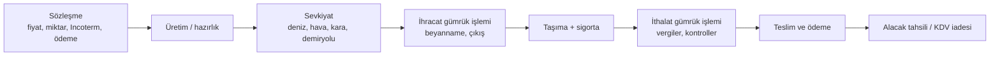
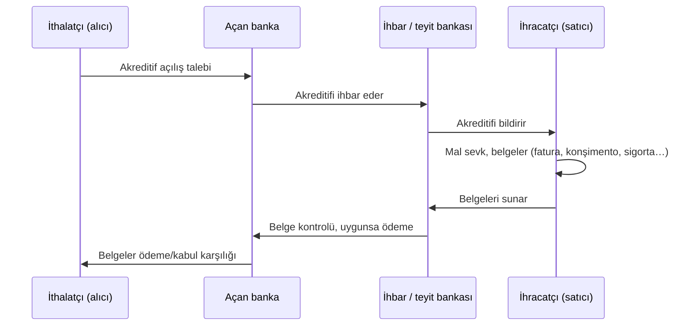

# D12. Derin İnceleme: Dış Ticaret, Gümrük ve Ödeme Teknikleri / Foreign Trade, Customs and Payment Methods

> Eğitim amaçlıdır. Gümrük vergisi, ek vergi, kota ve prosedürler sık değişir; kesin değerler için Ticaret Bakanlığı ve gümrük müşavirinizi kullanın. Incoterms 2020 bilgisi doğrulandı (✅). / Educational; rates and procedures change.

## 1. Dış ticaret akışı

## 2. Incoterms 2020: teslim şekilleri (✅ 11 kural)
Incoterms 2020, ICC tarafından yayımlanmış (10 Eylül 2019) ve 1 Ocak 2020'de yürürlüğe girmiştir. **DAT kaldırıldı, yerine DPU geldi.** Yedi kural her taşıma türünde, dördü yalnız deniz ve iç su yolunda kullanılır.

| Kural | Anlamı | Risk geçişi | Taşıma türü |
|---|---|---|---|
| **EXW** | Satıcının deposunda teslim | Satıcı yerinde | Her tür |
| **FCA** | Taşıyıcıya teslim | Belirlenen yerde taşıyıcıya | Her tür |
| **CPT** | Taşıma ödenmiş | Taşıyıcıya teslimde (satıcı navlun öder) | Her tür |
| **CIP** | Taşıma ve sigorta ödenmiş | Taşıyıcıya teslimde (satıcı sigorta öder, geniş teminat) | Her tür |
| **DAP** | Varış yerinde teslim | Varış yerinde araçta, boşaltmadan önce | Her tür |
| **DPU** | Boşaltılmış olarak varış yerinde teslim | Varış yerinde boşaltmadan sonra | Her tür |
| **DDP** | Gümrük vergileri ödenmiş teslim | Varış yerinde; ithalat gümrüğü dahil | Her tür |
| **FAS** | Gemi yanında teslim | Gemi yanında | Deniz |
| **FOB** | Gemi bordasında teslim | Gemiye yüklenince | Deniz |
| **CFR** | Mal bedeli ve navlun | Gemiye yüklenince | Deniz |
| **CIF** | Mal bedeli, sigorta, navlun | Gemiye yüklenince | Deniz |
**Önemli:** Incoterms **mülkiyeti devretmez, ödeme koşulunu belirlemez, sözleşme ihlali sonuçlarını düzenlemez.** Sadece teslim, risk, maliyet, gümrük sorumluluğunu bölüştürür. İsteğe bağlı olarak bir yer adıyla birlikte yazılır (örn. "FOB İstanbul, Incoterms 2020").

## 3. Ödeme yöntemleri: risk dağılımı
| Yöntem | Nasıl işler | İhracatçı riski | İthalatçı riski |
|---|---|---|---|
| **Peşin ödeme** | Mal gönderilmeden ödeme | Düşük | Yüksek (mal gelmeyebilir) |
| **Açık hesap** | Mal gönderilir, vadeli ödenir | Yüksek (tahsilat) | Düşük |
| **Mal mukabili / vesaik mukabili (D/P)** | Banka belgeleri ödeme karşılığı verir | Orta | Orta |
| **Kabul kredisi (D/A)** | Belgeler kabul edilir, vadede ödenir | Orta-yüksek | Düşük |
| **Akreditif (L/C)** | Banka ödeme taahhüdü verir; belgeler uyumluysa öder | Düşük (banka riski) | Orta (belge uyumu) |
| **Ihracat sigortası / kredi sigortası** | Alacak riskini sigortalar | Azalır | - |
| **Faktoring / forfaiting** | Alacağın devri | Azalır | - |

### 3.1 Akreditif mantığı (UCP 600 çerçevesi ❓)

- **Belgelere bakılır, mala bakılmaz:** Banka belgelerin akreditif şartlarına **birebir uygunluğuna** bakar. Küçük uyumsuzluk (yazım, tarih) reddetme sebebi olabilir.
- **Teyitli akreditif:** İhracatçıya ikinci banka da taahhüt verir; açan banka/ülke riski azalır.
- **Dolandırıcılık riski:** Sahte akreditif, sahte belge, "teyit ücreti" avans dolandırıcılığı; bankalar SWIFT mesajı ve ihbar bankası ile teyit eder.

## 4. İthalat maliyeti hesabı (illüstratif örnek)
CIF değeri 10.000 USD (varsayım) ve gümrük vergisi %10 (örnek), KDV %20:

| Kalem | Hesap | Tutar |
|---|---|---|
| CIF bedeli | | 10.000 |
| Gümrük vergisi (%10) | 10.000 × 0,10 | 1.000 |
| KDV matrahı | 10.000 + 1.000 (+ varsa ÖTV, ilave vergiler) | 11.000 |
| KDV (%20) | 11.000 × 0,20 | 2.200 |
| **Toplam vergi dahil maliyet** | | **13.200** |
Ek unsurlar: ilave gümrük vergisi, ek mali yükümlülük, damga vergisi, gümrük müşavir ücreti, antrepo ve demuraj, nakliye ve sigorta (CIF'e dahil değilse). **KDV** çoğunlukla indirilebilir, bu yüzden nakit akışına etkisi geçicidir.

## 5. Gümrük rejimleri ve belgeler
| Rejim / belge | Amaç |
|---|---|
| **Serbest dolaşıma giriş** | İthal malı ülkede serbestçe kullanım |
| **İhracat** | Malın ülke dışına çıkışı (KDV istisnası) |
| **Transit** | Malın gümrük bölgesinden geçişi (vergi askıda) |
| **Geçici ithalat / ihracat** | Belirli süre sonra geri çıkış/dönüş |
| **Dahilde işleme rejimi (DİR)** | İhraç edilecek ürünün girdisini vergisiz ithal etme |
| **Hariçte işleme** | Yurt dışında işlenecek malın çıkışı |
| **Antrepo / serbest bölge** | Vergi ve kısıtlama ertelemeli depolama / üretim |
| **Menşe belgesi, EUR.1, A.TR** | Tercihli tarife (Gümrük Birliği, serbest ticaret anlaşmaları) ❓ |
| **GTİP / HS kodu** | Mal sınıflandırması: vergi, kota ve mevzuat buna bağlı |
| **Ticari fatura, çeki listesi, konşimento/CMR/AWB, sigorta poliçesi, sağlık/uygunluk sertifikaları** | Beyanname eki belgeler |

**Sınıflandırma neden önemli?** Yanlış GTİP: yanlış vergi, ceza ve eksik izin riski. Yanlış beyan **bilinçli** ise kaçakçılık sayılabilir.

## 6. Ticaret politikası araçları
Gümrük tarifeleri · kota · ithalat lisansı · **anti-damping ve telafi edici vergiler** (haksız fiyatlama/sübvansiyona karşı) · teknik engeller ve standartlar · **yaptırım ve ambargolar** · ihracat denetim listeleri (çift kullanımlı mallar).

## 7. İhracat finansmanı ve destekler
Eximbank kredileri ve sigortası, ihracat destekleri (fuar, pazarlama), KDV iadesi, DİR. Şartlar ve oranlar sık değişir; Ticaret Bakanlığı/Eximbank duyurularına bakın.

## 8. Yasa dışı uygulamalar (tanıma amaçlı)
| Tür | Özet | Tespit göstergesi |
|---|---|---|
| **Kaçakçılık** | Gümrük denetimi dışından giriş-çıkış, beyansız mal | Risk analizi, X-ray, istihbarat |
| **Yanlış beyan: değer** | Faturanın düşük/yüksek gösterilmesi (under/over-invoicing) | Piyasa fiyatından sapma |
| **Yanlış beyan: GTİP/menşe** | Daha düşük vergi veya tercihli rejim için | Menşe doğrulama, laboratuvar analizi |
| **Hayali ihracat** | Mal çıkmadan KDV iadesi/teşvik alma | Gümrük çıkış kaydı yok, alıcı yok |
| **Hayali ithalat ve avans dolandırıcılığı** | Sahte tedarikçiye ön ödeme | Tedarikçi fiziki varlığı yok |
| **Ticaret yoluyla kara para aklama (TBML)** | Fatura, miktar, kalite beyanıyla değer aktarımı | Gereksiz ara ülke, uyumsuz navlun |
| **Transshipment dolandırıcılığı** | Menşe saklama için üçüncü ülkeden sevk | Rota/belge uyumsuzluğu |
| **Yaptırım ihlali** | Listedeki kişi/ülke ile ticaret, arkasını gizleme | Sahiplik zinciri, adres ortaklığı |
| **İhracat kontrol ihlali** | Çift kullanımlı/askerî mal çıkışı | Nihai kullanıcı beyanı şüpheli |
| **Sahte/taklit ürün ithalatı** | Marka ihlali | Marka sahibi bildirimi |
| **BEC / fatura IBAN değişikliği** | Tedarikçi e-postasının ele geçirilmesi | Son dakika IBAN değişikliği |
| **Rüşvet** | Gümrük görevlisine menfaat | TCK 252 (4–12 yıl hapis) |
**Sonuç:** Mal müsaderesi, ağır idari para cezası, hapis, ihracat yasağı, banka ilişkisinin kesilmesi, yaptırım listesine alınma.

**Savunma (şirket için):** Karşı taraf due diligence (şirket kaydı, fiziki adres, gerçek faydalanıcı, yaptırım taraması), sevk-ödeme-fatura üçgenini eşleştirme, IBAN değişikliğini **ikinci kanaldan** doğrulama, GTİP için bağlayıcı tarife bilgisi alma, gümrük müşaviri seçimi, iç uyum programı.

## 9. E-ihracat ve platformlar
Marketplace (Amazon, Etsy, Trendyol global) ve kendi sitesi; kargo ve gümrük gönderisi; iade/ cayma hakları, vergi ve mesafeli satış yükümlülükleri hedef ülkeye göre değişir (AB'de IOSS ile düşük değerli gönderilerde KDV tahsili gibi yapılar ❓). Hedef ülkenin tüketici ve ürün güvenliği kurallarını araştırın.

## 10. Kontrol listesi (ilk ihracat/ithalat)
- [ ] Ürünün GTİP kodu ve gümrük/ek vergi/ izin gereksinimi doğrulandı
- [ ] Karşı tarafın kimliği ve yaptırım durumu taranıldı
- [ ] Incoterm ve ödeme yöntemi sözleşmede net
- [ ] Sigorta kapsamı (hasar, çalıntı, savaş/grev) belirlendi
- [ ] Belge seti ve menşe/uygunluk sertifikaları hazır
- [ ] Kur riski için vade/ fiyat politikası var
- [ ] Alacak riski için sigorta, akreditif veya limit tanımlı

## English summary
Foreign trade flow from contract to cash. Incoterms 2020 (11 rules; DPU replaced DAT; seven for any mode, four sea-only) allocate risk, cost and customs but do not transfer title or set payment terms. Payment methods range from advance payment to open account, documentary collection and letters of credit (bank pays on conforming documents, not goods). Import cost worked example: CIF 10,000 + 10% duty + 20% VAT = 13,200. Customs regimes (free circulation, transit, inward processing, free zones), HS classification, trade-defense tools. Illegal patterns: smuggling, false valuation/classification/origin, phantom export, TBML, sanctions evasion, BEC invoice fraud; defenses: due diligence, document matching, out-of-band verification.
