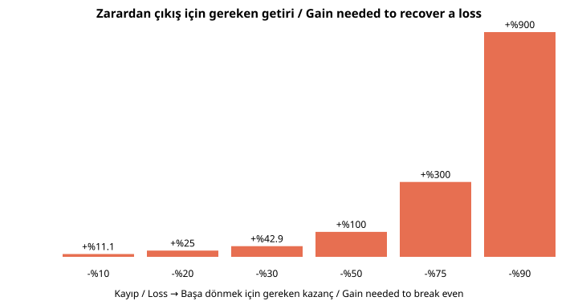

# D2. Derin İnceleme: Piyasalar ve Piyasa Suistimali / Deep Dive: Markets and Market Abuse

> Eğitim amaçlıdır; yatırım tavsiyesi değildir. Suistimaller **tanımak ve korunmak** için anlatılır, uygulama adımı verilmez. / Educational only; abuses are described for recognition and protection, not execution.

## 1. Piyasa mikroyapısı

### Emir defteri (order book)
| Alış (Bid) | Fiyat | Satış (Ask) |
|---|---|---|
| 5.000 | 10,00 | |
| 3.000 | 9,99 | |
| | 10,01 | 2.000 |
| | 10,02 | 4.500 |

- **Bid-ask spread:** 10,01 − 10,00 = 0,01. Likit piyasada dar, likit olmayan piyasada geniştir. Spread, işlem maliyetidir.
- **Derinlik:** Her fiyat kademesindeki emir miktarı. Sığ piyasada küçük bir emir fiyatı çok oynatır.
- **Fiyat-zaman önceliği:** En iyi fiyat önce, aynı fiyatta önce gelen emir önce eşleşir.

### Emir türleri
| Emir | Anlamı | Risk |
|---|---|---|
| **Piyasa emri** | Mevcut en iyi fiyattan hemen | Sığ piyasada kayma (slippage) |
| **Limit emri** | En fazla/en az belirlediğiniz fiyat | Gerçekleşmeyebilir |
| **Stop emri** | Fiyat eşiğe gelince piyasa emrine döner | Boşluklarda beklenenden kötü fiyat |
| **Stop-limit** | Eşikte limit emri | Gerçekleşmeme riski |
| **Gün sonu / İptale kadar geçerli** | Süre koşulu | - |

### Likidite ve oynaklık
- **Likidite:** Fiyatı çok etkilemeden hızlı alıp satabilme.
- **Oynaklık (volatilite):** Fiyatın değişkenliği; standart sapma ile ölçülür.
- **Devre kesici ve fiyat marjı:** Borsalar aşırı hareketlerde işlemi durdurur veya sınırlar (Borsa İstanbul'da pay bazında fiyat marjları ve devre kesici vardır).

## 2. Kaldıraç ve marjin matematiği

| Kaldıraç | Teminat/pozisyon | Kaç % ters hareket pozisyonu sıfırlar |
|---|---|---|
| 1x (kaldıraçsız) | %100 | %100 |
| 5x | %20 | %20 |
| 10x | %10 | %10 |
| 20x | %5 | %5 |

Örnek: 10.000 birim teminatla 10x = 100.000'lik pozisyon. Fiyat %5 düşerse zarar 5.000 (teminatın %50'si). %10 düşerse teminat biter (zorunlu kapanış/likidasyon). **Kaldıraç kazancı da kaybı da büyütür.** Gece boşluğu (gap) ve komisyonlar kayıpları artırır.

Yukarıdaki grafik: %50 kayıp, başa dönmek için **%100** kazanç gerektirir. %90 kayıp için **%900**.

## 3. Türev ürünlere kısa bakış
- **Vadeli işlem (futures):** Gelecekte belirli fiyattan alım-satım yükümlülüğü; her gün kâr-zarar hesaplanır (günlük mark-to-market).
- **Opsiyon:** Hak verir, yükümlülük değil. Alıcı en fazla primi kaybeder; satıcı (yazan) potansiyel olarak büyük zarar edebilir.
- **Swap, varant, CFD:** Karşı tarafa ve aracıya bağlı risk; CFD/forex'te kaldıraç ve zorunlu kapanış riski yüksek.
- **Açığa satış:** Ödünç alınan varlığı satıp daha düşük fiyattan geri alma beklentisi; teorik kayıp sınırsızdır.

## 4. Değerleme temelleri
- **F/K (P/E):** Fiyat / hisse başı kâr.
- **PD/DD (P/B):** Piyasa değeri / defter değeri.
- **FD/FAVÖK (EV/EBITDA):** Borç dahil firma değeri / faaliyet nakit kâr göstergesi.
- **İndirgenmiş nakit akışı (DCF):** Gelecekteki nakit akışlarının bugünkü değeri; iskonto oranına çok duyarlı.
- **Dikkat:** Tek oran tek başına karar vermez; sektör, borç, nakit akışı ve yönetim kalitesine bakın.

## 5. Piyasa suistimali kataloğu (tanıma amaçlı)

### 5.1 İçeriden öğrenenlerin ticareti (insider trading)
**Unsurlar (genel hukuk mantığı):**
1. **Kamuya açıklanmamış** bilgi,
2. **Fiyatı önemli ölçüde etkileyebilecek** nitelikte,
3. Bilgiyi **görev, ilişki veya güven** yoluyla edinme,
4. Bu bilgiyle işlem yapma veya başkasına verme ("ipucu", tipping).
- **ABD:** Rule 10b-5 ve ihlal doktrinleri (klasik teori: şirket içi; zimmete geçirme teorisi: bilgiyi güven ilişkisini ihlal ederek kullanma).
- **AB:** Piyasa Suistimali Tüzüğü (MAR) madde 7-14, dolaylı ihlalciler de dahil.
- **Türkiye:** 6362 sayılı Kanun md. 106.
- **Tespit:** Haber öncesi olağandışı alım/satım, ilişkili hesaplar, telefon-mesaj kayıtları, ödeme izleri.
**Belgelenmiş örnekler:** Ivan Boesky (1980'ler, ABD), Raj Rajaratnam/Galleon Group (2011 mahkûmiyet), SAC Capital (2013'te yaklaşık 1,8 milyar dolar uzlaşma; şirket olarak suçu kabul etti). Martha Stewart davası içeriden öğrenenlerin ticaretinden değil, soruşturmada yalan beyan/engelleme suçlarından mahkûm oldu.
**Meşru olanlar:** Önceden planlanmış işlem planları (ör. ABD'de Rule 10b5-1), kamuya açık analiz ve "mozaik" araştırma (kamuya açık parçalardan sonuç çıkarma).

### 5.2 Fiyat manipülasyonu
| Biçim | Mantığı | İşaretler |
|---|---|---|
| **Pump & dump** | Hype ile fiyatı şişirip satmak | Sosyal medya "tavsiye" dalgası, ani hacim |
| **Spoofing / layering** | Gerçekleştirme niyeti olmayan emirlerle yanlış arz-talep izlenimi | Emir defterinde büyük emirlerin ani iptali |
| **Wash trading** | Kendi kendine alım-satım | Fiyat değişmeden yüksek hacim |
| **Marking the close** | Kapanışı etkileyecek son dakika emirleri | Kapanış öncesi sıra dışı emir |
| **Danışıklı işlem (matched orders)** | İki taraf önceden anlaşıp işlem yapar | Aynı hesap grubu |
| **Bilgi yayma (rumor)** | Yanıltıcı haber | Kaynağı belirsiz haber |
| **Corner / squeeze** | Arzı kontrol ederek fiyatı sıkıştırma | Düşük serbest dolaşım, açık pozisyon yoğunluğu |
**Belgelenmiş örnek:** 2010 "Flash Crash" sonrası Navinder Sarao'nun spoofing suçlamasını kabul etmesi (ABD, 2016 suçlama kabulü).

### 5.3 Front-running ve çıkar çatışması
Aracı kurum çalışanı/fon yöneticisi müşteri emrinden önce kendi hesabına işlem yapar. Karşı önlem: Çin duvarı, kişisel işlem politikası, emir kayıtları.

### 5.4 Ponzi ve piramit
- **Ponzi:** Yeni yatırımcı parası eskilerin "getirisi" gibi ödenir. Çöküş, yeni para girişi durunca olur.
- **Piramit:** Kazanç, yeni üye getirmeye bağlıdır.
- **Madoff (ABD, 2008'de çöktü):** Onlarca milyarlarca dolarlık kağıt üstü bakiye; yıllarca tutarlı "getiri" sunması aşırı düzgünlüğüyle uyarıydı.
- **Uyarı:** Çok düzgün getiri, açıklanamayan strateji, bağımsız saklama/denetim yok, para çekme zorluğu.

### 5.5 Kripto'ya özgü riskler
Rug pull (geliştirici likiditeyi çeker), ödeme/saklama platformunun iflası (FTX), sahte airdrop/cüzdan boşaltma, "yatırım" adı altında romantik dolandırıcılık ("pig butchering"), mixer/tumbler ile aklama. On-chain veriler kamuya açıktır; takip kolaydır.

### 5.6 Gözetim nasıl çalışır?
- **Anormal getiri analizi:** Haber öncesi fiyat/hacim tepkisi.
- **Emir iptal/işlem oranı:** Spoofing göstergesi.
- **Ağ analizi:** Hesaplar arası bağlantılar.
- **İhbar:** Birçok vaka çalışan/ortak ihbarıyla açılır (ABD SEC ve CFTC ihbarcı ödül programları).
- **Haberleşme kayıtları:** Aracı kurumların kayıt zorunluluğu.

## 6. Yatırımcı hakları ve şikâyet
Aracı kurum sözleşmesi, yatırımcı tazmin merkezi (Türkiye: YTM), SPK'ya şikâyet, tahkim/ dava. Kayıtları saklayın: emir ekranları, dekontlar, yazışma.

## 7. Kontrol listesi (işleme girmeden)
- [ ] Aracı kurum lisansı doğrulandı (SPK listesi)
- [ ] Ürünün risk bildirimi okundu (kaldıraç, vade, zorunlu kapanış)
- [ ] Toplam maliyet hesabı: komisyon + spread + vergi + kur
- [ ] Zarar limiti ve pozisyon boyutu önceden belirlendi
- [ ] Bilgi kaynağı doğrulandı (KAP, resmî duyuru)
- [ ] "Garanti" ve "acele" ifadeleri varsa dur

## English summary
Order books show bid/ask depth; spread and slippage are costs. Leverage of L× wipes out margin on a 1/L adverse move; a 50% loss needs +100% to recover. Insider trading requires material non-public information obtained through a duty/relationship; US (Rule 10b-5), EU (MAR Arts. 7–14) and Türkiye (CMB Law Art. 106) prohibit it. Manipulation forms include pump-and-dump, spoofing/layering, wash trades, marking the close and rumor-spreading; surveillance uses abnormal-return and order-cancel ratio analytics, network analysis, records and whistleblowers. Documented cases: Boesky, Rajaratnam/Galleon, SAC Capital, Sarao, Madoff, FTX.
