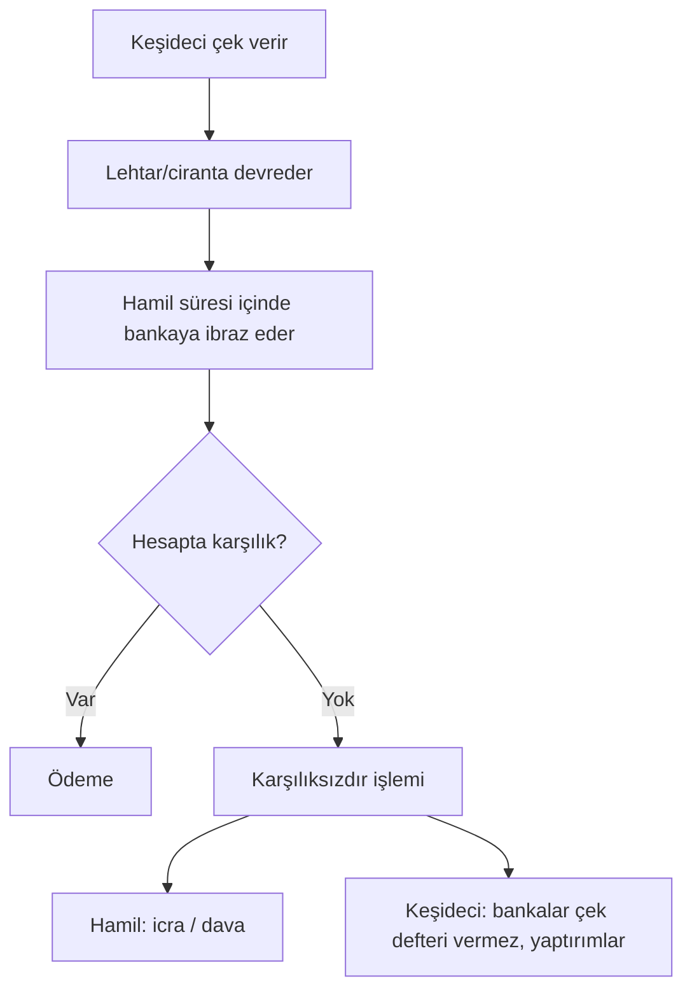

# D3. Derin İnceleme: Faiz, Kredi, Çek ve Senet / Deep Dive: Interest, Credit, Cheques and Notes

> Hukuki süre, tutar ve ceza hükümleri değişir. Burada **mantık ve yapı** anlatılır; güncel madde ve rakamlar için Çek Kanunu, TTK, İİK ve ilgili tebliğlere bakın. / Legal deadlines and amounts change; verify against current statutes.

## Bölüm A. Faiz matematiği

### A1. Temel formüller
| Kavram | Formül | Örnek |
|---|---|---|
| Basit faiz | F = A × r × t | 10.000 × %10 × 3 yıl = 3.000 |
| Bileşik faiz | F = A × (1+r)ⁿ | 1.000 × 1,10²⁰ ≈ 6.727 |
| Etkin yıllık oran (EAR) | (1 + r_dönem)^(dönem sayısı) − 1 | Aylık %3 → (1,03)¹² − 1 = **%42,58** |
| Reel faiz (Fisher) | (1+nominal)/(1+enflasyon) − 1 | %40 nominal, %50 enflasyon → **−%6,67** |
| 72 kuralı | Katlanma süresi ≈ 72 / r(%) | %6 → 12 yıl; %24 → 3 yıl |
| Gerçek maliyet (APR/YMO) | Masraf ve sigorta dahil iç verim | Kredi karşılaştırma ölçüsü |

**Önemli:** "Aylık %3" yıllık %36 değil, bileşik **%42,58**'dir. Aylık %4,5 faiz yıllık etkin **%69,59**'dur.

1.000 birim: %5'te 30 yılda ≈ 4.322, %10'da ≈ 17.449, %20'de ≈ 237.376. Küçük oran farkı uzun vadede devasa fark yaratır; aynı mantık borçta da geçerlidir.

### A2. Eşit taksitli kredi (amortisman)
Formül: Taksit = A × r / (1 − (1+r)⁻ⁿ)

**Örnek 1: 100.000 birim, aylık %3, 12 ay**
- Aylık taksit ≈ **10.046,21**
- Toplam geri ödeme ≈ 120.554,50; toplam faiz ≈ 20.554,50
| Ay | Taksit | Faiz payı | Anapara payı | Kalan borç |
|---|---|---|---|---|
| 1 | 10.046,21 | 3.000,00 | 7.046,21 | 92.953,79 |
| 2 | 10.046,21 | 2.788,61 | 7.257,59 | 85.696,20 |
| 3 | 10.046,21 | 2.570,89 | 7.475,32 | 78.220,87 |
| … | | | | |
| 12 | 10.046,21 | 292,61 | 9.753,60 | 0,00 |
İlk taksitlerde ödenen paranın büyük kısmı faizdir; erken kapatma bu yüzden ciddi tasarruf sağlar.

**Örnek 2: Aynı 100.000, aylık %3, 24 ay** → taksit ≈ 5.904,74; toplam faiz ≈ **41.713,80** (vade uzayınca taksit düşer, toplam maliyet artar).

**Örnek 3: Aylık %4,5, 36 ay** → taksit ≈ 5.660,58; toplam geri ödeme ≈ **203.780,81** (kredinin yaklaşık iki katı).

### A3. Faiz neden vardır? Neden değişir?
1. **Zaman tercihi:** Bugünkü para değerlidir.
2. **Risk primi:** Borçlu ödeyemeyebilir.
3. **Enflasyon beklentisi:** Paranın alım gücü kaybı telafi edilir.
4. **Vade primi:** Uzun vade belirsizdir.
5. **Likidite tercihi.**
6. **Politika faizi:** Merkez bankası kısa vadeyi belirler, piyasa uzunu fiyatlar.

**Getiri eğrisi (yield curve):** Vadeye göre faiz grafiği. Normalde yukarı eğimli; **ters eğri** (kısa vade > uzun vade) tarihsel olarak resesyon öncesinde sık görülmüştür ama garanti değildir.

**Tahvil fiyatı–faiz ilişkisi:** Faiz artarsa mevcut sabit kuponlu tahvil fiyatı düşer. Vadesi uzun tahvil (yüksek **duration**) daha duyarlıdır.

### A4. Tüketici kredisi tuzakları (yasal ama pahalı)
- Yalnızca aylık faize bakmak; dosya masrafı, hayat sigortası, komisyon eklenince gerçek maliyet artar.
- Asgari ödeme ve kart faizi: Kart borcunu asgari ile kapatmak uzun süre ve yüksek faiz demektir.
- Değişken faiz: Taksit zamanla artabilir.
- Yenileme döngüsü: Borcu borçla kapatmak.
**Bütçe kuralı:** Aylık borç ödemeleri gelirin makul bir bölümünü (ör. üçte birini) aşmasın.

## Bölüm B. Tefecilik, yasa dışı borç ve korunma

### B1. Neden yaygın?
Banka kanalına erişemeyenler, kara listedekiler, acil nakit ihtiyacı. Tefeci hızlı ve belgesiz kredi sunar ama maliyet çok yüksektir.

### B2. Yapı ve işaretler
| İşaret | Anlamı |
|---|---|
| Boş senet/çek imzalatma | Sonradan tutar yazılması riski |
| Tapu/araç/kimlik rehni | Haksız teminat |
| Önceden kesinti ("masraf" adı altında) | Gizli faiz |
| Tehdit, taciz, aile/işyerine baskı | Ayrıca suç |
| Sürekli yenileme (dönmeyen borç) | Borç tuzağı |

### B3. Hukuki dayanaklar (özet)
- Tefecilik TCK md. 241: kazanç sağlama amacıyla başkasına borç para vermek; 2–6 yıl hapis ve 500–5.000 gün adli para cezası, örgüt faaliyeti kapsamında işlenirse ceza bir kat artırılır. Unsur bir faiz oranı eşiği değil kazanç amacıdır; senet kırdırma ve POS yoluyla borç verme gibi yöntemler de bu kapsamda değerlendirilmiştir. Tehdit, şantaj, hürriyetten yoksun kılma, konut dokunulmazlığı ihlali ayrı suçlardır.
- Yasal ve temerrüt faizi oranları 3095 sayılı Kanun çerçevesinde belirlenir (güncel oranlar için resmî duyurulara bakın); bu oranlar sözleşme faizinin suç olup olmadığını tek başına belirlemez.
- İcra aşamasında borçlu **itiraz, şikâyet, menfi tespit, istirdat** gibi yollara sahiptir.
- Boş imzalı belgeyi doldurma sahtecilik/güveni kötüye kullanma olabilir.

### B4. Mağdur için adımlar
1. Konuşmaları ve ödemeleri kaydedin, dekont saklayın.
2. Tehdit varsa 112/155'e ve savcılığa gidin.
3. Avukattan menfi tespit/istirdat seçeneklerini sorun.
4. Banka kanalında yapılandırma isteyin; kredi birlikleri ve yasal mikro-finans alternatiflerine bakın.

## Bölüm C. Çek (ayrıntılı)

### C1. Çekin yapısı
**Zorunlu unsurlar (genel):** "Çek" ibaresi, kayıtsız şartsız havale, ödenecek tutar, muhatap banka, ödeme yeri, düzenleme yeri ve tarihi, keşidecinin imzası. Eksiklik varsa çek geçersiz sayılabilir.

**Taraflar:** Keşideci (çeki yazan), muhatap banka, lehtar/hamil (tahsil eden), ciranta (devreden).

**Çek türleri:** Nama yazılı, emre yazılı, hamile yazılı (ciro ile devredilir, hamile yazılıda teslimle devir); çizgili çek (yalnızca bankaya/müşteriye ödenir), hesaba geçirilecek çek.

### C2. Ciro türleri
| Ciro | Anlamı |
|---|---|
| Tam ciro | Devralan kişi belirtilir |
| Beyaz ciro | Sadece imza; taşıyana ödenir |
| Tahsil cirosu | Vekil sıfatıyla tahsil için |
| Rehin cirosu | Teminat amaçlı |

### C3. İşleyiş

- **İbraz süresi (TTK m. 796):** Düzenleme yeri ile ödeme yeri aynıysa 10 gün; farklı bir yerde ödenecekse 1 ay; yurt dışında düzenlenen çeklerde aynı kıtada 1 ay, farklı kıtada 3 ay. Süreler çekte yazılı düzenleme tarihinin ertesi gününden başlar ve hak düşürücüdür; son gün tatile denk gelirse ilk iş gününe uzar. İleri tarihli çekte çek üzerindeki tarih esas alınır. Süre geçince hamilin rücu hakları sınırlanır.
- **Banka ödeme sorumluluğu:** Kanunda belirlenen tutara kadar karşılık yoksa bile banka ödeme yapar ve keşideciden tahsil eder (sistem güncel tutarlar belirler).
- **Vadeli çek:** İleri tarihli çek hukuken ibrazda ödenir. Taraflar arasında vade yazılsa da bankaya erken ibraz edilebilir; bu yüzden çek "vade aracı" değildir.
- **Zamanaşımı (TTK m. 814, resmî metin):** Hamilin çirantalara, düzenleyene ve diğer çek borçlularına karşı başvuru hakları ibraz süresinin bitiminden itibaren **3 yıl** sonra zamanaşımına uğrar (2012'de 6273 sayılı Kanunla "altı ay"dan "üç yıl"a çıkarıldı). Çek borçlusunun diğerine karşı hakkı, çeki ödediği veya aleyhine dava açıldığı tarihten itibaren 3 yıldır.
- **Karşılıksız çek (5941 sayılı Çek Kanunu md. 3, 5, 6; resmî metinden):** Hamilin şikâyeti üzerine her çek için **1.500 güne kadar adli para cezası**; ceza çekin karşılıksız kalan miktarından az olamaz. Mahkeme çek düzenleme ve çek hesabı açma yasağı koyar (yargılamada koruma tedbiri olarak da). Ödenmeyen adli para cezası doğrudan hapse çevrilir; önödeme, uzlaşma ve HAGB uygulanmaz. Karşılıksız bedel ibraz tarihinden itibaren ticari temerrüt faiziyle tamamen ödenirse dava düşer veya hüküm ortadan kalkar (md. 6). Yasağın kaldırılması, cezanın infazından 3 yıl ve yasak tarihinden 10 yıl geçince istenebilir. Banka ödeme sorumluluğunun baz tutarı 1.000 TL'dir; TCMB her Ocak ayında güncel tutarı ilan eder (md. 3/3). Ayrıntı için [07 numaralı dosyaya](../07-cheques-and-promissory-notes.md) bakın.
- **Kaybolma/çalınma:** Bankaya yazılı bildirim, ilgili mahkemeye iptal/ödeme yasağı başvurusu.

### C4. Çek riskleri ve sahtecilik türleri
- **Sahte imza / sahte çek yaprağı:** Resmî belgede sahtecilik.
- **Değiştirilmiş (tahrif) çek:** Tutar/isim değişikliği.
- **Çek kitingi (check kiting):** İki hesap arasında gerçek karşılık olmadan çekle sahte bakiye yaratma (suç).
- **Ciro zincirinde kopukluk veya sahte ciro.**
- **Muvazaalı çek (malı teslim etmeden çek alma):** Çek bir ticari işlem karşılığı değilse; çek tek başına ödeme garantisi vermez.
- **"Çek karşılığı kredi" (çek-senet tefeciliği).**

### C5. Güvenli kullanım rehberi
1. Çekin ön-arka yüzünü, imzayı, tarihi, tutar yazı-rakam uyumunu kontrol edin.
2. Keşidecinin çek karnesi/yasak durumunu bankadan öğrenin.
3. Çizgi çekmek, çeke "hesaba geçirilecek" yazmak çalınma halinde riski azaltır.
4. Karşılıksız çıkarsa süreleri kaçırmadan hukuki yola başvurun.
5. Çeki depozito/güvence olarak vermeyin; teminat için yazılı sözleşme kullanın.

## Bölüm D. Senet / Bono (ayrıntılı)

### D1. Unsurlar (TTK'ya göre özet)
**Unsurlar (TTK m. 776, resmî metin):**
1. "Bono" veya "emre yazılı senet" kelimesi,
2. Kayıtsız şartsız belirli bir bedeli ödeme vaadi,
3. Vade,
4. Ödeme yeri,
5. Kime veya kimin emrine ödeneceği (lehtar),
6. Düzenlenme tarihi ve yeri,
7. Düzenleyenin imzası.

**Eksikse (TTK m. 777):** Bu unsurlardan birini içermeyen senet **bono sayılmaz**; yalnızca şu üç istisna vardır: vade yazılmamışsa görüldüğünde ödenir sayılır; ödeme yeri belirsizse düzenleme yeri ödeme yeri ve düzenleyenin yerleşim yeri sayılır; düzenleme yeri yoksa düzenleyenin adının yanındaki yer esas alınır. Bu nedenle bono ibaresi, ödeme vaadi, lehtar, düzenleme tarihi ve imza eksik olamaz. Bono vasfını kaybeden belge adi borç senedi olarak kalabilir.

### D2. Vade çeşitleri
Görüldüğünde ödenir · görüldükten belirli süre sonra · düzenleme tarihinden belirli süre sonra · belirli bir günde.

### D3. Aval ve ciro
- **Aval:** Üçüncü kişinin borçluya kefil gibi imza vermesi; aval veren borcun tamamından sorumlu olabilir.
- **Ciro:** Senedin devri; ciranta da sorumlu olur (ciro silsilesi kesintisiz olmalı).

### D4. Takip yolları (özet)
- **Kambiyo senetlerine özgü haciz yolu:** Senedin kambiyo vasfı varsa hızlı takip. Borçlu, ödeme emrinin tebliğinden itibaren 5 gün içinde icra mahkemesine şikâyet ve borca itiraz yollarını kullanabilir (İİK m. 168). Bu başvuru takibi kendiliğinden durdurmaz; durdurma için mahkemenin karar vermesi gerekir (İİK m. 170/a).
- **Genel haciz yolu veya dava:** Kambiyo vasfı yoksa.
- **Protesto:** Ödeme reddi resmen tespiti; bazı rücu hakları için gerekli olabilir.
- **Zamanaşımı (TTK m. 749):** Düzenleyen (borçlu) aleyhine talepler vadeden itibaren 3 yılda; müracaat borçlularına (cirantalar vb.) karşı protesto tarihinden itibaren 1 yılda; bedeli ödeyen müracaat borçlusunun diğerlerine karşı hakkı ödeme tarihinden itibaren 6 ayda zamanaşımına uğrar (TTK m. 749, 778 resmî metin; bonoda düzenleyen, poliçedeki kabul eden gibi sorumludur).

### D5. Riskler ve tuzaklar
- **Boş senet imzalatma:** Sonradan doldurma tutar ve vade ihtilafı; ispat yükü tartışması.
- **Teminat senedi:** Asıl borç sözleşmesine bağlı; sebepsiz ödeme talebi menfi tespit konusu olabilir.
- **Senedin zayi olması:** İptal davası.
- **Faiz gizleme:** Senet bedeline faiz eklemek, "masraf" yazmak.
- **Sahte senet:** Sahtecilik suçu; imza incelemesi (grafoloji/uzman raporu).

### D6. Çek ve senet karşılaştırma
| Özellik | Çek | Senet (Bono) |
|---|---|---|
| Düzenleyen | Keşideci (hesap sahibi) | Borçlu |
| Üçüncü taraf | Muhatap banka şart | Banka yok |
| Vade | Görüldüğünde ödenir | Vadeli olabilir |
| Karşılık | Hesapta olmalı | Borçlunun malvarlığı |
| Yaptırım | Çek Kanunu, banka kayıtları | Takip, icra, hukuki yollar |
| Kullanım | Hızlı ödeme aracı | Kredi/borç senedi |

## Bölüm E. Kısa pratik senaryolar
1. **Çekle mal sattınız, çek karşılıksız çıktı:** Ibraz tarihi, karşılıksızdır şerhi, keşideciye/ciro edenlere rücu; icra takibi.
2. **Kardeşinize senet verdiniz, "güvence" denildi:** Yazılı sözleşme ve senet ilişkisi; ödenince senedi geri alın ve ödeme belgesi isteyin.
3. **Tefeci boş çek istiyor:** Vermeyin; yasal kredi arayın; baskı varsa savcılık.

## English summary
Interest: simple, compound, EAR, real (Fisher) and the rule of 72; 3%/month equals 42.58% a year compounded. Amortization worked examples show most early installments are interest. Usury and illegal lending rely on blank cheques/notes, hidden fees and threats; victims should keep records, report threats and seek legal remedies. Cheques: unconditional order to pay on presentation; presentation periods, endorsement types, bank liability, kiting and forgery. Promissory notes: TTK Art. 776 lists seven elements (note designation, unconditional promise to pay, due date, place of payment, payee, date and place of issue, signature) and Art. 777 supplies defaults only for a missing due date (payable on demand), place of payment and place of issue; aval (guarantee), summary enforcement procedures, protest and limitation periods. Always verify current statutory numbers.
