# D4. Derin İnceleme: Krizler, Siyaset ve Jeopolitik / Deep Dive: Crises, Politics, Geopolitics

> Sayılar yaklaşık ve kamuya açık kaynaklardan bilinen büyüklüklerdir; kullanmadan önce IMF, Dünya Bankası, TCMB, TÜİK, Fed ve BIS gibi kaynaklardan doğrulayın. / Figures are approximate; verify with primary sources.

## 1. Kriz tipolojisi (Reinhart–Rogoff çerçevesi)
| Tür | Tetik | Örnek |
|---|---|---|
| **Banka krizi** | Mevduat çekilişi, batık krediler | 1930'lar ABD, 2008, 2023 SVB |
| **Para/kur krizi** | Sabit kurun savunulamaması | 1992 Avrupa ERM, 1997 Asya, 2001 Türkiye |
| **Egemen borç krizi** | Devletin ödeyememesi | Latin Amerika 1982, Yunanistan 2010, Arjantin 2001 |
| **Enflasyon / hiperenflasyon** | Para arzı + güven kaybı | Almanya 1923, Zimbabve 2008 |
| **Varlık balonu patlaması** | Aşırı değerleme | Lale çılgınlığı (1637), Güney Denizi (1720), dot-com (2000), konut (2007) |
| **Dış şok** | Savaş, ambargo, pandemi | 1973 petrol, 2020 Covid, 2022 enerji |

## 2. Büyük krizler: ayrıntılı
### 2.1 1929 Büyük Buhran
- Aşırı kaldıraçlı hisse alımı (marjinle alım), fiyatlar Eylül 1929 zirvesinden Temmuz 1932'ye kadar yaklaşık %89 düştü (Dow Jones).
- Bankaların çökmesi, para arzının küçülmesi, tarife savaşı (Smoot-Hawley, 1930) ticareti daralttı.
- ABD'de işsizlik 1933'te yaklaşık %25'e ulaştı.
- **Dersler:** Mevduat sigortası (FDIC, 1933), SEC ve Glass-Steagall (banka türlerinin ayrımı), merkez bankasının son kredi mercii rolü.

### 2.2 1971–73: Bretton Woods'un sonu ve petrol şoku
- 15 Ağustos 1971 **Nixon şoku:** Doların altına çevrilebilirliği kalktı; sabit kurlar çöktü.
- Ekim 1973 OPEC petrol ambargosu: fiyatlar kısa sürede dört katına yakın arttı.
- **Stagflasyon:** Aynı anda yüksek enflasyon ve düşük büyüme; klasik reçeteler zorlandı.
- 1979–82 **Volcker şoku:** Fed politika faizini agresif yükseltti (faizler %20 civarına), enflasyonu kırdı ama derin resesyon yarattı.

### 2.3 1980'ler Latin Amerika borç krizi
Petrodolar geri dönüşümüyle bankalar gelişen ülkelere bol kredi verdi; 1982'de Meksika ödeme güçlüğünü açıkladı. IMF programları, yapısal uyum ve "Kayıp On Yıl". Brady planı (1989) borçları tahvile çevirip kısmi silme yaptı.

### 2.4 1985 Plaza ve 1987 Louvre
Plaza Anlaşması (Eylül 1985): G5 doların değer kaybına koordineli müdahale. Louvre (1987): kurları dengeleme çabası. 19 Ekim 1987 "Kara Pazartesi": Dow Jones tek günde yaklaşık %22.

### 2.5 1992 Kara Çarşamba
Birleşik Krallık Avrupa Döviz Kuru Mekanizması'nda (ERM) kuru savunamadı; 16 Eylül 1992'de mekanizmadan çıktı. Spekülatörler (en bilineni George Soros'un fonu) sterline karşı büyük pozisyon aldı. **Ders:** Sabit kur ile bağımsız para politikasının bir arada sürdürülememesi ("imkânsız üçlü").

### 2.6 1997–98 Asya ve Rusya
Tayland baht'ı 2 Temmuz 1997'de dalgalanmaya bırakıldı; kriz Endonezya, Güney Kore, Malezya'ya yayıldı. Kısa vadeli dolar borç + sabit kur + zayıf bankacılık. 1998'de Rusya temerrüdü, **LTCM** fonunun kaldıraçlı çöküşü ve Fed öncülüğünde kurtarma organizasyonu.

### 2.7 2001 Türkiye krizi
- Arka plan: Sabit kur çapalı program (2000), cari açık, kamu bankalarının görev zararları, zayıf bankacılık.
- Şubat 2001: 19 Şubat'taki Millî Güvenlik Kurulu toplantısında Cumhurbaşkanı Sezer ile Başbakan Ecevit arasındaki gerginlik ("Kara Çarşamba") piyasaları sarstı; 21 Şubat'ta gecelik faizler olağanüstü yükseldi (kaynaklar farklı rakamlar verir: yaklaşık %760'tan %7.500'e kadar anılır), 22 Şubat'ta kur dalgalanmaya bırakıldı ve lira kısa sürede çok değer kaybetti.
- Sonrası: Güçlendirilmiş Ekonomik Program (Kemal Derviş), BDDK (4389 sayılı Kanunla Haziran 1999'da kuruldu, Eylül 2000'de faaliyete başladı; kriz sonrası rolü büyüdü), TMSF'nin rolü, bankacılık yeniden yapılandırması, Merkez Bankası Kanunu'nda 4651 sayılı değişiklik (25 Nisan 2001'de kabul, Mayıs 2001'de yürürlük; fiyat istikrarının asıl hedef olması ve Hazine'ye avans verilmesinin yasaklanması), sonrasında enflasyon hedeflemesine geçiş.

### 2.8 2007–09 Küresel Finansal Kriz (ayrıntı)

```mermaid
flowchart LR
    A[Düşük faiz + konut talebi] --> B[Riskli mortgage kredileri]
    B --> C[Menkul kıymetleştirme MBS/CDO]
    C --> D[Yüksek not verilen riskli paketler]
    D --> E[Bankalar ve fonlar kaldıraçla satın alır]
    E --> F[Konut fiyatları düşer, temerrütler artar]
    F --> G[Bilanço zararları, güven kaybı]
    G --> H[Lehman iflası 15 Eylül 2008]
    H --> I[Kredi piyasası dondu, küresel resesyon]
```

- **Bear Stearns** Mart 2008'de kurtarıldı; **Lehman Brothers** Eylül 2008'de iflas etti (yaklaşık 600 milyar dolar üzeri varlık). AIG kurtarıldı.
- ABD: TARP (700 milyar dolara kadar yetki), Fed politika faizini sıfıra yakın düşürdü, niceliksel gevşeme (QE).
- Reformlar: Dodd-Frank (2010), Basel III, stres testleri, Volcker kuralı, yapılandırılmış ürünlerin saydamlığı.

### 2.9 2010–12 Avro bölgesi borç krizi
Yunanistan'ın bütçe verilerinin yeniden düzeltilmesi, spreadlerin açılması, IMF-AB-AMB (troyka) programları, kemer sıkma. Mario Draghi'nin 2012'de "whatever it takes" açıklaması ve OMT programı krizin yatışmasında dönüm noktasıydı.

### 2.10 2018 Türkiye kur şoku
Dış borç yoğunluğu, cari açık, enflasyon, merkez bankası güven tartışmaları ve Ağustos 2018'de ABD ile gerginlik (çelik tarifesi duyurusu) lira üzerinde sert baskı yarattı; dolar karşısındaki kayıp ölçüye göre değişir: yıl başı–yıl sonu kıyasında yaklaşık %28 (kur yaklaşık 3,78'den 5,27'ye), yıl içindeki en sert noktalarda ise %40'ı aşan kayıplar görüldü. Sonrası: sıkı para politikası, kredi sıkılaşması, sermaye kontrolü benzeri adımlar tartışıldı.

### 2.11 2020 Covid-19
Küresel ekonomik "bilinçli durdurma"; Mart 2020'de likidite krizi (hazine tahvilleri bile satıldı), merkez bankaları sınırsız likidite ve tahvil alımı, devletlerin devasa mali teşvikleri. Sonuç: Hızlı toparlanma ama arz zinciri sorunları ve sonraki enflasyon.

### 2.12 2021–23 Enflasyon dalgası
Arz şokları, enerji ve gıda fiyatları (Rusya–Ukrayna savaşı), talep teşvikleri, ücret baskısı; merkez bankaları 2022'de agresif faiz artırdı. Tahvil fiyatları sert düştü; teknoloji hisselerinde düzeltme. Türkiye'de TÜİK'in resmî yıllık TÜFE enflasyonu Ekim 2022'de %85,51'e çıktı (bağımsız ENAG aynı ay için çok daha yüksek bir oran hesapladı).

## 3. Hiperenflasyon mekaniği
1. Bütçe açığı para basılarak finanse edilir.
2. Fiyatlar yükselir, para değer yitirir.
3. İnsanlar parayı hemen harcar/döviz alır → dolaşım hızı artar.
4. Fiyatlar daha da hızlı yükselir; vergi gelirleri reel olarak erir.
- **Weimar Almanyası (1923):** Savaş tazminatı, Ruhr işgali ve para basımı sonrası fiyatlar günlerle ölçülen sürede katlandı.
- **Zimbabve (2000'ler):** Tarım üretiminin çökmesi, para basımı; yüz trilyonluk banknotlar.
- **Dolarizasyon:** Halk yabancı paraya kayar; yerel para işlevini yitirir.

## 4. Erken uyarı göstergeleri
- Hızlı kredi/GSYH artışı, varlık fiyatlarının gelirlerden hızlı artması
- Cari açık + kısa vadeli dış borç yüksek, rezerv düşüyor
- Banka yükümlülüklerinde döviz açığı
- Ters getiri eğrisi (resesyon sinyali, kusurlu)
- Kamu borcunun faiz yükünün gelire oranı
- Kur dalgalanması ve risk primi (CDS) hızlı artışı
- Güven göstergeleri, mevduat dolarizasyonu

## 5. Siyaset, güç ve para: mekanizmalar
### 5.1 Merkez bankası bağımsızlığı
- **Neden:** Seçim döngüsünden korunmak, enflasyon beklentilerini çıpalamak.
- **Kanıt eğilimi:** Daha bağımsız merkez bankaları ortalamada daha düşük enflasyonla ilişkilendirilir; tartışmalıdır.
- **Risk:** Baskı → beklentilerin bozulması → kur ve faiz primi.

### 5.2 Mali baskınlık
Kamu borcu o kadar büyüktür ki merkez bankası faiz artıramaz (devletin borç servisi çöker) → enflasyon eğilimi.

### 5.3 Rezerv para ayrıcalığı
- ABD dolar ihraç ettiği için ucuz borçlanır, ama ihracı küresel talebe bağlıdır ("Triffin ikilemi").
- Yaptırım gücü: Dolar sistemine erişimi kısıtlayabilme.
- Alternatif çabalar: Altın, yuan ödemeleri, yerel para takasları.

### 5.4 Tarifeler ve ticaret savaşları
Tarife, ithalatı pahalı kılar: yerli üretici korunur, tüketici öder, misilleme yapılır. 2018'den itibaren ABD–Çin tarifeleri tedarik zincirini çeşitlendirdi ("China+1", "friend-shoring").

### 5.5 Seçim ve ekonomi
Seçim öncesi teşvik/vergi indirimi/ücret artışı eğilimi (siyasi iş çevrimi); sonrasında düzeltme. Etkisi ülkeden ülkeye değişir.

### 5.6 Kaynak siyaseti
Petrol–doğalgaz boru hatları, deniz yolları (Hürmüz, Süveyş, Malakka), nadir toprak elementleri, yarı iletkenler. "Kaynak laneti": doğal kaynak zengini ülkelerde kurumsal zayıflık ve yolsuzluk.

### 5.7 IMF ve Dünya Bankası
IMF programı: kredi karşılığı mali ve para politikası şartları (şartlılık). Eleştiri: kemer sıkma sosyal maliyeti; savunma: kontrolsüz kriz daha pahalı. Dünya Bankası: kalkınma finansmanı, proje kredileri.

## 6. "Fırsat" mı, "tuzak" mı? Kriz sonrası tarihsel kalıplar
- Varlık fiyatları dipte olduğunda satın alanlar uzun vadede kazanç elde etmiş olabilir, ama **dip önceden bilinmez**; birçok yatırımcı erken girip zarar eder.
- Kriz sırasında likiditesi güçlü olanlar (nakit, düşük borç) avantaj kazanır.
- Krizlerde dolandırıcılık artar: "kriz fırsatı" yatırımları, sahte kurtarma fonları, borç silme dolandırıcılığı.

## 7. Vaka çalışması soruları (kendi analiziniz için)
1. Kriz öncesi 5 yılda kredi, kur, rezerv, enflasyon nasıl hareket etti?
2. Tetikleyici dış mi iç mi?
3. Hükümet ve merkez bankası ne yaptı, hangi sırayla?
4. Kimler kazandı/kaybetti (borçlular, alacaklılar, ihracatçılar, tasarruf sahipleri)?
5. Hangi kurumsal reform yapıldı ve işe yaradı mı?

## English summary
Crisis types: banking, currency, sovereign debt, inflation, asset-bubble and external shocks. Detailed cases: 1929 (≈89% peak-to-trough fall; FDIC/SEC reforms), 1971–73 (Nixon shock, oil embargo, stagflasyon, Volcker shock), 1982 Latin American debt, 1985 Plaza and 1987 crash, 1992 sterling exit from ERM, 1997–98 Asia/Russia/LTCM, 2001 Türkiye (float on 22 Feb, BDDK and central-bank reforms), 2008 GFC (subprime → MBS/CDO → Lehman 15 Sept 2008 → TARP, QE, Dodd-Frank, Basel III), 2010–12 euro crisis ("whatever it takes"), 2018 lira shock, 2020 Covid, 2022 inflation. Politics matters through central-bank independence, fiscal dominance, reserve-currency privileges, tariffs, elections and resource geopolitics.
