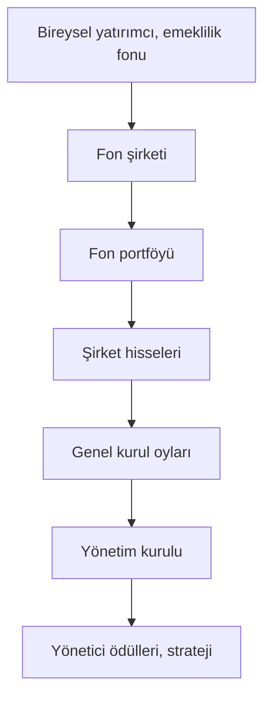

# D5. Derin İnceleme: Gizli Yapılar, Şirketler, Gölge Ekonomi / Deep Dive: Hidden Structures, Corporations, Shadow Economy

> **Kural:** Her iddiayı üç kategoriye ayırın: **Belgelenmiş** (mahkeme kararı, resmî rapor, bağımsız basın doğrulaması) · **Tartışmalı** (kanıt var ama yorum farklı) · **Kanıtsız** (güvenilir kaynak yok). Bu dosya bu ayrımı korur. Kimseyi suçlamaz, suç yöntemi öğretmez. / Separate every claim into documented, disputed, unsupported.

## 1. İddia değerlendirme çerçevesi
| Soru | Güvenilir iddia | Zayıf iddia |
|---|---|---|
| Birincil kaynak var mı? | Mahkeme kararı, SEC/SPK/FATF raporu, şirket belgesi | "Biliyorum", "iç kaynak" |
| Bağımsız doğrulama? | Birden çok bağımsız medya/akademik kaynak | Tek kaynaklı video |
| Çürütülebilir mi? | Hangi veri iddiayı çürütür belli | Her çürütme "örtbas" sayılır |
| Mekanizma açıklanıyor mu? | Para nasıl nereye aktı gösterilir | "Hepsi bağlantılı" |
| Kâr çıkarı var mı? | Kurs, abonelik, bağış satışı yok | Korku üzerinden satış |
| Genelleme | Belirli kişi/olay | "Tüm X'ler" |

## 2. Masonluk: yapı ve gerçekler
### 2.1 Yapı
- **Loca:** Yerel birim. **Büyük Loca:** Bir bölgedeki locaları yöneten yapı (ör. İngiltere Birleşik Büyük Locası, 1717/1813).
- **Dereceler (Craft/Mavi Masonluk):** Çırak, Kalfa, Usta. Ek sistemler: Eski Kabul Edilmiş İskoç Ritü (33 derece), York Ritü vb. Bu "üst dereceler" bir komuta zinciri değil, ek eğitim/ritüel sistemleridir.
- **Tanınma:** "Düzenli (regular)" ve "düzensiz" ayrımı; localar birbirini tanır veya tanımaz.
- **Üye sayısı:** Dünya genelinde milyonlarla tahmin edilir (kaynaklara göre değişir).
- **Gizlilik:** "Sembolik sır" (tokalaşma, sözcükler) vardır; üyelik ve ilkelerin çoğu kamuya açıktır, birçok ülkede locaların adresi ve üye ilkeleri yayımlanır.

### 2.2 Tarihsel roller (belgelenmiş)
- Aydınlanma dönemi tartışma ve dayanışma ortamı; bazı Amerikan kurucu figürlerinin üyeliği bilinir.
- Türkiye'de Osmanlı döneminden itibaren localar ve ilgili tartışmalar; üyelik siyasi dönemlerde tartışma konusu olmuştur.
- Hayırseverlik: hastane, burs, okul bağışları birçok ülkede kayıtlı.

### 2.3 Para ve siyaset bağlamında risk
- Gizli ağlarda **iç ilişkilerin ihale/atama/yargıda kayırmaya dönüşme** riski → bu yüzden bazı ülkelerde kamu görevlilerinden üyelik beyanı konusu tartışıldı.
- **P2 skandalı (İtalya):** Resmî masonik yapıdan dışlanmış gizli bir loca; politika, ordu, medya ve finanstan isimler; Banco Ambrosiano çöküşü ve Calvi ölümüyle bağlantılı soruşturmalar. Mahkemeler ve parlamento komisyonları ayrıntıları ele aldı.
- **Kanıtsız:** "Dünya merkez bankalarını masonlar yönetiyor", "tüm kriz tezgâhlıdır."

### 2.4 Neden efsane güçlü?
Ritüel + gizlilik + ünlü üyeler = anlatıya uygun sembol. Karmaşık ekonomik olaylara tek sorumlu aramak psikolojik olarak kolaydır (**komplo düşüncesi**: bilişsel örüntü arama + kontrol hissi).

## 3. Tarikat, cemaat ve ekonomi: ayrıntılı
### 3.1 Kavramsal ayrımlar
| Terim | Anlamı |
|---|---|
| Tarikat | Tasavvufi yol/silsile; geleneksel eğitim ağı |
| Cemaat | Dinî/sosyal topluluk; vakıf-dernek-şirket ağı kurabilir |
| Mezhep | İnanç yorumu |
| Mezhepsel ve tarikatsal gruplar | Ülkeden ülkeye hukuki statü değişir |
| Cult / baskıcı grup | Kontrolcü, istismarcı, kişiyi izole eden, malını/emeğini sömüren yapı (ölçüt: davranışlar, inanç değil) |

### 3.2 Ekonomik faaliyet türleri (meşru)
Vakıf ve dernek bağışları, eğitim kurumları, yayıncılık, ticari işletmeler, hayır kurumları, kooperatifler. Bunların hepsi vergi, denetim, bağış toplama ve muhasebe kurallarına tabidir.

### 3.3 Risk alanları (mekanizma)
- **Güven kredisi (affinity):** Üyeler birbirine daha çok güvenir → denetim ve yazılı sözleşme azalır → dolandırıcılık kolaylaşır. Belgelenmiş örneklerde dolandırıcılar dinî/etnik topluluklara hedefli yatırım şemaları kurmuştur.
- **Bağış ve vergi:** Bağış makbuzu, zekât/fitre yönetimi, yardım toplama izni; izinsiz yardım toplama kabahat/suç olabilir.
- **Hizmet ve emek:** Ücretsiz çalıştırma, burs karşılığı yükümlülük, "hizmet" adıyla tam zamanlı karşılıksız emek.
- **İzolasyon ve borçlandırma:** Üyeyi aile/dış çevreden ayırma, borç veya bağış yoluyla bağımlı kılma.
- **Siyasetle ilişki:** Oy yönlendirme, kamu atamaları, ihaleler → kayırmacılık.

### 3.4 Türkiye'de hukuk çerçevesi (özet)
- 1925 tarihli kanun tekke ve zaviyeleri kapattı; tarikat faaliyetleri resmen tanınmaz.
- Dernek ve vakıflar mevzuatı, yardım toplama kanunu, MASAK yükümlülükleri, terör finansmanının önlenmesi.
- Terör örgütü saptanan yapılar için kayyum, TMSF, el koyma ve tasfiye süreçleri vardır (Bank Asya 2015'te TMSF yönetimine alınmış, faaliyet izni sonradan kaldırılmıştır). Bu süreçlerin hukuki değerlendirmesi, adalet ve mülkiyet haklarıyla ilgili uluslararası kurum görüşleri dahil, tartışmalı ve karar metinlerine bağlıdır.

### 3.5 Kendini ve yakınlarını koruma
1. Yazılı sözleşme ve makbuz olmadan para vermeyin.
2. Büyük tutarda yatırım/ödünç taleplerinde bağımsız avukat/mali müşavir görüşü alın.
3. Mal devri/vasiyet/vekalet imzalamadan önce aile dışı hukuk danışmanı.
4. "Karşılıksız hizmet" için günlük kayıt tutun (emek hakları).
5. Baskı, tehdit varsa 155/112 ve savcılık; destek kuruluşları.
6. Eski üyeler/psikologlar/avukatlar bilgi veya destek verebilir.

## 4. Küresel şirket ve fon gücü: ayrıntı
### 4.1 Sahiplik katmanları

- **Oy kullanma:** Pasif fon yöneticileri müşterileri adına oy kullanır. Bazı fon şirketleri müşterilere oy seçeneği sunmaya başladı ("pass-through voting").
- **Yoğunlaşma:** ABD'de S&P 500 şirketlerinin çoğunda ilk üç pay sahibi çoğunlukla büyük endeks fon yöneticileridir. Bu, tek bir merkezden komuta anlamına gelmez; fonlar farklı strateji ve müşteri sahiplerine hizmet eder. Rekabet etkisi akademik olarak tartışılıyor.
- **Alternatifler:** Aile şirketleri, devlet şirketleri, kurucu pay sahibi oyları (dual-class: Meta, Alphabet).

### 4.2 Denetim ve derecelendirme: çıkar çatışması
- **Dört Büyükler** denetim + danışmanlık verirse bağımsızlık sorunu; Sarbanes-Oxley (2002) bu ayrımı sertleştirdi.
- Derecelendirme şirketlerine ihraççı ödeme yapar (2008'de hatalı yüksek notlar).

### 4.3 Vergi planlaması: sınır çizgisi
| Seviye | Örnek |
|---|---|
| Yasal teşvik | Ar-Ge kredisi, yatırım indirimi |
| Agresif planlama | Transfer fiyatlandırma ile kârı düşük vergili ülkeye kaydırma |
| Kaçakçılık | Gelirin gizlenmesi, sahte belge |
OECD **BEPS** projesi, küresel asgari kurumlar vergisi (%15 "Sütun 2") bu açığı kapatmayı hedefler.

### 4.4 Lobicilik
ABD'de lobiciler kayıtlıdır; OpenSecrets ve kayıt veritabanlarından harcama izlenebilir. Avrupa'da AB Şeffaflık Siciline kayıt. Türkiye'de kapsamlı lobi kaydı sistemi sınırlıdır. **Sorun:** Düzenleyiciye yakınlık, "döner kapı", araştırma finansmanıyla görüş etkileme.

### 4.5 Şirket suçları: belgelenmiş vaka kartları
| Vaka | Mekanizma | Sonuç/ders |
|---|---|---|
| **Enron (2001)** | Özel amaçlı kuruluşlarla borç gizleme; denetçi Arthur Andersen | Şirket iflası; Andersen dağıldı; SOX |
| **Volkswagen (2015)** | Test modunu algılayan yazılım | Milyarlarca dolarlık ceza/uzlaşma; üst yönetim davaları |
| **Wirecard (2020)** | Varlığı doğrulanamayan nakit bakiyeler | İflas; Almanya'da denetim reformu |
| **FTX (2022)** | Müşteri varlıklarının ilişkili fonla karıştırılması | İflas; kurucu mahkûmiyeti |
| **Boeing 737 MAX** | Güvenlik–sertifikasyon ilişkisi ve yönetim kültürü | Ceza/uzlaşmalar, düzenleyici reform |
| **Odebrecht (Brezilya)** | Ülkeler arası ihale rüşveti ağı | Çoklu ülkelerde soruşturmalar, rekor cezalar |
Bu vakaların hiçbirinde "evrensel gizli komuta" yoktu; sıradan çıkar, ödül sistemi, zayıf denetim ve bazen bilinçli suç vardı.

## 5. Gölge ekonomi ve kara para: ayrıntı
### 5.1 FATF çerçevesi
- FATF (Mali Eylem Görev Gücü, 1989) kara para aklama ve terör finansmanı için 40 tavsiye kararı yayımlar; ülke değerlendirmeleri yapar.
- **Gri liste:** İzlenen, stratejik eksiklikleri olan ülkeler; **kara liste:** yüksek riskli yargı alanları. Gri liste, bankalar için ek uyum maliyeti ve yatırımcı algısı demektir. Türkiye 2021'de gri listeye alındı, 2024'te çıkarıldı.
- Tahmini küresel aklama: BM Uyuşturucu ve Suç Ofisi (UNODC) yıllık küresel GSYH'nin yaklaşık %2–5'i aralığında tahmin eder (kesin ölçülemez).

### 5.2 Aklama aşamaları ve savunma kontrolleri
| Aşama | Ne olur (kavramsal) | Savunma |
|---|---|---|
| Yerleştirme | Nakit sisteme girer | Nakit eşikleri, şüpheli işlem bildirimi |
| Katmanlama | Hareketlerle izi gizleme | İşlem izleme, gerçek faydalanıcı kaydı |
| Bütünleştirme | Meşru varlık gibi kullanım | Kaynak ispatı, gayrimenkul/şirket işlem denetimi |

### 5.3 Kırmızı bayraklar (uyum çalışanları için)
- Kaynağı açıklanamayan nakit; müşteri profiline uymayan işlem hacmi
- Yapılandırma: eşiğin altında bölünmüş işlemler
- Aynı gün çok sayıda hesaba hızlı giriş-çıkış
- Üçüncü taraf ödemeleri, risk ülkelere havaleler
- Karmaşık ve amaçsız şirket zinciri; vekil (nominee) yönetici
- Ticaret faturasında fiyat-miktar uyumsuzluğu
- Gerçek faydalanıcıyı gizleme çabası
Bu liste **tespit** içindir. Bildirim: bankadaki uyum birimi → MASAK.

### 5.4 Offshore kayıtları
Panama Papers (2016, ~11,5 milyon belge), Paradise Papers (2017), Pandora Papers (2021) gibi sızıntılar, offshore şirket ve hesapların bir kısmının meşru, bir kısmının gizleme amaçlı olduğunu; yani **yapının kendisinin suç sayılmadığını**, amaç ve beyan eksikliğinin belirleyici olduğunu gösterdi. ICIJ'in Offshore Leaks veritabanı kamuya açıktır.

### 5.5 Yolsuzluk ölçümü
Transparency International **Yolsuzluk Algı Endeksi (CPI)**: 0–100 puan; algı temelli, kesin yolsuzluk ölçüsü değil. Dünya Bankası yönetişim göstergeleri, açık veri/ihale şeffaflığı, GRECO/OECD izleme raporları tamamlayıcıdır.

### 5.6 Organize suç ekonomisi
- Gelir kaynakları: uyuşturucu, insan kaçakçılığı, sahte ürün, tefecilik, haraç, yasa dışı bahis, siber dolandırıcılık.
- Para yönetimi: Nakit ağırlıklı işletmeler, gayrimenkul, kripto, hawala/gayriresmi değer transfer sistemleri.
- Toplumsal maliyet: Şiddet, haksız rekabet, kamu görevlisi yozlaşması, fiyat artışı.
- Karşı önlem: Uluslararası işbirliği (Europol, Interpol, FinCEN), varlık dondurma ve müsadere, kamu ihale denetimi, gerçek faydalanıcı kaydı.

### 5.7 Türkiye'de uyum altyapısı (özet)
MASAK (suç gelirleri), BDDK (bankacılık denetimi), SPK (piyasalar), TCMB (ödeme sistemleri), Ticaret Bakanlığı (gümrük/ticaret), Gelir İdaresi (vergi). Yükümlüler: bankalar, aracı kurumlar, sigorta, kuyumcular, gayrimenkul aracıları, kripto platformları vb. KYC, şüpheli işlem bildirimi (ŞİB), kayıt saklama zorunluluğu.

## 6. Pratik "araştırma" kitiniz
- **Şirket:** KAP, MKK, Ticaret Sicili Gazetesi, EDGAR, OpenCorporates, ICIJ Offshore Leaks
- **Kişi/PEP riski:** Kamuya açık görev ve beyan, haber arşivleri (isim benzerliğine dikkat)
- **Yaptırım listeleri:** OFAC SDN, AB konsolide liste, BM listesi
- **Mahkeme:** Karar arama sistemleri (ülkeye göre)
- **Doğrulama:** İddiayı en az iki bağımsız kaynakla eşleştirin; fikir ile olguyu ayırın.

## English summary
Evaluate claims as documented, disputed or unsupported. Freemasonry: lodges, Grand Lodges, three Craft degrees plus additional rites (Scottish Rite's 33 degrees are not a chain of command); documented risks are favoritism and secrecy, and the P2 scandal shows how clandestine networks can fuse with banking and politics; claims that Masons control global finance are unsupported. Religious communities: legitimate economic activity exists, but affinity fraud, coerced donations/unpaid labor, isolation and political entanglement are known risks; Turkish trustee/takeover cases (e.g., Bank Asya) are legally contested. Corporations: layered ownership via funds, auditing and rating conflicts, tax planning ladder (incentive → aggressive → evasion), BEPS and the 15% minimum tax, lobbying transparency, and case cards (Enron, VW, Wirecard, FTX, Boeing, Odebrecht). Shadow economy: FATF's 40 Recommendations, grey/black lists (Türkiye grey-listed 2021, removed 2024), laundering stages, red flags for compliance, offshore leaks, CPI limits and organized-crime economics.
