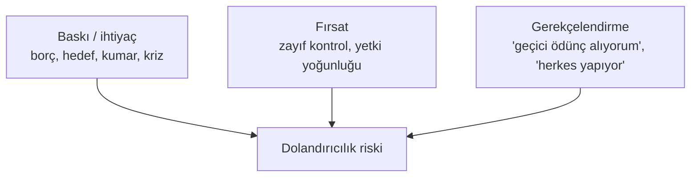
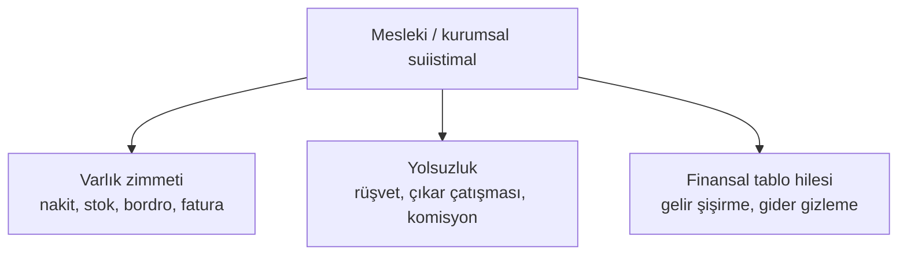
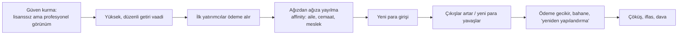
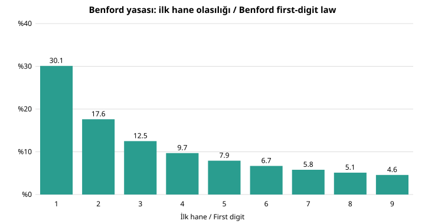
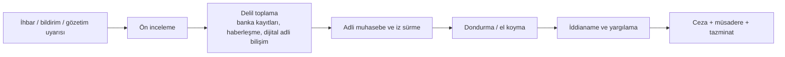

# D6. Yasa Dışı Uygulamalar Vaka Kitabı / Casebook of Illegal Practices

> **Kapsam ve sınır.** Bu dosya, suç soruşturması, uyum (compliance) ve mağdur koruma literatüründeki düzeyde ayrıntı verir: şemanın **mantığı**, hukuki unsurlar, işaretler, tespit yöntemleri, cezalar, gerçek vakalar, mağdurun yapacakları. **Suçun nasıl işleneceğini, yakalanmadan nasıl kaçılacağını veya denetimlerin nasıl aşılacağını anlatmaz.** Madde numaraları genel bilgiye dayanır; hangilerinin nasıl doğrulandığı için [17-fact-check-log.md](../17-fact-check-log.md) dosyasına bakın. / Detail at the level of enforcement, compliance and victim-protection literature. No operational how-to for committing or evading detection.

## 0. Bütün suçlara bakış

### 0.1 Sahtekârlık üçgeni (Cressey)

Üç unsurdan biri kaldırılırsa risk düşer. Şirketler en çok **fırsat** tarafını (iç kontrol, görev ayrılığı, çift imza, denetim) yönetebilir.

### 0.2 Mesleki dolandırıcılık ağacı (ACFE sınıflaması)

ACFE raporlarının genel bulgusu: vakaların en büyük bölümü **ihbar** yoluyla ortaya çıkar; en çok görülen tür varlık zimmetidir, en pahalı olan finansal tablo hilesidir.

### 0.3 Hukuki unsurlar mantığı
Bir eylemin suç sayılması için genelde şunlara bakılır: (1) **hareket** (ne yapıldı), (2) **kast** (bilerek mi), (3) **sonuç/zarar** veya tehlike, (4) **illiyet bağı**, (5) **hukuka aykırılık**. "Bilmiyordum" savunması, kastın ispatında kritik; bu yüzden uyum programları "bilmesi gereken" (willful blindness) ölçütüne dikkat eder.

## 1. Menkul kıymet ve yatırım suçları

### 1.1 Ponzi düzeni: anatomi

**Neden matematiksel olarak çöker?** Aylık %10 getiri vaadi ve getirilerin yeniden yatırılması varsa vaat edilen bakiye (yükümlülük) her ay 1,1 kat büyür: 6 ayda ×1,77; 1 yılda ×3,14; 2 yılda ×9,85; 3 yılda ×30,91. Gerçek bir üretken faaliyet bu getiriyi karşılayamaz; yükümlülük, yeni yatırımcı girişinden hızlı büyür ve düzen kaçınılmaz olarak ödeme yapamaz hale gelir.

**Piramit farkı:** Piramitte kazanç, yeni üye getirmeye bağlıdır; ürün/hizmet bahanedir. **Hibrit düzenler** ikisini karıştırır.

**Uyarı işaretleri:** Aşırı düzgün getiri (piyasa dalgalansa da); stratejinin açıklanamaması ("gizli algoritma"); bağımsız saklama ve denetim yokluğu; para çekmede zorluk; getiriyi yeniden yatırmaya teşvik; üye getirene prim; lisans no yok; yüksek sosyal baskı ve "VIP" kültürü.

**Tespit:** Banka hesaplarında yeni girişle eski ödeme eşleşmesi (adli muhasebe), ihbar, aşırı çıkış dalgası, düzenleyicinin lisans taraması.

**Hukuki zemin (Türkiye, özet):** İzinsiz sermaye piyasası faaliyeti (SPKn md. 109), nitelikli dolandırıcılık (TCK md. 158'in ilgili bentleri), suç örgütü (TCK md. 220), aklama (TCK md. 282). **ABD:** Securities Act ve Exchange Act ihlalleri, wire/mail fraud.

**Belgelenmiş vaka:** Bernard Madoff (ABD): 2008'de itiraf; yıllarca tutarlı getiri; denetimde ve düzenleyici incelemede kaçırılan uyarılar. Türkiye'de de çeşitli "yatırım/oyun/kripto" şemaları soruşturuldu; ayrıntılar mahkeme kararlarına bağlıdır.

### 1.2 Pump & dump ve sosyal medya manipülasyonu
- **Mantık:** Düşük hacimli varlıkta kamuya yönelik abartılı pozitif söylem ve eş zamanlı hesap hareketleriyle talep yanılsaması yaratılır; erken pozisyon sahipleri çıkışı topluluğa bırakır.
- **Hukuki nitelik:** Bilgi bazlı veya işlem bazlı piyasa dolandırıcılığı (SPKn md. 107). Aracı: yanlış/yanıltıcı bilgi yayma, söylenti, danışıklı işlem.
- **İşaretler:** Yeni, bilinmeyen varlığı çok sayıda "tavsiyeci" aynı anda öne çıkarır; zaman baskısı ("saatler içinde"); fiyat sıçrar, hacim bir iki gün sonra kurur.
- **Tespit:** SPK/Borsa İstanbul gözetimi, hesap ilişkileri, sosyal medya analizi, işlem öncesi/sonrası bağlantılar.
- **Mağdur için:** Kayıp genelde geri alınamaz; ekran görüntüsü, işlem dekontu, tavsiye mesajlarını saklayıp SPK'ya bildirim ve suç duyurusu.

### 1.3 Lisanssız danışmanlık ve "sinyal" grupları
- **Mantık:** Telegram/WhatsApp gruplarında kâr paylaşımlarıyla güven; ardından "özel" ücretli üyelik veya yönlendirme ile belirli bir platforma para yatırma.
- **Neden suç olabilir:** Lisanssız yatırım danışmanlığı ve yönlendirdiği platformun izinsiz faaliyeti (SPKn md. 109'un kapsamı; SPK, yönlendiren ve altyapı sağlayanlar hakkında suç duyurusu yapar).
- **İşaretler:** Kâr ekran görüntüleri doğrulanamaz; platformda "para yatırması kolay, çekmesi zor"; çekim öncesi "vergi", "teminat", "doğrulama" ücreti.

### 1.4 Kripto'ya özgü dolandırıcılıklar
| Tür | Mantık (özet) | Tanıma işareti |
|---|---|---|
| **Rug pull** | Proje geliştiricileri hype sonrası likiditeyi çeker | Anonim ekip, kilitlenmemiş likidite, kopya sözleşme |
| **Sahte platform** | Gerçek gibi görünen ama bakiyesi gösterilik olan site | Çekim yapılamıyor, ek ödeme isteniyor |
| **Romantik/ilişki kaynaklı ("pig butchering")** | Uzun süreli sohbetle güven, sonra "yatırım" yönlendirmesi | Tanımadığınız biri, yatırım konusu açılıyor |
| **Cüzdan boşaltma / sahte airdrop** | Zararlı onay isteyen siteler | "Ücretsiz token", cüzdan bağlama ısrarı |
| **Saklama platformu suistimali** | Müşteri varlıklarının karıştırılması (FTX) | Denetlenmemiş bakiye, aşırı yüksek getiri |
**Önemli:** Blockchain kayıtları kamuya açıktır; takip kolaydır ama varlık geri alma, işlem sınır ötesi ve platform işbirliğine bağlıdır.

## 2. Bankacılık ve ödeme dolandırıcılıkları

### 2.1 Sınıflama
| Tür | Özet mantık | Savunma |
|---|---|---|
| **Kimlik avı (phishing/vishing/smishing)** | Sahte site/arama/SMS ile bilgi ve OTP alma | Linkten giriş yapma, bankayı kendi uygulamanızdan arayın |
| **Hesap devralma** | Bilgilerle hesaba girip ayar/kart değişikliği | İşlem bildirimleri, çok faktörlü doğrulama |
| **SIM değiştirme** | Hattı ele geçirip OTP yakalama | Operatör PIN'i, SMS dışı doğrulama |
| **APP (yetkilendirilmiş ödeme) dolandırıcılığı** | Kişiyi kendi eliyle para göndermeye ikna | "Güvenli hesap" talebi, polis/banka kılığı |
| **BEC (iş e-postası ele geçirme)** | Tedarikçi/yönetici kılığında IBAN değişikliği | IBAN değişikliğini ikinci kanaldan doğrulama |
| **Kart verisi hırsızlığı / kartsız ödeme** | Çalıntı kart verisiyle e-ticaret | 3-D Secure, kart limitleri |
| **Para katırlığı** | Kendi hesabını suç gelirinin geçişine açma | "Kolay iş: hesabına para gelecek" tuzağı |
| **Sahte kredi/başvuru dolandırıcılığı** | Çalıntı kimlikle kredi alma | Kredi raporu izleme, kimlik koruma |
| **Çek/senet sahteciliği ve kiting** | Karşılıksız bakiye yaratıp çeki dolaşıma sokma | Karşılık teyidi, banka doğrulaması |

### 2.2 Para katırlığı: sonuçları
Hesabı bilmeden kullandırmak bile suç soruşturmasına yol açabilir (aklamaya yardım, dolandırıcılığa iştirak şüphesi); hesaplar bloke olur, banka ilişkisi biter. "Hesabına gelen parayı başkasına gönder, komisyon al" teklifini **her zaman reddedin**.

### 2.3 Bankanın tespit mantığı
Davranışsal profil (müşteri normali), hız (velocity) kontrolleri, coğrafi tutarsızlık, cihaz parmak izi, yeni alıcıya yüksek tutar uyarıları. Kural tabanlı sistemler artık makine öğrenmesiyle desteklenir; yanlış pozitifler (meşru işlemlerin durdurulması) bir maliyettir.

## 3. Kara para aklama: tipolojiler (FATF literatürü düzeyi)

**Üç aşama:** yerleştirme → katmanlama → bütünleştirme. FATF ve kurumlar bu aşamaların **göstergelerini** yayımlar; amaç tespit ve engellemedir.

| Tipoloji | Ne anlama gelir | Tespit göstergesi |
|---|---|---|
| **İşlem bölme (structuring/smurfing)** | Raporlama eşiklerinin altında parçalama | Eşiğin hemen altında tekrarlayan işlemler, çok sayıda kişi/hesap |
| **Paravan/şirket zinciri** | Mal sahibini gizleyen çok katmanlı şirket yapısı | Amacı belirsiz zincirler, vekil yönetici, gerçek faydalanıcı belirsiz |
| **Ticaret yoluyla aklama (TBML)** | Fatura, miktar, kalite beyanını gerçek dışı gösterme | Piyasa fiyatından uzak fiyat, hayalet sevkiyat, gereksiz ara ülke |
| **Nakit yoğun işletme** | Gerçek hasılatla suç gelirini karıştırma | Sektör normalinin çok üstü gelir, nakit yatırma artışı |
| **Gayrimenkul/lüks mal** | Değerli varlığa dönüştürme | Gelirle uyumsuz alım, nakit/üçüncü kişi ödemesi |
| **Kumarhane/bahis** | Fiş/bahis üzerinden "kazanç" kayıtlandırma | Düşük risk bahis, hızlı giriş-çıkış |
| **Kripto/mixer** | Dijital varlıkta izi bulanıklaştırma | Mixer/tumbler adresleri, zincir atlama (chain hopping) |
| **Gayriresmî değer transferi (hawala vb.)** | Resmî sistem dışı transfer | Kayıtsız para göndericiler |
| **Sahte/şişirilmiş faturalama** | Gerçek mal hizmet olmadan belge düzenleme | Faaliyetle uyumsuz fatura hacmi |

**Savunma halkaları:** Müşteri tanıma ve gerçek faydalanıcı doğrulaması, işlem izleme, yaptırım ve PEP taraması, şüpheli işlem bildirimi, kayıt saklama, kolluk-MASAK işbirliği, varlık dondurma.

**Hukuki zemin:** TCK md. 282 (suçtan kaynaklanan malvarlığı değerlerini aklama), 5549 sayılı Kanun (önleme ve bildirim yükümlülükleri). Bankacı veya uyum görevlisinin bildirim yapmaması **idari para cezası** ve cezai sorumluluk doğurabilir.

## 4. Muhasebe, vergi ve finansal tablo hileleri

### 4.1 Finansal tablo hilesi türleri
| Tür | Mantık | İşaret |
|---|---|---|
| **Gelir şişirme** | Erken/ sahte satış kaydı | Alacaklar gelirden hızlı büyür, nakit akışı zayıf |
| **Kanal doldurma (channel stuffing)** | Bayiye dönemsonu aşırı mal sevki | Dönem sonu satış sıçraması, iade artışı |
| **Gider erteleme / aktifleştirme** | Giderleri aktife yazma | Aktifleştirme oranı sektör ortalamasının çok üstü |
| **Bilanço dışı yapılar** | Borcu yapıya taşıma (Enron'daki özel amaçlı kuruluşlar) | Karmaşık ilişkili taraf işlemleri |
| **Sahte nakit/varlık** | Var olmayan hesap/stok (Wirecard iddiaları) | Doğrulanamayan üçüncü taraf bakiyeleri |

### 4.2 Benford yasası: sayılar hile yapılınca nasıl "kokar"
Doğal veri setlerinde (fatura, harcama, nüfus) ilk hane 1 çıkma olasılığı yaklaşık %30,1, 9 olasılığı yaklaşık %4,6'dır (P = log₁₀(1 + 1/d)). Adli muhasebeciler, sahte veya manipüle edilmiş kayıtların bu dağılımdan sapmasını **ilk tarama** olarak kullanır (kanıt değil, soruşturma ipucu).

### 4.3 Vergi suçları (Türkiye'de özet kavramlar)
- **Sahte veya muhteviyatı itibarıyla yanıltıcı belge** düzenleme/kullanma (Vergi Usul Kanunu md. 359 ilgili hükümleri): Belge, gerçek bir mal/hizmet olmadan veya farklı tutarla düzenlenir; vergi yükünü azaltmak, kara parayı belgelendirmek gibi amaçlarla kullanılır.
- **Kayıt dışılık:** Gelirin beyan edilmemesi, kayıt/defterlerin eksik tutulması.
- **Transfer fiyatlama suistimali:** Bağlı şirketler arası fiyatla kârı düşük vergili yere kaydırma; yasal sınır "emsallere uygunluk" ilkesidir.
- **Tespit:** Vergi incelemesi, e-fatura/e-defter çapraz kontrolü, sektör oranı analizi, banka-hesap eşleşmesi, ihbar.

## 5. Yolsuzluk, rüşvet ve rekabet suçları

### 5.1 Rüşvet ve ilgili suçlar
| Suç | Özet | Dayanak (özet) |
|---|---|---|
| **Rüşvet** | Kamu görevlisine yarar sağlama veya vaat | TCK md. 252 |
| **İhaleye fesat karıştırma** | İhale sürecine hile/anlaşma | TCK md. 235 |
| **Zimmet / görevi kötüye kullanma** | Kamu malını aleyhe kullanma | TCK md. 247, 257 |
| **Nüfuz ticareti** | "Bende tanıdık var" diyerek menfaat | TCK md. 255 vb. |
| **Özel sektörde rüşvet/ çıkar sağlama** | Ticari ilişkilerde kayırma | Kanuna göre değişir |
**Dış rüşvet:** Yabancı kamu görevlisine rüşvet OECD Sözleşmesi, ABD FCPA ve İngiltere Bribery Act ile cezalandırılır; şirketlere yüksek cezalar ve gözetmen atama uygulanır.

**Tipik dolaylı yollar (tanımak için):** Danışmanlık sözleşmesi adı altında ödeme, aracı komisyonu, "bağış/sponsorluk", hediye ve ağırlama; işaretler: iş tanımı belirsiz danışmanlık bedelleri, yüksek komisyon, gerçek hizmet kanıtı yok.

### 5.2 Kartel ve rekabet ihlalleri
Fiyat tespiti, pazar/müşteri paylaşımı, ihale danışıklığı (bid rigging: kapak teklifi, rotasyon). Türkiye'de 4054 sayılı Rekabet Kanunu; Rekabet Kurumu **pişmanlık (leniency)** programıyla ilk başvuran katılımcıya ceza indirimi/bağışıklık tanıyabilir. İşaretler: rakiplerin aynı gün aynı oranda zam yapması, ihalede sistematik teklif örüntüleri.

## 6. Gümrük, kaçakçılık ve yaptırım ihlalleri

| Tür | Mantık | Tespit |
|---|---|---|
| **Kaçakçılık (5607)** | Malın gümrük denetimi dışında girişi/çıkışı | Risk analizi, X-ray, istihbarat |
| **Yanlış beyan** | Değer/miktar/cins/menşe | Fiyat veri tabanı karşılaştırması |
| **Yaptırım ihlali** | Listedeki kişi/ülke/mal ile ticaret, arkasını gizleme | Mülkiyet zinciri incelemesi, rota anomalileri |
| **İhracat kontrolü ihlali** | Çift kullanımlı/askerî malı izinsiz çıkarma | Son kullanıcı beyanı denetimi |
| **Fikrî mülkiyet kaçakçılığı** | Sahte marka mal ticareti | Marka sahibi bildirimi, sevkiyat profili |
**Sonuçlar:** Mal müsaderesi, ağır para cezası, hapis, şirket için ihracat yasağı, bankaların hesap kapatması.

## 7. E-ticaret ve tüketici suçları
| Tür | Özet |
|---|---|
| **Sahte mağaza** | Ürün göndermeyen siteler; aşırı indirim, yeni alan adı, tek ödeme yöntemi |
| **Sahte yorum ve puan** | Satın alınmış/uydurma yorum; haksız ticari uygulama |
| **Dropshipping yalanı** | Menşe/teslim süresi beyanında aldatma |
| **Chargeback ("dostça") dolandırıcılığı** | Mal alınıp kart itirazıyla geri alınması; işletmeler kanıt (teslim, iletişim) saklamalı |
| **Taklit ürün** | Marka ihlali + tüketiciyi yanıltma |
| **Veri ihlali ve satışı** | Kişisel veriyi hukuka aykırı elde/satma (KVKK ve TCK veri suçları) |

## 8. Organize suç ve gri ekonomi
- **Kazanç kolları:** Tefecilik, haraç, kaçakçılık, yasa dışı bahis, uyuşturucu, insan kaçakçılığı, siber dolandırıcılık, sahte ürün.
- **Ekonomiye karışma:** İnşaat, nakliye, restoran, hurda, gayrimenkul, ihale; yerel yönetim ve siyasetle ilişkiler yolsuzluğu besler.
- **Etkisi:** Haksız rekabet, fiyat bozulması, güvensizlik, yatırım kaçışı, şiddet.
- **Karşı önlem:** Suç örgütü soruşturmaları (TCK md. 220), varlık dondurma ve müsadere, gerçek faydalanıcı kayıtları, kamu ihale denetimi, uluslararası işbirliği (Europol, Interpol).

## 9. Soruşturma nasıl yürür? (genel akış)

- **Adli muhasebe araçları:** Hesap hareket eşleştirme, ağ analizi, Benford testi, zaman çizelgesi, kaynak-kullanım (net değer) analizi.
- **Dijital adli bilişim:** Cihaz imajı, log analizi, blockchain analiz araçları.
- **Uluslararası yardımlaşma:** Karşılıklı adli yardım anlaşmaları (MLAT), FIU'lar arası bilgi paylaşımı (Egmont).
- **Sorunlar:** Zamanaşımı, delil toplama güçlüğü, sınır ötesi varlık, mağdurun geç ihbarı.

## 10. Cezalar ve sonuçlar (genel tablo)
| Sonuç | Açıklama |
|---|---|
| Hapis ve adli para cezası | Suça göre; örgüt, nitelikli hâl, kamu görevlisi olma artırır |
| Müsadere / varlık dondurma | Suç geliri ve araçları |
| Tazminat | Mağdura zararı ödetme |
| İdari para cezaları | SPK, BDDK, MASAK, Rekabet, Gümrük ve Vergi idaresi |
| Mesleki yasaklar | İşlem yasağı, yöneticilik yasağı, lisans iptali |
| Şirket yaptırımı | İzin iptali, ihale yasağı, el koyma, gözetmen |
| Ticari ve itibar kaybı | Banka ilişkisi kesilmesi, ihracat/ihale engelleri |

### 10.1 Resmî metinden doğrulanan ceza özeti (Türkiye)

mevzuat.gov.tr PDF'lerinden okunmuştur (TCK, SPKn, Çek Kanunu, 5549, 6502, 4054). Ceza miktarları sonradan değişebilir; "gün" adli para cezasında günlük miktarla çarpılan gün sayısıdır.

| Suç / ihlal | Madde | Ceza |
|---|---|---|
| Nitelikli dolandırıcılık (din istismarı, vakıf/dernek aracı, bilişim sistemi ve banka aracı, kamu görevlisi/banka çalışanı kılığı, sigorta, kredi vb.) | TCK 158/1 | 3–10 yıl hapis ve 5.000 güne kadar adli para; (e), (f), (j), (k), (l) bentlerinde alt sınır 4 yıl ve para cezası menfaatin iki katından az olamaz; 3+ kişi: yarı oranında, örgüt: bir kat artış |
| Güveni kötüye kullanma | TCK 155 | Basit: 6 ay–2 yıl (şikâyete bağlı); meslek/ticaret/yönetim yetkisi nedeniyle teslim edilen mal: 1–7 yıl ve 3.000 güne kadar adli para |
| Rüşvet | TCK 252 | 4–12 yıl hapis (hâkim, hakem, bilirkişi, noter, yeminli mali müşavirde artış) |
| İhaleye fesat karıştırma | TCK 235 | 3–7 yıl hapis (cebir/tehditle alt sınır 5 yıl) |
| Suç örgütü kurma/yönetme | TCK 220 | 5–10 yıl; üyelik 2–5 yıl (2025 değişikliğiyle güncel metin) |
| Suçtan kaynaklanan malvarlığını aklama | TCK 282 | 3–7 yıl hapis ve 20.000 güne kadar adli para; bilerek satın alan/kabul eden/kullanan: 2–5 yıl; kamu görevlisi veya meslek mensubu: yarı artış; örgüt: bir kat |
| Tefecilik | TCK 241 | 2–6 yıl hapis ve 500–5.000 gün adli para; örgüt faaliyetinde bir kat artış |
| İçeriden öğrenenlerin ticareti | SPKn 106 | 3–5 yıl hapis veya adli para (menfaatin 2 katından az olamaz) |
| Piyasa dolandırıcılığı | SPKn 107 | 3–5 yıl hapis ve 5.000–10.000 gün (işlem bazlı); bilgi bazlı 5.000 güne kadar |
| İzinsiz sermaye piyasası faaliyeti / izinsiz halka arz | SPKn 109 | 2–5 yıl hapis ve 5.000–10.000 gün |
| İzinsiz kripto varlık hizmet sağlayıcılığı | SPKn 109/A | 3–5 yıl hapis ve 5.000–10.000 gün |
| Karşılıksız çek | Çek K. 5 | Her çek için 1.500 güne kadar adli para (karşılıksız miktardan az olamaz) + çek yasağı |
| Çek yasağına rağmen çek düzenleme | Çek K. 7/6 | 1–3 yıl hapis |
| Yetkisiz çek defteri basma | Çek K. 7/8 | 2–5 yıl hapis ve 1.500 güne kadar adli para |
| Şüpheli işlem bildirim yükümlülüğünün ihlali (idari) | 5549 md. 13 | Yükümlüye idari para cezası; finansal kuruluşlarda işlem tutarının %5'inden az olmamak üzere iki katı (tutarlar yeniden değerlenir) |
| Şüpheli işlem bildiriminin başkasına açıklanması | 5549 md. 4/2 | Yasak ("tipping-off"), denetim ve yargılama dışında kimseye açıklanamaz |
| Rekabet ihlali: taahhüt mekanizmasının sınırı | 4054 md. 43 | Fiyat tespiti, bölge/müşteri paylaşımı, arz kısıtlaması gibi açık ve ağır ihlallerde taahhüt kabul edilmez |

Not: TCK 282/6, SPKn 107/3 gibi **etkin pişmanlık** hükümleri soruşturmayı kolaylaştıran ödeme veya bildirimlerde cezayı kaldırabilir ya da indirebilir; ayrıntı için ilgili maddeye bakın.

## 11. Mağdur el kitabı

### İlk 24 saat
1. **Para göndermeyi durdurun**; "kurtarma" teklifine para vermeyin (ikinci dolandırıcılık).
2. **Bankayı hemen arayın** (kartın arkasındaki numara): kart/hesap bloke, işlem itirazı, havale ise iade talebi (FAST/EFT kesin işlemlerde alıcı bankanın işbirliği gerekir).
3. **Delilleri koruyun**: yazışmalar, ekran görüntüleri, URL, IBAN, işlem kodları, telefon numaraları. Hesapları silmeyin.
4. **Şifre ve cihaz güvenliği**: şifreleri değiştirin, cihazı antivirüsle tarayın, SIM/operatör bildirimi.
5. **Suç duyurusu**: polis/jandarma/siber suçlar birimi veya savcılık. Yatırım dolandırıcılığında SPK'ya, aklama şüphesinde MASAK'a, tüketici sorunlarında Ticaret Bakanlığı/Tüketici Hakem Heyeti'ne bildirin.

### Gerçekçi beklenti
Geri alma ihtimali **zamanla hızla düşer**. İlk saatlerdeki bildirim, bankanın alıcı hesabı bloke etme şansını artırır. Suçlular parayı hızla başka hesaplara/kripto'ya taşır. Yasal yollar uzun sürer; avukat ve tazminat/İcra yoluyla alacak takibi mümkün olsa da tahsilat garanti değildir.

### Psikolojik taraf
Utanç, ihbarı geciktiren ana nedendir. Dolandırıcılar profesyonel ve manipülasyon odaklıdır; mağdur olmak zekâ eksikliği değildir. Destek isteyin, ikinci kez hedef olma riskine (kurtarma dolandırıcılığı) dikkat edin.

## 12. İşyerinde çizgiyi aşma baskısı altındaysanız
- Yazılı talimat isteyin; sözlü "halledelim" taleplerini kayıt altına alın.
- İç ihbar kanalı, uyum birimi, denetim komitesi.
- **Türkiye:** Kapsamlı genel bir ihbarcı koruma kanunu sınırlıdır; sektöre göre SPK, MASAK, Rekabet Kurumu (pişmanlık), vergi idaresi kanalları vardır. Avukat desteği alın.
- **ABD:** SEC ihbarcı programı, yaptırım tutarının belirli bir yüzdesine kadar ödül öngörür (bir milyon doları aşan yaptırımlarda genellikle %10–30 aralığı) ve misilleme yasağı vardır.
- Belge sızdırmadan önce hukuki danışmanlık alın; sır ve veri koruma kuralları ayrıca geçerlidir.

## 13. Vaka karşılaştırma tablosu
| Vaka | Tür | Mekanizma | Ders |
|---|---|---|---|
| Madoff | Ponzi | Fon yöneticisi, sahte işlem kayıtları | Bağımsız saklama ve denetim şart |
| Enron | Finansal tablo hilesi | Özel amaçlı kuruluşlar, borç gizleme | Denetçi bağımsızlığı, SOX |
| Wirecard | Sahte varlık iddiası | Doğrulanamayan üçüncü taraf bakiyeleri | Banka teyidi ve denetim reformu |
| FTX | Müşteri varlığı karıştırma | İlişkili şirkete aktarım | Saklama ayrımı |
| Volkswagen | Tüketici/çevre dolandırıcılığı | Test algılayan yazılım | Kurumsal kültür, ihbar |
| Odebrecht | Uluslararası rüşvet | İhale rüşvet ağı | Çok ülkeli işbirliği |
| P2 | Gizli yapı + banka | Siyaset-finans-ordu ilişkisi | Şeffaflık ve hesap verebilirlik |
| Panama/Pandora Papers | Offshore | Sızıntı | Gerçek faydalanıcı kayıtları |

## English summary
Detail at enforcement level, no operational guidance. Fraud framed by the fraud triangle and the ACFE tree (asset misappropriation, corruption, financial-statement fraud). Ponzi anatomy: trust → high steady returns → early payouts → affinity spread → redemption stress → collapse; at 10%/month compounding, liabilities grow ×1.77 in 6 months, ×3.14 in a year, ×30.9 in three years, so it must fail. Securities: pump-and-dump, unlicensed "signal" groups, crypto rug pulls and pig butchering. Banking fraud: phishing, SIM swap, authorized-push-payment scams, BEC, mule accounts. Laundering typologies (structuring, shell chains, TBML, cash-intensive businesses, real estate, crypto mixing) shown with detection indicators. Accounting fraud and tax: revenue inflation, channel stuffing, off-balance-sheet vehicles, Benford screening, fake invoices. Corruption, bid-rigging cartels (leniency programs), customs and sanctions violations, e-commerce fraud, organized crime. Investigation flow, consequences, and a victim playbook (stop payments, call the bank within hours, preserve evidence, report to police and regulators); whistleblower options.
