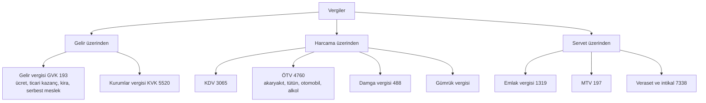
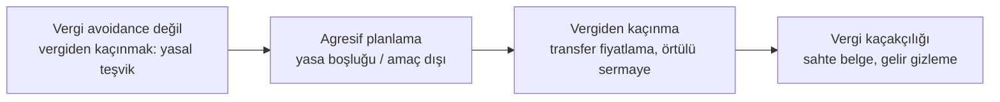
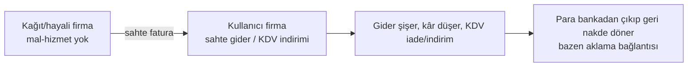

# D7. Derin İnceleme: Vergi Sistemi, Planlama ve Vergi Suçları / Tax System, Planning and Tax Crimes

> Bu dosyadaki kanun maddeleri ve oranlar mevzuat.gov.tr'den indirilen resmî metinlerden (GVK, KVK, KDV, VUK) okunmuştur (✅). Her yıl yeniden değerlenen tutarlar ve Cumhurbaşkanı kararlarıyla belirlenen oranlar için güncel kararnameye bakın. / Statutes read from the official texts; revalued amounts and presidential-decree rates change.

## 1. Vergi türleri (harita)

**Resmî metinden (✅):**
- **Kurumlar vergisi (KVK md. 32):** Kurum kazancı üzerinden **%25**; bankalar, 6361 sayılı Kanun kapsamındaki şirketler, elektronik ödeme ve para kuruluşları, yetkili döviz müesseseleri, varlık yönetim şirketleri, sermaye piyasası kurumları, sigorta-reasürans ve emeklilik şirketleri ile yap-işlet-devret ve kamu-özel iş birliği projelerindeki şirketler için **%30**. (Bazı yıllar için geçici maddelerle farklı oranlar uygulandı.)
- **KDV (3065 md. 28):** Kanun metnindeki oran %10'dur; Cumhurbaşkanı bu oranı **%1'e kadar indirmeye, dört katına kadar artırmaya** ve mal/hizmet türlerine göre farklı oranlar belirlemeye yetkilidir. Bugün uygulanan %20 / %10 / %1 oranları bu yetkiye dayanan Cumhurbaşkanı kararlarıyla belirlenir (karar metni bu oturumda okunmadı ⚠️). **İhracat teslimleri KDV'den müstesnadır** (md. 11/1-a); mükellef, hesaplanan KDV'den faaliyetiyle ilgili alışlarda ödediği KDV'yi indirir (md. 29).
- **Gelir vergisi tarifesi (GVK md. 103):** Dilimli ve oranlar **%15, %20, %27, %35, %40**. Dilim sınırları her yıl yeniden değerlenir; metinde parantez içinde işlenen güncel tutarlar: 190.000 TL'ye kadar %15; 400.000 TL'ye kadar %20; 1.000.000 TL'ye kadar %27 (ücret gelirlerinde 1.500.000 TL); 5.300.000 TL'ye kadar %35; üstü %40. (Bu tutarların hangi yıla ait olduğu metinde açık yazmıyor; güncel yıl için Gelir İdaresi tebliğine bakın.)

## 2. KDV mekaniği: zincirde kim neyi öder?
KDV, **katma değer** üzerinden alınır; her halka kendi hesapladığı KDV'den ödediği KDV'yi düşer, farkı öder.

| Halka | Satış (KDV hariç) | Hesaplanan KDV %20 | İndirilecek KDV (alıştan) | Ödenecek KDV |
|---|---|---|---|---|
| Üretici | 100 | 20 | 0 | **20** |
| Toptancı | 150 | 30 | 20 | **10** |
| Perakendeci | 200 | 40 | 30 | **10** |
| **Toplam** | | | | **40** |
Tüketici son fiyatta 40 TL KDV öder; devlete halkalar toplamda 40 TL yatırır. **İhracatta** KDV sıfırlanır ve alıştaki KDV iade edilir; bu yüzden **KDV iadesi** hileli talepler için de bir hedeftir (aşağıda).

**Ters yönlü sorun:** Sahte fatura kullanan, gerçekte ödemediği KDV'yi indirimine yazar ve devlet gelirini azaltır.

## 3. Vergi Usul Kanunu (VUK) çerçevesi
- **Mükellefiyet:** İşe başlama bildirimi, vergi dairesi kaydı.
- **Defter ve belge düzeni:** Fatura/e-fatura, e-arşiv, e-irsaliye, e-defter, serbest meslek makbuzu, gider pusulası. Belge düzeni kâğıttan elektronik sisteme geçmiştir; bu, Vergi Denetim Kurulu'nun çapraz kontrolünü güçlendirir.
- **Ödevler:** Beyanname verme, defter tutma, saklama (genelde birkaç yıl), bildirim.
- **İnceleme:** Yoklama, inceleme (vergi müfettişi/inceleme elemanı), arama. Risk analizi sistemleri (ör. VDK'nın veri analizi) sektör ve davranış anomalilerini işaretler.
- **Cezalar (idari, VUK md. 344 ✅):** Vergi ziyaına sebebiyet verenlere ziyaa uğratılan verginin **bir katı** vergi ziyaı cezası kesilir; ziyaa **VUK 359'daki fiillerle** sebebiyet verilirse ceza **üç kat**, bu fiillere iştirak edenlere bir kat uygulanır. Kanuni süre geçtikten sonra (inceleme başlamadan) verilen beyannamelerde ceza %50 oranında uygulanır. Mükellefiyet tesis ettirmeden, vergi dairesinin bilgisi dışında ticari/zirai/mesleki faaliyette bulunarak ziyaa sebebiyet verilirse ceza %50 artırılır (7524 sayılı Kanunla eklenen fıkra, 2024). Ayrıca özel usulsüzlük/usulsüzlük cezaları ve gecikme faizi/zammı vardır.
- **Uyuşmazlık:** Tarhiyat öncesi uzlaşma, tarhiyat sonrası uzlaşma, vergi mahkemesinde dava (süreler kısadır, genelde 30 gün). Süreleri kaçırmak hak kaybı yaratır.
- **Zamanaşımı (VUK md. 114 ✅):** Vergi alacağının doğduğu takvim yılını izleyen yılın başından başlayarak **beş yıl** içinde tarh ve mükellefe tebliğ edilmeyen vergiler zamanaşımına uğrar. Ceza kesmede zamanaşımı da genel olarak beş yıldır (md. 374: vergi ziyaı cezası için; usulsüzlük cezalarında iki yıl).

## 4. Vergi planlaması mı, kaçakçılık mı? Çizgiler

| Seviye | Örnek | Hukuki sonuç |
|---|---|---|
| **Yasal teşvik kullanımı** | Ar-Ge indirimi, yatırım indirimi, teknokent istisnası | Hukuka uygun |
| **Yasal tercih** | Şirket türü, kâr dağıtımı zamanlaması, kayıtlı kanalla ihracat | Hukuka uygun; ticari gerçeklikle uyumlu olmalı |
| **Agresif planlama** | Sırf vergi için yapılan yapay yapı | İnceleme, vergi ziyaı, "muvazaa/hile" tartışması |
| **Transfer fiyatlama suistimali** | Bağlı şirketler arası emsallere aykırı fiyat (KVK 13) | Örtülü kazanç dağıtımı: kâr dağıtılmış sayılır |
| **Örtülü sermaye** | Ortaktan aşırı borçlanmayla faiz gideri yaratma (KVK 12) | Faiz gideri kabul edilmez |
| **Kaçakçılık** | Gelirin saklanması, sahte belge, defter tahrifatı | Cezai yaptırım |

**KVK md. 12 ve 13 (resmî metin ✅):**
- **Örtülü sermaye (md. 12):** Kurumun ortaklarından veya ortaklarla ilişkili kişilerden temin ederek işletmede kullandığı borçların, hesap dönemi içinde herhangi bir tarihte **öz sermayenin üç katını aşan kısmı** örtülü sermaye sayılır. Ana faaliyet konusuna uygun faaliyet gösteren banka/kredi kurumlarından yapılan borçlanmalar %50 oranında dikkate alınır.
- **Transfer fiyatlandırması (md. 13):** Kurumlar ilişkili kişilerle emsallere uygunluk ilkesine aykırı bedel veya fiyat üzerinden mal/hizmet alım-satımında bulunursa kazanç **örtülü olarak dağıtılmış** sayılır. İlişkili kişi: ortaklar, bağlı kişi/kurumlar, ortakların eşleri ve belirli derecedeki yakınları; vergi sistemi yeterli olmayan olarak ilan edilen ülke veya bölgelerdeki kişilerle yapılan tüm işlemler ilişkili kişilerle yapılmış sayılır. Ortaklık kanalıyla ilişkinin oluşması için en az %10 oran aranır.

**OECD BEPS ve küresel asgari vergi:** Çok uluslu şirketlerin kârı düşük vergili yere kaydırmasını azaltmak için "Sütun 2" %15 küresel asgari vergi oranını hedefler. Türkiye de buna paralel bir "küresel asgari tamamlayıcı kurumlar vergisi" düzenlemesi yaptı (kapsam ve tarih için GİB duyurusuna bakın).

## 5. Vergi suçları ve sahte belge (anatomi, tanıma amaçlı)

### 5.1 VUK md. 359 (resmî metin ✅)
**(a) bendi: 18 aydan 5 yıla kadar hapis.** Vergi kanunlarına göre tutulan veya düzenlenen, saklama ve ibraz zorunluluğu olan defter, kayıt ve belgelerde:
1. Hesap ve muhasebe hileleri yapmak, gerçek olmayan veya kayda konu işlemlerle ilgisi bulunmayan kişiler adına hesap açmak, kaydı gereken hesap ve işlemleri vergi matrahının azalmasına yol açacak şekilde başka defter/belge/kayıt ortamlarına kaydetmek,
2. Defter, kayıt ve belgeleri **tahrif etmek veya gizlemek**, **muhteviyatı itibarıyla yanıltıcı belge düzenlemek** veya bu belgeleri kullanmak.

Noter tasdik kayıtlarıyla varlığı sabit olduğu hâlde inceleme sırasında defter ve belgelerin ibraz edilmemesi **gizleme** sayılır. *Muhteviyatı itibarıyla yanıltıcı belge*, gerçek bir muamele veya duruma dayanmakla birlikte bunu mahiyet veya miktar itibarıyla gerçeğe aykırı yansıtan belgedir.

**(b) bendi: 3 yıldan 8 yıla kadar hapis.** Defter, kayıt ve belgeleri **yok etmek**, defter sayfalarını yok edip yerine başka yaprak koymak veya hiç koymamak, belgelerin asıl veya suretlerini tamamen/kısmen **sahte olarak düzenlemek** veya bu belgeleri **kullanmak**. *Sahte belge*, gerçek bir muamele veya durum olmadığı hâlde bunlar varmış gibi düzenlenen belgedir.

**(c) bendi: 2 yıldan 8 yıla kadar hapis.** Maliye ile anlaşması olanların basabileceği belgeleri anlaşması olmadan basmak veya bilerek kullanmak.
**(ç) bendi: 3 yıldan 8 yıla kadar hapis.** Yetkilendirilmeden ödeme kaydedici cihaz mührünü kaldırmak, donanım/yazılımına müdahale ederek satış kayıtlarını engellemek, değiştirmek veya silmek, elektronik kontrol sistemlerine veri iletilmesini önlemek.

*Not:* 7394 sayılı Kanun (8/4/2022), (a) bendindeki "üç" ibaresini "beş", (b), (c) ve (ç) bentlerindeki "beş" ibarelerini "sekiz" yapmıştır. Maddenin sonraki fıkralarındaki ek hükümler için kanun metnine bakın.

### 5.2 Sahte fatura ekosistemi: roller

- **Düzenleyen:** Gerçek faaliyeti olmayan veya faaliyeti dışı fatura kesen kişi/firma.
- **Kullanan:** Faturayı gider ve KDV indirimi için deftere işleyen.
- **Aracı/organizatör:** Zinciri kuran, kağıt firmaları yöneten.
- **Zarar:** Vergi kaybı, haksız rekabet (dürüst firma rakibi altında kalır), kamu bütçesi.

**Tanıma göstergeleri (denetçi/uyum için):** Faaliyet konusuyla uyuşmayan fatura; sevk belgesi, taşıma, stok hareketi olmayan "mal alımı"; fatura kesen firmanın yeni kurulu, sermayesiz, tek çalışanlı veya adresinin boş olması; piyasa fiyatından belirgin sapma; ödemenin hemen geri dönmesi; ciro/fatura hacminin vergi beyanıyla uyumsuzluğu.

**Tespit:** E-fatura/e-defter çapraz kontrolü, alıcı-satıcı bildirim eşleştirmesi, banka verileri, adres ve çalışan analizi, veri madenciliği, ihbar.

**Kullanıcı olarak korunma:** Tedarikçinin vergi kaydını ve faaliyetini doğrulayın, sevk ve teslim kanıtı saklayın, piyasa dışı indirimleri sorgulayın, ödemeyi banka yoluyla yapın.

### 5.3 KDV iadesi hileleri
İhracat veya indirimli oran nedeniyle iade hakkı doğduğunda iade talebinin **gerçek mal akışı** olmadan yapılması; zincir/kaçak (carousel) benzeri çok halkalı yapılar tespit için en çok izlenen alandır. Denetimde belge zinciri, gümrük çıkış kaydı, tedarikçi uyum durumu aranır.

### 5.4 Vergi kayıp ve kaçak ekonomi ilişkisi
Kayıt dışı istihdam ve satış, vergi ve sigorta primi kaybı yaratır; kara para aklama ile iç içe geçer (aklamaya konu suç, alt sınırı altı ay veya daha fazla hapis gerektiren suç olduğunda TCK 282 uygulanır; vergi kaçakçılığı da bu kapsamda değerlendirilebilir).

### 5.5 Pişmanlık ve ıslah (VUK md. 371 ✅)
Beyana dayanan vergilerde vergi ziyaı cezasını gerektiren fiilleri işleyen mükellef ve iştirak edenler, kanuna aykırı hareketlerini ilgili makamlara **kendiliğinden dilekçeyle** haber verirlerse vergi ziyaı cezası kesilmez; şartlar:
1. Aynı hususta daha önce bir muhbir tarafından resmî makama ihbar yapılmamış olmalı,
2. Haber verme, ilgili vergi türüne ilişkin **vergi incelemesine başlandığı veya takdir komisyonuna sevk edildiği günden önce** (kaçakçılık suçu teşkil eden fiillerin işlendiğinin tespitinden önce) yapılmış olmalı,
3. Hiç verilmemiş beyannameler bildirim tarihinden itibaren **15 gün** içinde verilmeli,
4. Eksik/yanlış beyan **15 gün** içinde tamamlanmalı veya düzeltilmeli,
5. Ödeme süresi geçmiş vergiler, gecikme zammıyla birlikte **15 gün** içinde ödenmeli.

Emlak vergisinde uygulanmaz. Yani pişmanlık, ancak **inceleme başlamadan önce** ve kısa sürelerle yapılan kendiliğinden başvuruda işler.

## 6. Vergi planlama kontrol listesi (yasal)
1. İş modeli ve sözleşmeler **ticari gerçeklikle** örtüşüyor mu?
2. Her gider için belge, sevk, sözleşme, ödeme kaydı var mı?
3. Teşvik ve istisna şartları (süre, belge, bildirim) sağlanıyor mu?
4. Bağlı taraf işlemleri emsallere uygun mu, belgelendirildi mi (transfer fiyatlama raporu)?
5. Yurt dışı gelir/hesap bildirimleri yapıldı mı?
6. Nakit kullanımı ve kasa limitleri risk yaratıyor mu?
7. Mali müşavir/ avukat görüşü yazılı mı?

## 7. Mükellef hakları
Vergi mahkemesi başvuru hakkı; uzlaşma; tarhiyat öncesi bilgilendirme; vergi inceleme sürecinde savunma hakkı; Gelir İdaresi'nin yanlış işlemine karşı idari başvuru. Süreleri kaçırmayın.

## English summary
Turkish taxes: income, corporate (25% general rate from 2025; 30% for banks and similar), VAT (20/10/1%, 0% export), special consumption tax, stamp duty, property and motor-vehicle taxes. VAT is a chain of output minus input tax (worked table). Tax planning ranges from incentives (legal) to aggressive planning, transfer-pricing abuse and evasion; OECD Pillar Two aims at a 15% minimum. VUK Art. 359 criminalizes record tampering and false/misleading documents; the fake-invoice ecosystem has issuers, users and organizers, detected through e-invoice cross-checks and bank data. Voluntary disclosure rules reduce penalties if used before an investigation begins.
