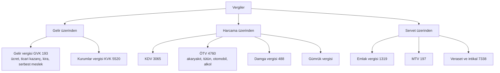
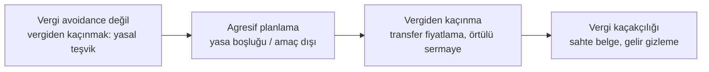
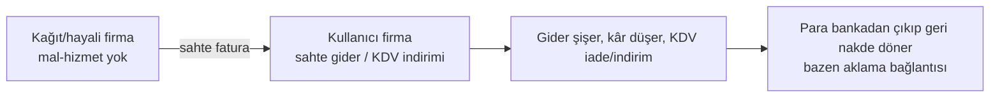

# D7. Derin İnceleme: Vergi Sistemi, Planlama ve Vergi Suçları / Tax System, Planning and Tax Crimes

> Oranlar ve tutarlar her yıl değişir; bu dosyadaki oranlar PwC, EY gibi kaynaklardan derlenmiş ikincil bilgidir. Vergi Usul Kanunu ve Gelir İdaresi metinleri bu oturumda indirilemedi. Sonuç için güncel mevzuata veya mali müşavire bakın. / Rates change yearly; verify against official sources.

## 1. Vergi türleri (harita)

Oranlar (ikincil kaynaktan, bu tarihte): **Kurumlar vergisi genel oran %25** (2025'ten itibaren); bankalar, ödeme/e-para kuruluşları, sigorta, sermaye piyasası kurumları ve benzerleri için **%30**. **KDV: genel %20; %10 ve %1 indirimli oranlar; ihracat teslimi %0 (istisna).** Gelir vergisi dilimli tarifedir, üst oran %40 mertebesindedir; her yıl yeniden değerleme ile dilimler değişir, güncel tarife için Gelir İdaresi duyurusuna bakın.

## 2. KDV mekaniği: zincirde kim neyi öder?
KDV, **katma değer** üzerinden alınır; her halka kendi hesapladığı KDV'den ödediği KDV'yi düşer, farkı öder.

| Halka | Satış (KDV hariç) | Hesaplanan KDV %20 | İndirilecek KDV (alıştan) | Ödenecek KDV |
|---|---|---|---|---|
| Üretici | 100 | 20 | 0 | **20** |
| Toptancı | 150 | 30 | 20 | **10** |
| Perakendeci | 200 | 40 | 30 | **10** |
| **Toplam** | | | | **40** |
Tüketici son fiyatta 40 TL KDV öder; devlete halkalar toplamda 40 TL yatırır. **İhracatta** KDV sıfırlanır ve alıştaki KDV iade edilir; bu yüzden **KDV iadesi** hileli talepler için de bir hedeftir (aşağıda).

**Ters yönlü sorun:** Sahte fatura kullanan, gerçekte ödemediği KDV'yi indirimine yazar ve devlet gelirini azaltır.

## 3. Vergi Usul Kanunu (VUK) çerçevesi
- **Mükellefiyet:** İşe başlama bildirimi, vergi dairesi kaydı.
- **Defter ve belge düzeni:** Fatura/e-fatura, e-arşiv, e-irsaliye, e-defter, serbest meslek makbuzu, gider pusulası. Belge düzeni kâğıttan elektronik sisteme geçmiştir; bu, Vergi Denetim Kurulu'nun çapraz kontrolünü güçlendirir.
- **Ödevler:** Beyanname verme, defter tutma, saklama (genelde birkaç yıl), bildirim.
- **İnceleme:** Yoklama, inceleme (vergi müfettişi/inceleme elemanı), arama. Risk analizi sistemleri (ör. VDK'nın veri analizi) sektör ve davranış anomalilerini işaretler.
- **Cezalar (idari):** Vergi ziyaı cezası, özel usulsüzlük cezası, usulsüzlük cezası, gecikme faizi/zammı.
- **Uyuşmazlık:** Tarhiyat öncesi uzlaşma, tarhiyat sonrası uzlaşma, vergi mahkemesinde dava (süreler kısadır, genelde 30 gün). Süreleri kaçırmak hak kaybı yaratır.
- **Zamanaşımı:** Vergi alacağında genel olarak beş yıllık zamanaşımı mantığı vardır (güncel madde ve başlangıç için VUK'a bakın).

## 4. Vergi planlaması mı, kaçakçılık mı? Çizgiler

| Seviye | Örnek | Hukuki sonuç |
|---|---|---|
| **Yasal teşvik kullanımı** | Ar-Ge indirimi, yatırım indirimi, teknokent istisnası | Hukuka uygun |
| **Yasal tercih** | Şirket türü, kâr dağıtımı zamanlaması, kayıtlı kanalla ihracat | Hukuka uygun; ticari gerçeklikle uyumlu olmalı |
| **Agresif planlama** | Sırf vergi için yapılan yapay yapı | İnceleme, vergi ziyaı, "muvazaa/hile" tartışması |
| **Transfer fiyatlama suistimali** | Bağlı şirketler arası emsallere aykırı fiyat (KVK 13) | Örtülü kazanç dağıtımı: kâr dağıtılmış sayılır |
| **Örtülü sermaye** | Ortaktan aşırı borçlanmayla faiz gideri yaratma (KVK 12) | Faiz gideri kabul edilmez |
| **Kaçakçılık** | Gelirin saklanması, sahte belge, defter tahrifatı | Cezai yaptırım |

**OECD BEPS ve küresel asgari vergi:** Çok uluslu şirketlerin kârı düşük vergili yere kaydırmasını azaltmak için "Sütun 2" %15 küresel asgari vergi oranını hedefler. Türkiye de buna paralel bir "küresel asgari tamamlayıcı kurumlar vergisi" düzenlemesi yaptı (kapsam ve tarih için GİB duyurusuna bakın).

## 5. Vergi suçları ve sahte belge (anatomi, tanıma amaçlı)

### 5.1 VUK 359: iki ana grup
- **359/a:** Defter ve kayıtları tahrif etme, gizleme, yok etme; sahte veya hileli bilanço/hesap; "muhteviyatı itibarıyla yanıltıcı belge" gibi eylemler.
- **359/b:** Sahte belge düzenleme ve kullanma.
Cezalar yıllar içinde artırılmıştır; kaynaklar güncel cezalar için farklı aralıklar vermektedir (359/b için "3–8 yıl", 359/a için 1–3 veya 18 ay–5 yıl aralıkları dolaşıyor). **Güncel madde metnini kontrol edin; bu depo kesin ceza rakamı vermez.**

### 5.2 Sahte fatura ekosistemi: roller

- **Düzenleyen:** Gerçek faaliyeti olmayan veya faaliyeti dışı fatura kesen kişi/firma.
- **Kullanan:** Faturayı gider ve KDV indirimi için deftere işleyen.
- **Aracı/organizatör:** Zinciri kuran, kağıt firmaları yöneten.
- **Zarar:** Vergi kaybı, haksız rekabet (dürüst firma rakibi altında kalır), kamu bütçesi.

**Tanıma göstergeleri (denetçi/uyum için):** Faaliyet konusuyla uyuşmayan fatura; sevk belgesi, taşıma, stok hareketi olmayan "mal alımı"; fatura kesen firmanın yeni kurulu, sermayesiz, tek çalışanlı veya adresinin boş olması; piyasa fiyatından belirgin sapma; ödemenin hemen geri dönmesi; ciro/fatura hacminin vergi beyanıyla uyumsuzluğu.

**Tespit:** E-fatura/e-defter çapraz kontrolü, alıcı-satıcı bildirim eşleştirmesi, banka verileri, adres ve çalışan analizi, veri madenciliği, ihbar.

**Kullanıcı olarak korunma:** Tedarikçinin vergi kaydını ve faaliyetini doğrulayın, sevk ve teslim kanıtı saklayın, piyasa dışı indirimleri sorgulayın, ödemeyi banka yoluyla yapın.

### 5.3 KDV iadesi hileleri
İhracat veya indirimli oran nedeniyle iade hakkı doğduğunda iade talebinin **gerçek mal akışı** olmadan yapılması; zincir/kaçak (carousel) benzeri çok halkalı yapılar tespit için en çok izlenen alandır. Denetimde belge zinciri, gümrük çıkış kaydı, tedarikçi uyum durumu aranır.

### 5.4 Vergi kayıp ve kaçak ekonomi ilişkisi
Kayıt dışı istihdam ve satış, vergi ve sigorta primi kaybı yaratır; kara para aklama ile iç içe geçer (aklamaya konu suç, alt sınırı altı ay veya daha fazla hapis gerektiren suç olduğunda TCK 282 uygulanır; vergi kaçakçılığı da bu kapsamda değerlendirilebilir).

### 5.5 Etkin pişmanlık ve ıslah
Vergi mevzuatı, mükellefin kendiliğinden beyan veya düzeltme yapması durumunda ceza ve faiz indirimi ("pişmanlık ve ıslah") sağlar; koşullar ve süreler mevzuatta sıkı biçimde tanımlıdır. Soruşturma başladıktan sonra yararlanılamayabilir. Bu yüzden **erken** başvuru önemlidir.

## 6. Vergi planlama kontrol listesi (yasal)
1. İş modeli ve sözleşmeler **ticari gerçeklikle** örtüşüyor mu?
2. Her gider için belge, sevk, sözleşme, ödeme kaydı var mı?
3. Teşvik ve istisna şartları (süre, belge, bildirim) sağlanıyor mu?
4. Bağlı taraf işlemleri emsallere uygun mu, belgelendirildi mi (transfer fiyatlama raporu)?
5. Yurt dışı gelir/hesap bildirimleri yapıldı mı?
6. Nakit kullanımı ve kasa limitleri risk yaratıyor mu?
7. Mali müşavir/ avukat görüşü yazılı mı?

## 7. Mükellef hakları
Vergi mahkemesi başvuru hakkı; uzlaşma; tarhiyat öncesi bilgilendirme; vergi inceleme sürecinde savunma hakkı; Gelir İdaresi'nin yanlış işlemine karşı idari başvuru. Süreleri kaçırmayın.

## English summary
Turkish taxes: income, corporate (25% general rate from 2025; 30% for banks and similar), VAT (20/10/1%, 0% export), special consumption tax, stamp duty, property and motor-vehicle taxes. VAT is a chain of output minus input tax (worked table). Tax planning ranges from incentives (legal) to aggressive planning, transfer-pricing abuse and evasion; OECD Pillar Two aims at a 15% minimum. VUK Art. 359 criminalizes record tampering and false/misleading documents; the fake-invoice ecosystem has issuers, users and organizers, detected through e-invoice cross-checks and bank data. Voluntary disclosure rules reduce penalties if used before an investigation begins.
