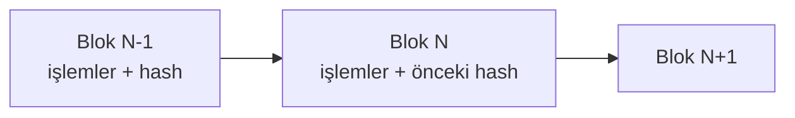

# D8. Derin İnceleme: Kripto Varlıklar ve DeFi / Deep Dive: Crypto Assets and DeFi

> Eğitim amaçlıdır; yatırım tavsiyesi değildir. Kripto piyasası çok oynaktır ve düzenlemeler hızla değişir. / Educational only; crypto is highly volatile and rules change fast.

## 1. Temel mantık

### 1.1 Blokzincir nedir?

- İşlemler **bloklar** halinde gruplanır; her blok önceki bloğun özetini (hash) içerir, geriye dönük değiştirmek sonraki tüm blokları bozar.
- **Konsensüs:** Ağdaki düğümlerin hangi bloğun geçerli olduğuna karar vermesi. Başlıca iki model: **iş ispatı (PoW)** ve **pay ispatı (PoS)**.
- **Anahtar çifti:** Özel anahtar (imza atar) ve genel anahtar/adres (alıcı kimliği). Özel anahtarı kaybeden varlığa erişemez; başkasının eline geçerse varlığı alır.
- **Geri alınamazlık:** Onaylanan işlem genelde geri alınamaz; hatalı veya dolandırıcı transferin iadesi karşı tarafın iyi niyetine kalır.

### 1.2 Bitcoin ve Ethereum farkı
| Özellik | Bitcoin | Ethereum |
|---|---|---|
| Amaç | Dijital nakit/değer saklama | Akıllı sözleşme platformu |
| Model | UTXO (harcanmamış çıktı) | Hesap tabanlı |
| Akıllı sözleşme | Sınırlı | Geniş (Solidity vb.) |
| Ücret | İşlem boyutu ve yoğunluk | Gaz (hesaplama maliyeti) |

### 1.3 Varlık türleri
Yerel token (BTC, ETH) · stablecoin · yönetişim tokenı · yardımcı (utility) token · NFT (benzersiz belirteç) · menkul kıymet niteliğinde tokenlar · merkez bankası dijital parası (CBDC; kripto sayılmaz).

## 2. Stablecoin: türler ve riskler
| Tür | Nasıl değer sabit tutulur | Risk |
|---|---|---|
| **Fiat destekli** | Rezervde nakit/kısa vadeli tahvil | Rezerv şeffaflığı, banka riski, çıkış kısıtı |
| **Kripto destekli** | Fazla teminatlı (overcollateralized) kripto | Teminat düşüşü, likidasyon zinciri |
| **Algoritmik** | Arz-talep algoritması, ikinci token | Güven kaybında "ölüm sarmalı" |
**Terra/UST çöküşü (Mayıs 2022):** Algoritmik stablecoin sabitliğini kaybetti ve milyarlarca dolarlık değer yok oldu. Ders: "Garantisiz yüksek getiri + algoritmik çıpa" kırılgandır.

## 3. DeFi mekaniği

### 3.1 Otomatik piyasa yapıcı (AMM)
Havuzda iki varlık tutulur; fiyat **x · y = k** formülüyle belirlenir (Uniswap tipi, ücretler hariç).

**Örnek:** Havuzda 100 ETH ve 200.000 USDC var (k = 20.000.000), fiyat 2.000 USDC.
| Alınan ETH | Ödenecek USDC | Ortalama fiyat | Fiyat etkisi | Havuz yeni fiyat |
|---|---|---|---|---|
| 1 | 2.020,20 | 2.020,20 | +%1,0 | 2.040,61 |
| 10 | 22.222,22 | 2.222,22 | +%11,1 | 2.469,14 |
| 25 | 66.666,67 | 2.666,67 | +%33,3 | 3.555,56 |
**Çıkarım:** Havuz sığsa, büyük işlem fiyatı ciddi oynatır (kayma/slippage).

### 3.2 Geçici kayıp (impermanent loss)
Likidite sağlayıcı, havuz fiyatı değiştiğinde "sadece tutsaydı" göre kaybeder. Formül: **2√r / (1 + r) − 1** (r = fiyat oranı değişimi).
| Fiyat değişimi (r) | Geçici kayıp |
|---|---|
| ×1,25 | −%0,62 |
| ×1,5 | −%2,02 |
| ×2 | −%5,72 |
| ×4 | −%20,00 |
| ×9 | −%40,00 |
İşlem ücretleri bu kaybı karşılayabilir ya da karşılamayabilir.

### 3.3 Borç verme (lending)
Kullanıcı varlık yatırır, **fazla teminatla** borç alır (örn. 150 değerinde teminata 100 borç). Teminat değeri eşiğin altına düşerse **likidasyon**: teminat indirimli satılır. Aşırı oynaklık, zincirleme likidasyon yaratır.

### 3.4 Oracle, köprü (bridge), akıllı sözleşme riski
- **Oracle:** Zincir dışı fiyatı zincire getirir; manipüle edilirse sözleşme yanlış karar verir.
- **Köprüler:** Zincirler arası varlık aktarımı; en çok saldırı gören katmandır (Ronin ağı 2022 saldırısı yüz milyonlarca dolar kayıpla belgelenmiştir).
- **Sözleşme hatası:** Kod açığı fonları boşaltabilir; denetim raporu güvence değildir.
- **Yönetişim saldırıları ve admin anahtarı:** Merkezî kontrol noktası "merkeziyetsiz" iddiasını zayıflatır.
- **MEV (maksimum çıkarılabilir değer):** Blok üreticilerinin/botların işlem sıralamasından kâr sağlaması; sandviç saldırıları işlem maliyetini artırabilir.

## 4. Saklama: kendi kendine mi, platformda mı?
| Seçenek | Avantaj | Risk |
|---|---|---|
| **Borsa/platform saklama** | Kolay, destek | Platform iflası/hırsızlığı (Mt. Gox 2014, FTX 2022) |
| **Yazılım cüzdanı** | Kontrol sizde | Kötü amaçlı yazılım, kimlik avı |
| **Donanım cüzdanı** | Yüksek güvenlik | Fiziksel kayıp, yedek yönetimi |
| **Çoklu imza** | Ortak kontrol | Karmaşıklık |
**Kural:** "Anahtarlar sizin değilse, coin'ler sizin değil." Ama kendi saklamada hata yaparsanız geri dönüş yoktur.

## 5. Düzenleme

### 5.1 Türkiye
- **7518 sayılı Kanun (RG 2 Temmuz 2024):** SPKn'ya kripto varlık hizmet sağlayıcılığı hükümleri eklendi. Platformlar ve saklama kuruluşları SPK izni ve denetimine tabidir; sermaye, iç kontrol, müşteri varlığının ayrılması, bilgi sistemleri ve MASAK uyumu gibi yükümlülükler gelir.
- **SPKn md. 109/A:** İzinsiz kripto varlık hizmet sağlayıcılığı için 3–5 yıl hapis ve 5.000–10.000 gün adli para cezası.
- Kripto varlıklara ilişkin vergilendirme ve diğer ayrıntılar için güncel mevzuata bakın (bu depo vergi hükmü vermez).
- Kural: Bir platformun **SPK izin listesinde** olup olmadığını kontrol edin.

### 5.2 AB ve ABD (özet)
- **AB MiCA:** Kripto varlık hizmet sağlayıcıları için tek çerçeve; stablecoin hükümleri 2024'te, kapsamlı hükümler 2024 sonunda uygulanmaya başladı (kesin tarihler için AB metnine bakın).
- **ABD:** SEC ve CFTC arasında hangi tokenin menkul kıymet/emtia sayılacağı tartışması, davalar ve eyalet lisansları.
- **FATF Seyahat Kuralı (Travel Rule):** Kripto varlık hizmet sağlayıcıları transferlerde gönderen/alıcı bilgisi paylaşır. Anonimlik tam değil: borsalar KYC yapar.

## 6. Yasa dışı kullanım ve dolandırıcılıklar (tanıma amaçlı)
| Tür | Özet | İşaret |
|---|---|---|
| **Rug pull / exit scam** | Geliştiricilerin likiditeyi çekmesi | Anonim ekip, kilitlenmemiş likidite |
| **Pump & dump / koordineli çıkış** | Sosyal medya hype'ı | Yeni coin, "100x" vaadi |
| **Sahte platform / sahte uygulama** | Bakiye görünür, çekim yok | Çekimde ek ücret |
| **Pig butchering (ilişki + yatırım)** | Uzun süreli güven sonra sahte yatırım | Tanımadığınız biri yatırım öneriyor |
| **Cüzdan boşaltıcı (drainer) / sahte onay** | Zararlı yetki onayı | "Ücretsiz token" sitesi |
| **Adres zehirleme (address poisoning)** | Benzer görünen adrese transfer | Geçmişten kopyalanan adres |
| **Rüşvet/fidye yazılımı ödemesi** | Suç gelirinin kripto ile tahsili | İzlenebilir adres kümeleri |
| **Yaptırım kaçırma** | Listedeki kişi/devletin kripto ile transferi | OFAC/AB listeleriyle eşleşen adresler |
| **Karıştırıcılar (mixer)** | Fon izini bulanıklaştırma | Karıştırıcı adreslerle etkileşim |
**Tornado Cash (2022):** ABD Hazinesi OFAC bir akıllı sözleşme adresini yaptırım listesine aldı ve karıştırıcı hizmetlerinin yasa dışı finansman riski tartışmasını başlattı.

**Tespit:** Blokzincir analiz şirketleri adresleri kümeler, borsa çıkışlarını izler; kolluk, borsalar ve düzenleyicilerle işbirliği yapar. Ama anonim, hızlı sınır ötesi transferler tahsilatı zorlaştırır.

## 7. Güvenlik uygulamaları (kullanıcı)
1. Tohum kelimeleri (seed phrase) **asla** çevrimiçi yazılmaz, fotoğraflanmaz; kimseyle paylaşılmaz.
2. Donanım cüzdanı ve yedek; çoklu yedek yeri.
3. Sözleşme onaylarını düzenli gözden geçirip kullanılmayanları iptal edin.
4. Adres kopyalarken ilk ve son karakteri değil **tamamını** doğrulayın; küçük test transferi.
5. Bağlantıya tıklamak yerine resmî siteyi yer imine ekleyin.
6. Destek ekibi sizden asla tohum kelimesi istemez.
7. Yüksek getiri vaadi = yüksek risk veya dolandırıcılık varsayın.

## 8. Risk kontrol listesi
- [ ] Platform/proje SPK veya ilgili düzenleyiciden izinli mi?
- [ ] Ekip kimliği doğrulanabilir mi, kod denetimi var mı (ve sınırı biliniyor mu)?
- [ ] Likidite kilitli mi, token dağılımı adil mi?
- [ ] Çıkış (para çekme) deneme yapıldı mı?
- [ ] Vergi ve kayıt yükümlülükleri araştırıldı mı?
- [ ] Kaybetmeyi göze alabileceğiniz tutar mı?

## English summary
Blockchains chain blocks via hashes and use consensus (PoW/PoS); transfers are generally irreversible. Stablecoins are fiat-backed, crypto-backed or algorithmic (Terra/UST collapse 2022). DeFi: AMMs follow x·y=k (worked slippage table), impermanent loss = 2√r/(1+r) − 1, over-collateralized lending with liquidations, oracle/bridge/contract risks, MEV. Custody trade-offs (Mt. Gox, FTX). Regulation: Türkiye's Law 7518 (2024) and SPKn Art. 109/A (3–5 years for unlicensed services), EU MiCA, FATF Travel Rule. Scam typologies: rug pulls, fake platforms, pig butchering, drainers, address poisoning, sanctions evasion and mixers; blockchain analytics aids detection.
