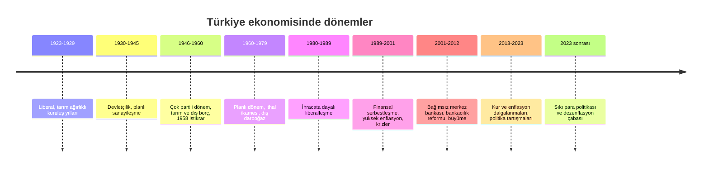
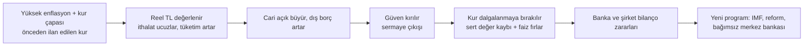

# D9. Derin İnceleme: Türkiye Ekonomi Tarihi (1923 - günümüz) / Turkish Economic History

> Bu dosya tarihsel bir özettir. Tarihlerin bir kısmı web aramasıyla teyit edildi (✅), bir kısmı genel tarih bilgisine dayanır (❓). Güncel veriler için TCMB, TÜİK ve Hazine ve Maliye Bakanlığı kaynaklarına bakın. / Historical summary; ✅ checked by web search, ❓ general knowledge.

## 1. Büyük resim

## 2. Dönemler ayrıntısı

### 2.1 Cumhuriyetin kuruluşu ve devletçilik (1923-1945)
- **1923 İzmir İktisat Kongresi** ❓: Özel girişimi destekleyen, tarım ve ticareti öne çıkaran kararlar.
- **1929 Büyük Buhran** etkisi ❓: Tarım ürünü fiyatları düştü; 1930'ların başında ithalat sınırlamaları ve **devletçilik** (kamunun sanayi kurması) yönelimi güçlendi.
- **1930'da Türkiye Cumhuriyet Merkez Bankası'nın kuruluşu** ❓ (banknot ihracı yetkisi daha sonra devralındı).
- **Sanayi planları ve kamu iktisadi teşebbüsleri** ❓: Sümerbank gibi kuruluşlar, 1930'larda sanayi planlaması.

### 2.2 Çok partili dönem ve 1958 (1946-1960)
- Tarımda makineleşme, Marshall yardımı, dış ticaret açıkları ❓.
- **1958 istikrar programı** ❓: Kuru önemli ölçüde devalüe eden ve dış borç yeniden yapılandırmasına yönelik ilk büyük istikrar paketlerinden biri.

### 2.3 Planlı dönem ve ithal ikamesi (1960-1979)
- **1960'lardan itibaren kalkınma planları** (Devlet Planlama Teşkilatı) ❓; sanayi korumacı gümrük ve kota ile desteklendi.
- **Gelir dağılımı ve dış darboğaz:** Ara malı ve petrol ithalatı artarken ihracat sınırlıydı; dış borçlanma arttı. **1973 petrol şoku** ve **1970'lerin sonunda döviz darboğazı**, raflarda kıtlıklara ve yüksek enflasyona yol açtı ❓.

### 2.4 24 Ocak 1980 ve ihracata yönelim (1980-1989)
- **24 Ocak 1980 kararları ✅:** Serbest piyasa ekonomisine geçiş, kambiyo rejiminde serbestlik, piyasaya bağlı reel faiz, ihracata dayalı büyüme hedefi.
- İhracat teşvikleri, kur politikası, **1980'ler boyunca kamu iktisadi teşebbüslerinin yeniden yapılanması** ❓.
- **1989 Ağustos'ta sermaye hareketlerinin serbestleşmesi ✅** (tam konvertibilite yönünde adım): Yabancı sermaye girişi kolaylaştı ama kısa vadeli sermaye hareketlerine bağımlılık arttı.

### 2.5 1990'lar: finansal serbestleşme, kamu açıkları ve enflasyon
- Kamu kesimi açıkları, **bankaların kamu borçlanmasını finanse etmesi**, yüksek reel faiz ve kronik enflasyon (yıllık %60-100 civarı dalgalanmalar) ❓.
- **5 Nisan 1994 krizi ✅:** Ağır kur ve bankacılık krizi, devalüasyon; enflasyon 1995 başında yaklaşık %125'e ulaştı ✅; ardından istikrar önlemleri alındı.
- **17 Ağustos 1999 depremi** ❓: Büyük ekonomik ve beşerî yıkım; Aralık 1999'da **IMF destekli dezenflasyon programı** başlatıldı ❓ (kur çapası: önceden ilan edilen kur sepeti).

### 2.6 2000-2001 krizleri
- **Kasım 2000 likidite krizi** ❓: Kısa vadeli fonlamaya dayanan bankaların tasfiyesi, faizlerin sıçraması.
- **Şubat 2001 krizi ✅:** 19 Şubat MGK gerginliğinin ardından 21 Şubat'ta faizlerin fırlaması ve 22 Şubat'ta kurun dalgalanmaya bırakılması; lira kısa sürede çok değer kaybetti; çok sayıda banka sorun yaşadı.
- **Güçlendirilmiş Ekonomik Program (Kemal Derviş, 2001) ❓:** Bankacılık yeniden yapılandırma, mali disiplin, bağımsız merkez bankası.
- **4651 sayılı Kanun ✅:** Merkez Bankası'nın fiyat istikrarı asıl hedef, Hazine'ye avans yasağı (yürürlük Mayıs 2001).
- **BDDK ✅:** 4389 sayılı Kanunla 1999'da kuruldu, Eylül 2000'de başladı; 2001 sonrası güçlendi.

### 2.7 2002-2012: reformlar, büyüme ve düşen enflasyon
- Mali disiplin, kamu borcu/GSYH oranının düşmesi, bankacılık sisteminin güçlenmesi ❓.
- **Enflasyon hedeflemesi:** 2002'de örtük, 2006'da açık enflasyon hedeflemesi ❓.
- **1 Ocak 2005: Yeni Türk Lirası, altı sıfır atıldı** ❓ (bir YTL = bir milyon eski TL).
- **2008-2009 küresel kriz:** Dış talep daraldı, ekonomi küçüldü; kamu bankaları ve bankacılık sisteminin görece sağlam sermayesi etkisini sınırladı ❓.
- **Dış finansmana bağımlı büyüme:** Cari açık, özel sektörün döviz borcu ❓.

### 2.8 2013-2023: kur şokları ve politika tartışmaları
- **2013 "taper tantrum" ❓:** ABD Fed'in tahvil alımlarını azaltma sinyali yükselen piyasalardan çıkışlara yol açtı; Türkiye'de lira baskı gördü.
- **15 Temmuz 2016 darbe girişimi ❓:** Siyasi ve ekonomik belirsizlik.
- **2018 kur şoku ✅:** Dolar karşısındaki kayıp ölçüye göre yıl başı-sonu yaklaşık %28, yıl içi %40+; bankalar ve şirketler döviz borcu baskısıyla karşılaştı.
- **2020-2021:** Covid kredi teşvikleri, politika faizinin indirilmesi, **Aralık 2021'de sert kur hareketi** ve kur korumalı mevduat (KKM) uygulamasının başlatılması ❓.
- **Ekim 2022: resmî yıllık TÜFE %85,51 ✅.**

### 2.9 2023 sonrası
Politika faizinin hızla artırıldığı, makroihtiyati önlemlerin sıkılaştırıldığı bir dönem ❓ (güncel faiz ve enflasyon verileri için TCMB). Dezenflasyon süreci, kur ve cari denge, turizm ve ihracat ana göstergelerdir.

## 3. Yapısal temalar
| Tema | Açıklama |
|---|---|
| **Cari açık** | İthalat (enerji, ara malı) ihracat ve turizm gelirinden büyükse dış finansman gerekir; sermaye girişi yavaşlayınca kur baskısı doğar |
| **Dış borç ve döviz yükümlülüğü** | Gelir TL, borç dövizse kur şoku bilanço krizine dönüşür |
| **Kronik enflasyon** | Beklentilerin eskiye dayanması (endeksleme), kur geçişkenliği, mali ve parasal gevşeklik |
| **Bankacılık sistemi** | 1990'larda kamu borçlanmasına bağımlı; 2001 sonrası daha güçlü; döviz pozisyonu ve vade uyumsuzluğu hâlâ izleniyor |
| **Üretim yapısı** | Tekstil/otomotiv/beyaz eşya ihracatı, inşaat, turizm; yüksek teknoloji payı sınırlı |
| **Demografi ve emek** | Genç nüfus; kayıt dışılık; verimlilik |

## 4. Döngü deseni: "kur çapalı program" nasıl biter?

1994 ve 2001 krizleri bu desene belirgin biçimde uyar. Ders: **sürdürülemez çapa**, **kısa vadeli dış borç** ve **zayıf bankacılık** birlikte yıkıcıdır.

## 5. Tarih okurken kullanılacak sorular
1. Ekonomik programın **çapası** neydi (kur, para arzı, enflasyon hedefi)?
2. Dış finansman nereden geldi ve vadesi nedir?
3. Kamu bankaları ve kamu açıkları finansmanı nasıl etkiledi?
4. Siyasi olaylar piyasa güvenini nasıl etkiledi?
5. Reformlar kalıcı kurumlara mı dönüştü (BDDK, bağımsız merkez bankası) yoksa geri mi alındı?

## 6. Güncel verileri nereden takip etmeli?
TCMB (EVDS veri sistemi, PPK metinleri, enflasyon raporu), TÜİK (TÜFE, GSYH, işgücü), Hazine ve Maliye Bakanlığı (borç, bütçe), Ticaret Bakanlığı (dış ticaret), BDDK (bankacılık verileri).

## English summary
Phases: Republic-era liberal start, 1930s étatism, post-1946 multiparty period (1958 stabilization), planned import-substitution era (oil shock and FX shortages in the 1970s), 24 January 1980 market reforms (verified), capital-account liberalization in August 1989 (verified), the 1994 crisis (verified; inflation about 125% in early 1995), the 2000–2001 crises (21–22 Feb 2001 verified), reforms (BDDK, central-bank law 4651), 2005 currency redenomination (unverified), the 2018 lira shock, and the 2022 inflation peak (85.51% official CPI). Recurring pattern: exchange-rate anchor → real appreciation → current-account deficit → confidence loss → float and bank stress.
